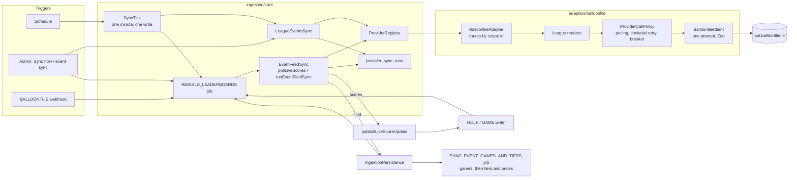

# Live Sports Data Sync

How a sport league's data gets from a provider (BALLDONTLIE) into PoolMaster: which leagues
sync, what each sync writes, what starts it, and what a new league adds. It describes `main` and
is written for reviewing provider PRs. Derek's standing decisions for the provider are in §8
(also in the BALLDONTLIE plan, `plans/live-sports-data-balldontlie.md`, until epic #1494 closes); the background jobs named here are
specified in [`BACKGROUND-JOBS.md`](BACKGROUND-JOBS.md).

## The short version

- **Every active sport league is synced, or switched off.** A league is synced when a root admin
  sets its `event_sync_provider_id`. Leagues no provider covers are inactive (*Switched-off
  leagues*). Formula 1 is the one active league without a feed: an admin runs its events.
- **The sync owns a synced league's events** (ADR 0011). It creates them, keeps their name,
  venue and dates current, loads their fields and games, and tiers and prices the field while
  the event is a draft. **The provider wins** over an admin's edit of those details. A sync never
  sets status: status follows the dates. A draft releases itself once its ready checks pass.
- **Three syncs, one schedule.** Events (the league's event list), Field (participants and
  games) and Scores (live scores). One ingestion schedule covers every league; webhooks carry
  live scores between scheduled runs.
- **An event links to a provider by a `sport_event_provider_mappings` row** (#2004): the
  provider, its id for the event (`external_id`, unique per provider) and the league's provider
  mapping the event came under. Only the sync writes it; a test event has none. For BALLDONTLIE, which has
  games but no events, the external id is a *scope id* the adapter invents and parses back
  (`nfl-2026-week-12`, `nba-2025-postseason`).
- **An event covers Season slots by `sport_event_slots` rows** (#2004): each slot at most one
  event's, in the event's own Season, and an event with slots takes its dates from them. Only a
  test event and the migration backfill write them until slice 8 makes the sync write them. A
  test event is one on a labelled **test slot** (`is_test_data`), which the sync never reads or
  writes; every other event is the sync's, so an event is synced exactly when it covers no test
  slot (`isTestData` on the event).
- **A participant links by feed id only**, within its event's sport league. Names are never
  compared. Test data shares a row with the sync by carrying the same feed id.
- **Each league adds a reader, not a pipeline**: a scope id format, a few vendor reads, and a
  mapping into one of two shared shapes (`GOLF`, `GAME`).



## 1. Configuration

Each provider is a `Provider` row with its `ProviderLeague` rows (#1997), seeded by migration and
edited on the root admin's Providers page: base URL, request rate, webhook switch, safety-net
poll minutes, and per league its webhook event set, `quietAfterMinutes`,
`typicalGameMinutes` and whether it is read. Each environment's database holds its own values; the
running tasks read the rows again every minute, so an edit needs no restart.
`registerConfiguredProviders` (`ingestion/core/provider-bindings.ts`) registers each enabled row's
adapter at startup, and reads only its enabled leagues. A sport league syncs from the provider
league its selected `SportLeagueProviderMapping` names; the migration mapped the leagues it could
match and selected the mapping of each league that was synced before. The running adapters are
held in `ProviderRegistry` by Provider code (#2073): `forLeague` resolves a league's provider
through that selected mapping, and refuses a league with none (422 `SPORT_LEAGUE_NOT_SYNCED`) or
whose provider is not running (404 `PROVIDER_NOT_FOUND`) rather than fall back to another provider
of the sport. Providers have no priority: two leagues of one sport may sync from different
providers. The scheduler runs its loops for the sports that have an active league whose selected
mapping names a running provider.

Secrets stay out of the database:

| Setting | What it does |
|---|---|
| `BALLDONTLIE_API_KEY` | The vendor key, from Secrets Manager. A deployed task with an enabled row and no key fails to start. |
| `BALLDONTLIE_WEBHOOK_SECRET` | The webhook signing secret. While unset the row's webhook switch is refused on the Providers page (422 `PROVIDER_WEBHOOK_SECRET_MISSING`), a switch already on is logged at startup, every delivery is refused (403), and live scores are polled. |

Which providers run is never read from the environment: core-api builds one adapter per enabled
Provider row whose key is set, and nothing else (#2039). Functional and integration tests register
their own fake provider through `buildApp`'s provider factory, from test code.

A sport's leagues are read one by one: a league the vendor plan refuses (401/403) or whose read
fails is logged as `balldontlie.league.unavailable` and left out, so its neighbours still list.
A league the provider rate limits is never left out: the read throws its RATE_LIMITED refusal,
so the job is deferred rather than syncing a partial list (*Rate limit and retries* below).

**The schedule** is the `INGESTION_SCHEDULE_CONFIG` settings group
(`platform/ingestion-config-service.ts`), edited on the root admin's Providers page. One schedule
serves every sport league; there are no per-sport or per-league overrides, and every sport a
registered provider covers is scheduled. Its keys are the sync kinds, `ProviderSyncKind` (#1999),
and each kind has an interval per Season state, `SyncSeasonState` (#2009): `IN_SEASON` while one
of the league's Seasons' spans holds now, `OFFSEASON` otherwise (`syncSeasonStateOf`, read from
the league's Seasons on every tick).

| Policy | In season | Off season | Runs |
|---|---|---|---|
| `EVENTS.intervals` | 6 h | 24 h | the Events sync of every synced league (§2) |
| `FIELD.intervals` | 6 h | 24 h | the Field sync of each event in the league's next slot (§3); it has no `enabled` switch and always runs (#2086) |
| `SCORES.intervals` | 300 s | 300 s | the Scores sync of each event with a Game due or in play (§5); webhooks arrive between runs |
| `ROSTER.intervals` | 24 h | 24 h | the Roster sync of each synced league whose provider mapping names position codes (*Rosters* below); no `enabled` switch, it always runs |

The sync tick reads the schedule every minute, so a saved change applies without a restart.
The schedule read (`GET /api/v1/platform/ingestion-schedule`) answers each kind's policy with
`runs` and `switchable`, read from whether the policy has an `enabled` switch, so the Providers
page draws its Sync schedules rows from those fields alone (#2086).

There is no health check loop and no route calls a provider live (#1999). A provider's health on
the Providers page comes from its own sync runs of the last hour: HEALTHY when none failed, DOWN
when all did, DEGRADED when some did, and unknown when none finished
(`providerHealthOfRuns`).

### Rate limit and retries

Every provider request goes through one `ProviderCallPolicy` per provider
(`ingestion/core/provider-call-policy.ts`), shared by every job on the task. The provider's HTTP
client makes one attempt per call and says what its failure was (rate limited, transient or
final); the policy is the only layer that retries.

| What | Rule |
|---|---|
| Pacing | Each task starts a request at most every `60 s × BACKGROUND_JOB_MAX_TASKS / requestsPerMinute`: an even share of the plan's limit for each task that can run background work. The limit is read for each request from the Provider row in memory, so a Providers page edit takes effect without a restart and no request waits on a database read. Set `BACKGROUND_JOB_MAX_TASKS` to the most such tasks a deploy or scale-out runs together (unset is 1, right for QA's one task). |
| Retries | A 429, a 5xx or no answer is tried up to 3 more times. A 429's Retry-After (whole seconds) is honoured up to 30 s; otherwise the wait doubles from 1 s with half jitter, capped at 30 s. Any other status, or a body that breaks the contract, is not retried. |
| Breaker | Five 429s in a row open the provider's circuit for 60 s; calls meanwhile are refused without reaching the provider. 5xx failures do not count toward it. |
| RATE_LIMITED | A call the open circuit refuses, a 429 asking for more than 30 s, or a 429 still there after every retry throws `ProviderRateLimitedError`. The sync that made the call throws it on, and the job runner queues the job again for when the provider will answer (the circuit's reopening, or the Retry-After) without counting the try toward its attempts (`docs/BACKGROUND-JOBS.md`). A manual sync's feed it turned away is marked FAILED and the feeds still waiting run on the next try. A scheduled sweep stops at it and the next tick carries on. |

A transient failure still there after the retries stays a provider error, and the job is
retried on the usual 1, 5 and 30 minutes.

**The rate-limit finding.** The policy tells `ProviderRateLimitWatch`
(`ingestion/findings/provider-rate-limit-watch.ts`) of each call that ended RATE_LIMITED and each
the provider answered. Once every call has been turned away for 15 minutes, each league the
Provider syncs gets one `PROVIDER_RATE_LIMITED` WARNING; once the streak lasts a league's
`quietAfterMinutes` it becomes an ERROR (logged for the alarm, *Sync findings* below). The
Provider's next answer resolves them. The streak is held in memory per task, so a restart begins
a new one; its first answer resolves what an earlier task left open. The leagues are read only
when a refusal comes past a threshold not yet reached, so a short burst of 429s reads nothing.

**The Providers page** also counts each provider's rate-limited jobs of the last 24 hours (jobs
whose latest try hit the client's 429). Jobs carry no provider: a job belongs to the provider
syncing its sport league or to
the provider its event is linked to.

## 2. Events sync

### What a league needs first

Seeded by migration on `sport_leagues`:

| Column | Why the sync needs it |
|---|---|
| `selected_provider_mapping_id` | Makes the league synced: its mapping to one provider league (#1997). The sync keeps the provider's events whose provider league code is that league's, never matching a name. |
| `round_series_lengths` | Best-of lengths per round for series playoffs (NBA/NHL `[7,7,7,7]`, WNBA `[3,5,7]`, MLB `[3,5,7,7]`). Empty means single games. |
| `platform_tier_profile_id`, `platform_pricing_profile_id` | The profiles the field's tiers and prices come from (§3). |
| `auto_release_days_before_start` | The auto-release window (default 7, `null` never). |
| `time_zone` | The IANA zone its calendar weeks break in (#2003). |

And its Seasons (#2003), also by migration: one `sport_league_seasons` row per championship year
(unique on league and year), and for each the provider's own id for it in
`sport_league_season_provider_mappings`, keyed by the league's provider mapping. The sync never
creates a Season. `current_season_id` is set by the nightly `currentSeasons` step
(`currentSeasonOf`), never by hand.

### The run

The sync tick (`SyncTick`, §4) queues one `SYNC_LEAGUE_EVENTS` job per active synced league on
the Event list policy; a root admin's **Sync now**
(`POST /api/v1/ingestion/sport-leagues/:id/events-sync`) queues the same job.
`LeagueEventsSync.run` reads the league's current Season and every later one (`seasonsToSync`),
or the one Season a **Sync now** names (`sportLeagueSeasonId`), asks the provider for each by its
own id for that Season, and records one `EVENTS` sync run. A Season the provider has no id for is
not read; when the last of them lacks one, the job raises one `SEASON_MISSING` ERROR finding per
league and provider (*Sync findings* below), since only a migration can add it.

**One league per read (#2005).** The provider is asked for the one league its selected mapping's
provider league code names; there is no read of every league of a sport. A code the provider does
not read (no enabled league row of the sport has it, or the adapter has no reader for it) reads
nothing: the job raises one `PROVIDER_LEAGUE_UNKNOWN` ERROR finding per league and provider and
fails for good until the mapping or the league row is fixed.

**Matching games to Season slots (#2005).** The adapter reduces each provider event's games to
plays: one per code the provider names their place by (`providerSlots`, each with its games'
earliest and latest start). A code is the provider's own value, never ours: the season type and
the vendor's week or round (`REG:5`, `POST:2`, built once in `provider-slot-codes.ts`), or a
tournament id. The sync matches each code to a Season slot through the slot definition's
`PROVIDER_CODE` row in `sport_league_competition_slot_provider_mappings` at the league's selected
provider mapping, so a league's own offsets live in those rows, not in code. Test slots are never
read. Each matched slot takes its games' dates (an update only when they moved): it starts at its
first game's start and ends at its last game's start, since the feed sends start times only, never
an end; no slice yet records a game's end, so this stays until one does. An event that plays slots
takes its dates from them (`eventDatesFromSlots`), on creation and on every later sync. A code no slot
maps raises one `SLOT_VALUE_UNMAPPED` INFO finding per league and code; waive it for a code the
league does not play (the preseason). A page that lists fewer events or games deletes nothing.

**Tournaments matched by name (#2011).** An open phase (golf) has one slot definition per
recurring tournament, and its Season slots are not created with the Season. A league whose
selected provider mapping has `NAME_PATTERN` rows places a tournament no code places by its
normalized name (lower case, any year and anything from "presented by" on
removed), once, in `placeSlotsByName`, the one place name matching happens. One definition's
pattern matching creates that definition's Season slot when the events sync loads the season
schedule (or links the existing one) and records the tournament's code on it
(`sport_league_season_competition_slot_provider_mappings`); from then on the tournament matches by that code, whatever it is
called. A name no pattern matches places nothing and raises one `SLOT_NAME_UNMATCHED` INFO finding
per league and normalized name, whose **Link to existing** action adds the name as another
pattern of a chosen definition and resolves it (the next sync links the tournament). There is no
"create new": definitions are set by migration, so a tournament with none waits for its migration.
A name that matches more than one definition, or a slot another tournament already has, raises one
`SLOT_NAME_AMBIGUOUS` ERROR finding and links nothing. A name that matches a definition whose competition
the Season does not have gets no slot and raises one `SLOT_SEASON_COMPETITION_MISSING` ERROR finding,
so a Season added without its open competition is never skipped in silence.

**Matching by date window (#2012).** A feed that names no place for its games (BALLDONTLIE's
college football has no round, bowl name or postseason flag) sends each game as a play with a null
code. Such a game goes to the Season slot whose definition has a `DATE_WINDOW` mapping row and
whose window (`window_starts_at` inclusive to `window_ends_at` exclusive on the Season slot, kept
apart from the dates its games give) holds its start; a Season's windows do not overlap. The
windows are data, loaded by migration each Season. A window is `TENTATIVE` (a best guess while the
shape is known and the games are not) or `CONFIRMED`. The adapter sends each game's two teams'
feed ids with it, and only a game between two teams on the event's field (the seeds the admin
places) is the slot's own: those games give the slot its dates, and the first one in a tentative
window confirms it. Any game in a window still places the event on its slot, so the event exists
for its seeds to be placed, but a window holding only other games (a bowl between two unseeded
schools on the first round's days, or anything before the seeds are placed) takes no dates and
confirms nothing. Games no window holds are not synced and raise one `GAMES_UNPLACED` INFO finding
per league and Season, counting only games inside the Season's span, so a waiver covers one
Season's known bowls and never a later Season's gap (inclusion only: the other bowls share the
playoff's days). A Season the sync reads with a date-window slot that has no window, or a tentative one,
raises one `SLOT_DATES_NEEDED` WARNING naming the slots, which resolves once every window is
confirmed; the Structure tab flags those slots (`needsDates`). An event's field is the seeds placed
on it: an event playing a date-window slot takes no new team from its feed, and the feed only
refreshes the rows already there (#1715). Any game placed outside its Season's span raises one
`SLOT_OUTSIDE_SEASON` WARNING per place and is still written. An event starts at its slots' first
game, so a season-long slate whose windowed games lie ahead is still created.

**The rest of a phase (#2154).** A slot whose mapping row is `REST_OF_PHASE` takes every game in
its window that no other slot places, whoever plays it, and is matched after every other slot. Its
window is its phase's span (NCAA Men's Football's bowls, from the Sunday after Army-Navy to the day
after the CFP final) or a weekend of title games (its conference championships, in their own
`POSTSEASON_CONFERENCE` phase). So a CFP game between two seeds on the CFP's field goes to its CFP
slot, and every other postseason game to the bowls; a CFP game played before the seeds are placed
goes to the bowls until they are, and the next sync places it in the CFP. These windows may hold
other slots' windows. A rest-of-phase slot's own games give it its dates and confirm its tentative
window, as a date-window slot's do. One provider event's games can reach several competitions (a
season's slate reaches its bowls, its title games and its CFP); the sync makes one event per
competition it reaches, and an event never crosses competitions, so a linked event takes only its
own competition's slots. Those events all carry the provider event's one id, so that id is not
unique per provider; a field sync writes each of their fields and queues each one's follow-up job
by its event id. An event made for a competition with a name (`SportLeagueCompetition.name`, such
as "Bowl Games") takes that name, and the sync that keeps events current keeps it, rather than the
provider's slate name.

**A rest-of-phase event's games and field (#2154).** Where the feed names its games (`gameIds` on
each play), the sync records the games each rest-of-phase slot holds
(`SportLeagueSeasonCompetitionSlotGameProviderMapping`, one row per game and provider mapping), and
a later sync that places a game elsewhere moves it: a CFP game the bowls held before its seeds were
placed leaves the bowls. A field sync then gives each event of the provider event what its slots
take: an event playing a rest-of-phase slot gets those games, which its Matches are made from, and a
field of their teams; an event playing only date-window slots gets no game and no new team (its
Matches are its seeds' bracket); any other event gets the whole feed. A date-window slot records no
games. While a rest-of-phase event is a draft, a team on its field with no game left in its slots is
withdrawn (#2221), so a CFP team the bowls held before the seeds were placed leaves the bowls'
field with its game; a team whose game comes back is made active again. A released event keeps
every row, since a contest may already hold it, and each such team is a `FIELD_TEAM_WITHOUT_GAME`
WARNING finding on the event, named by its feed id and name (#2223); the field sync that finds the
team's game back in the slots, or the team withdrawn, resolves it.

For each provider event:

- **New, start in the future, on a slot a contest template lists**: created as a `DRAFT`
  `sport_events` row in the Season it was read for, on the league (`sport_league_id`), playing its
  matched slots (`sport_event_slots`, dates from those slots), kept under the provider's id for
  it: a `sport_event_provider_mappings` row under the league's selected provider mapping, written
  in the same transaction (ADR 0011).
- **New, but no slot matched** (`NO_SLOT`), **no active template lists its slot**
  (`NO_TEMPLATE`), or **its slot already has an event** (`SLOT_TAKEN`): never created. The
  slot still takes the games' dates.
- **New, start already passed**: never created (`ALREADY_STARTED`).
- **Already linked**: kept current (`SportEventService.keepProviderEventsCurrent`) through the
  same update the admin's own edit makes, so a moved start shifts the rounds and notifies leagues
  on a released event. A value the provider stops sending is kept. It also takes any matched
  slot no event plays yet, so a playoff event gains each later round as its games arrive.

| Status | Provider may change |
|---|---|
| `DRAFT`, `SCHEDULED`, `POSTPONED` | name, venue, start, end |
| `IN_PROGRESS` | name, venue, end |
| `COMPLETED`, `CANCELLED` | nothing |

On a synced event the admin's Edit details shows name, venue and dates read-only
(any event that is not a test event, `SportEventDto.isTestData` false); location, rounds, field, tiers, prices, release and result entry
stay the admin's. The older admin routes (Create from provider event, Link score source under
`/api/v1/events`) remain as a fallback for an event the feed lacks; the Year import went with
event years (#2003).

### Auto-release

`SportEventAutoReleaseScheduler` runs hourly and queues a `RELEASE_SPORT_EVENT` job per synced
draft inside its league's `auto_release_days_before_start` window. The job judges every ready
check: all passing releases the event through the manual button's path; any failing holds it.
Each attempt is stored on the event (`auto_release_checked_at`, `_outcome`, `_failed_checks`) and
shows in Activity; a repeat hold for the same failed checks is not logged again. An admin can
release earlier by hand. `sport_events.released_at` records every release.

## 3. Field sync

The sync tick (§4) queues a `SYNC_EVENT_FIELD` job, on the participants interval, for each event
in its league's next slot: the synced Season slots starting soonest after now, judged by the
slot's start and never by the event's status (`fieldWindowEventIds`). A test slot never is. An
admin's **Load Participant Field** (`POST /api/v1/events/:eventId/participants/refresh`) queues
the same job for one event, running the run it submitted: `runEventFieldSync` →
`provider.getEventDetails(externalId)` → `IngestionPersistence.persistEventDetailWithDiagnostics`.
The games and then the tiers and prices follow in one `SYNC_EVENT_GAMES_AND_TIERS` job per event,
written with the field (the `sync-games-then-tier-field` handler of `SPORT_EVENT_FIELD_SYNCED`,
#1952), so a task that stops after the field still runs them. The job carries the provider's
games and bracket. A finished event queues none. Its stats and warnings below are the job's
result in Activity, not the field sync run's; a job that changed nothing and warned of nothing
leaves no row.

### Participants

| Table | Written |
|---|---|
| `participants` | One per feed id per sport league. A feed id no participant of the event's league is mapped to creates a new participant in that league, whatever the site already holds by that name. |
| `participant_provider_mappings` | The only home of a participant's feed ids (#2040). `provider_id` is the `providers` row. Unique on `(provider_id, external_id, sport_league_id, participant_type)`. Written by the sync, bound by hand, or loaded with test data; no confidence. `last_seen_at` is set on every mapping a field sync matches. |
| `sport_event_participants` | The field row: active, ranking, seed, odds. A released bracket's seeds are kept. |

A participant the site holds by name with no mapping stays beside the new one: merge them, or
bind the feed id on the participant page (`PUT /api/v1/participants/{id}/provider-mappings`).
A feed id the live scores name that no participant of the league is mapped to raises an
`UNMAPPED_PARTICIPANT` sync finding (see *Sync findings* below); its Map participant action binds
it and resolves the finding. A mapping made any other way (the participant page's bind, or a later
roster or field sync creating the participant) resolves it too: each mapping write says
`PARTICIPANT_PROVIDER_MAPPED`, whose handler queues a `RESOLVE_MAPPED_PARTICIPANT_FINDINGS` job (#2069). Participant ids are the provider's raw feed ids in every league, never prefixed (#2040).
The mapping's sport league and participant type keep a team and a player with the same raw id
apart.

**Load sport data is test data only.** It never creates a production participant the sync would
match differently: test rows carry the feed id ([`SPORT-DATA-LOADING.md`](SPORT-DATA-LOADING.md)
*Feed ids*).

### Tiers and prices

While the event is a draft, the field is tiered and priced with no typing
(`SyncedFieldValuationService`): one field order (odds, then seed, then rank, whichever every
participant has, then name to break ties), the event's tiers from its league's tier profile, and prices from
the event's last pricing or the league's pricing profile. Any tier placed by hand freezes tiers
for that event, and any price typed by hand freezes prices (`tiersKeptAsEdited`,
`pricesKeptAsEdited`); later field additions then warn `FIELD_ROWS_UNTIERED` / `UNPRICED`.
Pressing *Auto-assign* is not a hand edit. A released event's tiers and prices are locked. A
field where nobody has odds, a seed or a rank has no order: it is not ordered by name, it is
skipped with reason `NO_ORDER` (#2040). A failure or a skip is a `TIERS_AND_PRICES_NOT_MADE`
warning on the job; the field is written regardless.

### Games and brackets

After each field load, its job's first step, `ProviderGameSlateService.afterFieldLoad`
(`events/provider-game-slate.ts`), turns the provider's games into the event's matches. A game is matched to a stored match by its
two teams. Nothing loads while a team is missing from the field; a refused load is logged, raises
a `GAMES_NOT_SYNCED` finding on the event (resolved once a later load syncs the games), and
never fails the field sync. Spreads stay the admin's. Each round with kickoffs starts at its
earliest one.

| Event status | Effect |
|---|---|
| `DRAFT` | When the provider's pairings or bracket differ (or none is stored), they replace the stored ones through `loadBracket`. Otherwise matches are kept and take the provider's kickoff, and where each side plays Game 1. |
| Released, not finished | Pairings stay fixed. Unstarted matches take moved kickoffs. A reseeded round is placed by the server's own reseed when the provider pairs the same teams. Anything else is logged for an admin. |
| `COMPLETED`, `CANCELLED` | Nothing. |

| League | Shape the provider gives |
|---|---|
| NFL weeks, Premier League matchweeks | One round of games. |
| NFL postseason | Full bracket: seeds 1–7 per conference from `/nfl/v1/standings`, 13 matches over four rounds (`toNflPlayoffBracket`). |
| NCAA men's tournament | Full bracket from `/ncaab/v1/bracket`; the First Four is round 1, each game's winner advancing into its round of 64 side (#2184). **Which regions meet in the semifinals is read from `region_id` order, which the vendor does not promise**: check it before a live tournament (`crossRegionPairings` log, `EVENT-SETUP-PROCEDURES.md` *Knockout brackets*). |
| NCAA women's, College Football Playoff | Games only: the women's bracket has no region and the CFP feed has no committee seeds, so an admin builds the bracket and the sync only links games to open matches. |
| NBA, WNBA playoffs | Each series as one game; once the first round is out, a fixed bracket seeded from standings (`series-playoff-bracket.ts`). |
| NHL playoffs | As the NBA, seeded by division from standings points (`toNhlSeedRanks`). |
| MLB postseason | As the NBA, six seeds per league with byes for the top two (`toMlbSeeds`). |
| World Cup knockout | Single games, bracket read back from the final through each match's team sources (`toWorldCupBracket`); third place is left out. |

When standings are refused or don't place the whole first round, the read logs it
(`standingsRefused`, `bracketUnplaced`) and loads games without a bracket. Games without a bracket
never replace a multi-round event's bracket; a draft only takes their kickoffs.

## 4. Triggers, jobs and Activity

| Trigger | Starts | Job / runner |
|---|---|---|
| Schedule, Event list policy | Events sync per synced league | `SYNC_LEAGUE_EVENTS` |
| Root admin **Sync now** | Events sync for one league | `SYNC_LEAGUE_EVENTS` |
| Schedule, participants policy | Field sync of each event in its league's next slot | `SYNC_EVENT_FIELD` |
| Schedule, live scores policy | Scores sync of each linked event with a Game in play, or scheduled and started, not overdue | `SYNC_EVENT_SCORES` |
| Root admin event sync or field refresh | Field or scores for one event, one job per kind | `SYNC_EVENT_FIELD`, `SYNC_EVENT_SCORES` |
| BALLDONTLIE webhook | Scores for the notified events | `SYNC_EVENT_SCORES` |
| Schedule, roster policy | Roster sync of each synced league whose provider mapping names position codes | `SYNC_LEAGUE_ROSTER` |
| Hourly release sweep | Auto-release check | `RELEASE_SPORT_EVENT` |

### Rosters

The Roster sync (#2025, `modules/ingestion/roster/league-roster-sync.ts`) writes the league's
current Season's roster rows (`SportLeagueSeasonParticipantTeam`): one per player, naming the
player's team and position. It runs only for a league whose selected provider mapping names
position codes (`SportLeaguePositionProviderMapping`); the League page lists the Rosters sync only
for those leagues. It reads the provider's roster for the current Season's provider id
(BALLDONTLIE: NFL `players/active`, which takes no season and answers today's rosters), and:

- keeps a player only when the feed sends a position code the league maps to a position that is
  eligible for a field, and a team. A code the league has no position for is not one of its
  positions, and is dropped without a finding.
- reads the team only through a provider mapping of one of the league's TEAM participants. A team
  id mapped to none raises `UNMAPPED_PARTICIPANT` for the team, named as the feed names it; the writer refuses a row whose team
  is not a TEAM participant of the league.
- creates a player named for the first time, with its provider mapping, renames one the feed names
  differently, and moves a traded one. A player the feed stops listing keeps their row, with the
  time it last listed them.

Mapping lookups by feed id filter to the league's own participant type, so a player mapped in a
team league never answers for a team the provider numbers the same.

Every sync writes a `provider_sync_runs` row with its **kind** (`EVENTS`, `FIELD`, `SCORES`, `ROSTER`),
its **trigger** (`SCHEDULE`, `WEBHOOK`, `ADMIN`, `COMMISSIONER`, `SYSTEM`; a job's own when a job
ran it), its sport league and event (every event sync job names its event by our own id), and the
job that ran it. Its outcome is in columns (#1999): a one-line `summary`, its
numeric `stats`, `changed_count` (rows created, updated or deleted, once it completes) and
`error_count` (at least one on a FAILED run). Who asked is the trigger; nothing else of the
request is kept. The detailed diagnostics (`details_json`) are kept 30 days. Each background job records the same trigger and who started it
("Started by" on screen). The root admin's shared Activity grid (`GET /api/v1/activity`) lists
jobs with their runs, and the Sports, League and Event pages read each league's and event's
latest run per kind for its sync health.

**The sync tick (#2009).** Every server task starts `SyncTick`; each minute the task holding the
`sync-tick` lock reads what is due and queues it as jobs in one write, and the job runner makes
every provider call. Nothing is remembered between ticks: each sync is paced by its subject's
latest job (`findLatestRunAt`), so a job a webhook or a root admin queued also counts. A league is
synced while it is active and its selected mapping names a provider running here. Its reads are a
fixed few statements however many leagues and events are due (`PrismaSyncDueWorkReader`). A job
carries only our own ids; the event's id at its provider is read when the job runs. A scores job
runs only while live scores are on; a field job always runs (#2086).

**Overdue.** A released event is `OVERDUE` when it is neither completed nor cancelled more than
4 hours after it should have ended (its last round's end, else its last start plus its league's
provider league's `typicalGameMinutes`). A draft never released is never overdue. One function:
`overdueExpectedEnd` in `packages/shared/domain/event-overdue.ts`.

### Webhooks

`POST /api/v1/provider-webhooks/balldontlie` checks the HMAC-SHA256 signature of
`"{ts}.{raw body}"` (5 minute tolerance; bad or missing → 403), drops unsubscribed leagues and
event types with a 200, and hands the rest to `ProviderNotificationService.receive`. It queues
one `SYNC_EVENT_SCORES` per in-progress event the notification is about, 60 seconds out, deduped
on `SYNC_EVENT_SCORES:SYNC:<sportEventId>` so a burst coalesces (the tick's job for the event waits
under the same key). A game notification is
routed by its game id alone (#2007): the one Game whose provider mapping
(`sport_event_round_match_game_provider_mappings`) holds that id, and the in-progress event that
Game is in. There is no prefix match and no fan-out to a league's other events. An id no Game is
mapped to queues nothing and raises a `GAME_UNKNOWN` finding (WARNING) on each league synced from
the provider league its event type names (`nfl.game.ended`); the sync maps Games as it loads the
event's slate, so the next sync usually closes it. The notification time goes on the Game
(`last_provider_notification_at`); a golf notification's goes on its event. The job runs the
normal scores sync. **The delivery is a trigger, never a record**: only the notification time is
written.

Subscribed types are the events `GAME_EVENTS_BY_SET` and `GOLF_EVENT_PHASES` name, by each enabled league row's
webhook event set: `game.started`, `game.period_ended` (`game.halftime` for soccer, `GAME_HALVES`)
and `game.ended` for a game league, and the four PGA tournament and round events for
`GOLF_ROUNDS`.

While the webhook secret is set, polling is only the safety net:

- **Pace.** BALLDONTLIE events poll every `webhookPollMinutes` (15), a golf round every `webhookRoundPollMinutes` (2), both on the Provider row.
- **Start.** A start notification also syncs a linked event still `SCHEDULED` six minutes out,
  after the lifecycle has moved it.
- **Reconcile.** An end notification queues a second sync ten minutes out for late corrections.
- **Quiet alert.** When an event in play hears nothing for longer than its league's
  `quietAfterMinutes` (or 6 hours for a golf round), the sweep logs
  `ingestion.providerNotifications.quiet`, which a CloudWatch alarm forwards.

### Sync findings

`provider_sync_findings` (#1999) is the one list of problems the sync found, shown in root admin at
Manage › Providers › Findings and counted per league, by severity, in the Sports page's Issues
column. Each finding names its sport league; its event, Provider row and the feed's raw value
(`provider_value`) are there when its kind has them.

- **One row per kind and subject.** A NULLS NOT DISTINCT unique index on (kind, league, event,
  Provider, value, sync kind) dedupes: a finding seen again counts the sighting and takes the new
  severity. Only `SYNC_FAILED` has a sync kind (a check constraint says so).
- **Status.** `OPEN`, `RESOLVED` or `WAIVED` (a waive needs a note, a CHECK constraint). A resolved
  finding the sync sees again opens again; a waived one stays waived.
- **Kinds.** `PROVIDER_RATE_LIMITED` (WARNING after 15 minutes of every call rate limited, ERROR
  at the league's quiet threshold, raised per synced league; resolved by the Provider's next
  answer, *Rate limit and retries* above), `UNMAPPED_PARTICIPANT` (WARNING, raised by the live
  scores writer; its action is the Map participant page) and `WEBHOOK_SECRET_MISSING` (ERROR,
  raised per synced league when a worker task starts with the Provider's webhooks on and no
  signing secret; resolved once it is set, and on a league the Provider no longer syncs at the next check, #2070),
  `SEASON_MISSING` (ERROR, *The run* above), `PROVIDER_LEAGUE_UNKNOWN` (ERROR, a mapping's
  provider league code the provider does not read, *The run* above), `SLOT_VALUE_UNMAPPED`
  (INFO, a provider code no slot maps, *Matching games to Season slots* above; it has no action,
  since a mapping is added by migration), `SLOT_NAME_UNMATCHED` (INFO, a tournament name no
  pattern matches; its action is Link to existing) and `SLOT_NAME_AMBIGUOUS` (ERROR, a name that
  matches more than one slot) and `SLOT_SEASON_COMPETITION_MISSING` (ERROR, a matched slot whose competition the
  Season lacks), all three *Tournaments matched by name* above, and `SLOT_OUTSIDE_SEASON` (WARNING),
  `GAMES_UNPLACED` (INFO) and `SLOT_DATES_NEEDED` (WARNING, resolved once the Season's windows are
  confirmed), all three *Matching by date window* above. Two are checked on an event by each sync that
  could see them, raised as a WARNING when it does and resolved when a later one does not:
  `NO_PROVIDER_PARTICIPANTS` (a completed FIELD run whose provider sent no field) and
  `GAMES_NOT_SYNCED` (the field's follow-up job could not load the games the provider listed).
  `NO_PROVIDER_LIVE_SCORES` (#2094) is a WARNING the sync tick raises on an event in play whose
  scores no completed run has changed, and whose provider has sent no notification, for its
  provider league's `quietAfterMinutes` (counted from play getting under way, or the later of the
  two), once per quiet window; a poll with no updates inside the window raises nothing, since a
  game between scoring plays is quiet. The next SCORES run that brings updates resolves it. `FIELD_TEAM_WITHOUT_GAME`
  is checked the same way per team, by the field sync of a released rest-of-phase event (*A
  rest-of-phase event's games and field* above). The ledger turns a feed
  run's warning into its finding, so a run carries no warnings of its own; the tier and price
  warnings stay in the follow-up job's result.
- **Failed syncs (#2092).** Every run that ends `FAILED` (its feed threw, its job failed, or an
  earlier try stopped mid-run and the retry marks it interrupted) raises `SYNC_FAILED`, an ERROR on
  its league, event (none for a league's events sync), Provider and sync kind, naming the latest
  run that failed. The next `COMPLETED` run of the same sync resolves it, so a field sync that
  completes leaves the event's failed scores sync open. The ledger checks every feed run's outcome;
  the league events sync checks its own. A findings write that fails is logged
  (`ingestion.syncFinding.checkFailed`), never thrown, since the run's outcome is already written.
  The Sports page's Sync chip lists a league's open `SYNC_FAILED` findings, each opening its run,
  and its health is ERROR while any is open; the Findings chip counts the rest, a `SYNC_FAILED`
  whose run the history has cleared among them.
- **Alert.** An ERROR that opens logs `ingestion.syncFinding.errorOpened`; a CloudWatch metric
  filter and alarm (`infrastructure/terraform/monitoring.tf`) send it to the alerts topic.
- **Retention.** The nightly cleanup deletes RESOLVED findings 90 days after they were resolved,
  never an OPEN or WAIVED one: deleting a waiver would let the finding open again.

The actions a finding offers come from the API (`actions` on each finding); the web app draws them.

## 5. Scores sync

```mermaid
sequenceDiagram
  participant S as EventFeedSync.pollLiveScores
  participant A as BalldontlieAdapter.getLiveScores
  participant P as publishLiveScoreUpdate
  participant F as Scoring family writer
  S->>A: getLiveScores(externalId)
  A->>A: route by scope id to the league reader
  A-->>S: LiveScoreResult {GOLF | GAME}
  S->>P: onLiveScores(result, providerId)
  P->>P: Zod-validate; find event by the provider's id for it (its mapping); skip unless IN_PROGRESS
  P->>F: the event's scoring family's writer, if it accepts the category
  F-->>P: rows + REBUILD_LEADERBOARDS job, one transaction
```

The family is the event's sport league's (`scoringFamilyForEvent`). Finish position (racing) accepts no live scores.

| Category | Writer | Writes |
|---|---|---|
| `GOLF` | `StrokePlayResultService` | Each round as the golfer's side result in the round's FIELD Game, and the standings with their totals and ranks, in one write. A tick that changes nothing writes nothing. Stroke play only. |
| `GAME` | `writeGameScores` | `sport_event_round_match_games`: maps each provider game id to its Game and keeps the Game's status; `sport_event_round_match_game_side_results`: each side's score in that Game and where it played; `sport_event_round_matches` and `sport_event_round_match_sides`: a match's status and each side's outcome, written for a final of a single game or a series through `MatchResultService.recordResult`. Postponed games are marked `POSTPONED`. |

**Games** (#2007). Every match has its Games: a single game has Game 1, and a best-of series is
one match whose Games are numbered in the order they start. A provider's game id lives on the
Game's provider mapping, never on the match.

**Sides** (#2046). A match has two numbered sides. The sync that creates a match puts the
provider's away team on side 1 and its home team on side 2, and a side keeps its team from then
on: a provider listing the two teams the other way round later changes only where each side
plays that Game (`home_away` on the Game's side result), which is how a series' home court
alternates. Each Game holds each side's score and its periods as each period's own points (a
shoot-out is one `SHOOTOUT` period, never part of the score); the match's score is read from its
Games, never stored on the match.

**GAME mapping.** A game id no Game holds is mapped to Game *n* of the one open match between its
two teams, *n* being the game's number in its series (1 for a single game); a series Game the
match does not have yet is created. Two candidate matches map nothing until a later sync
(`liveScore.game.ambiguous`). A series' result is recorded once a side has won more than half of
its stored Games, never at Game 1. Two cases raise a WARNING finding and keep going:

- `GAME_ID_REISSUED`: the provider sends a new id for a game a Game already holds (same teams and
  game number); the mapping moves to the new id.
- `GAME_MOVED`: a mapped id turns up in another event's slate (a game moved to another week). The
  old Game is kept, with whatever points at it, and marked moved; the target event's Game takes
  the mapping. Voiding the picks on the old Game is #2016's.
**The feed is the only writer** (#2074): a
provider final overwrites whatever the match holds, a result written by hand before included,
and so the API carries no result source on a match (#2184); nothing stores one. A level knockout game takes its winner from the shoot-out wherever its slot's games
cannot end level.

**Status** is never set by a sync. `EventLifecycleScheduler` (every 5 minutes) moves
`SCHEDULED → IN_PROGRESS → COMPLETED` from the round schedule; settlement and emails follow as
jobs. Scores for an event not yet `IN_PROGRESS` are skipped
(`liveScore.publish.eventNotInProgress`).

## 6. Per league

All files are under `packages/core-api/src/modules/ingestion/adapters/balldontlie/`. Each league
has a vendored OpenAPI document and fixtures under `tests/fixtures/balldontlie/`. The adapter
keeps only the vendor's league code mapped to the reader for its endpoints; which leagues it
reads, their sport and their name are the Provider's league rows (#1997). An event's details and
scores go to the enabled league whose reader knows the id; an id no enabled league knows reads
nothing (#2005).

| League | Vendor code | External id | Participants | Category | Files |
|---|---|---|---|---|---|
| PGA TOUR | `pga` | vendor tournament id | bare player id | `GOLF` | `pga-*` |
| NFL | `nfl` | `nfl-<season>-week-<n>`, `nfl-<season>-postseason` | raw team id | `GAME` | `nfl-*` |
| College Football Playoff | `ncaaf` | `ncaaf-<season>-cfp` | raw team id | `GAME` | `ncaaf-*` |
| NCAA men / women | `ncaab` / `ncaaw` | `ncaab-<season>-tournament`, `ncaaw-…` | raw team id | `GAME` | `ncaa-tournament-*` |
| NBA / NHL / MLB / WNBA playoffs | `nba` / `nhl` / `mlb` / `wnba` | `<league>-<season>-postseason` | raw team id | `GAME`, as series | `<league>-*`, `series-playoffs*.ts` |
| Premier League | `epl` | `epl-<season>-matchweek-<n>` | raw team id | `GAME` (draws allowed) | `epl-*`, `soccer-contract.ts` |
| FIFA World Cup | `worldcup` | `fifa-wc-<year>-knockout` | raw team id | `GAME` with shoot-outs | `fifa-world-cup-*` |

A participant id is the provider's raw feed id, never prefixed (#2040). The same raw id can name a
team in two leagues, or a team and a player in one: the participant's provider mapping tells them
apart, since it is unique on (provider, feed id, sport league, participant type), and its provider
is a `Provider` row. Sync runs and sync jobs name their `Provider` row too, and a run's event is a
link to the `SportEvent` it synced.

League notes that are not obvious from the code:

- **CFP by date window.** College games carry no playoff marker, so the reader sends each
  season's games (`seasons[]`) as plays with no code, and the CFP's four rounds are placed by
  their Season slots' date windows (*Matching by date window* above). Live scores read
  yesterday, today and tomorrow (`dates[]`). A conference title game can pair two playoff teams,
  so no window covers title weekend. If the feed ever gains a playoff marker, it wins: map the
  rounds by `PROVIDER_CODE` instead.
- **Series playoffs** hand every postseason game over each sync, because the writer counts
  wins from the batch. Readers keep games by the vendor's `postseason` flag for the asked
  season, so every normalizer must read it.
- **Round numbering** (`playoffSeries`): a team's first series is round 1, each later one is one
  past the later of its teams' previous series, which puts MLB's bye teams in round 2.
- **WNBA** has no postseason filter, so the whole season is read. **NHL** places games on
  `game_date`.

### Switched-off leagues

Leagues no provider covers are `is_active = false` by migration, not deleted; bringing one back is
**Activate** on the root admin, or a migration, once it has a source. An inactive league is left
out of How to Play, Contest types, Create contest, event pages and offers, event emails and the
scheduled syncs.

| Switched off | Return ticket |
|---|---|
| Cycling | #682 |
| Running | #683 |
| FIFA Women's World Cup, UEFA Euro, Copa América | #1814 |
| NASCAR, IndyCar | #681 (provider check #1813, deferred) |
| Horse racing | #680 (provider check #1813, deferred) |
| NWSL, PWHL, college hockey, NCAA soccer and tennis | #1815 |

Each return first re-checks BALLDONTLIE's specs before any other provider.

## 7. Reviewing a provider PR

A new league usually touches only these:

1. **Spec and fixtures**: `tests/fixtures/balldontlie/openapi/<league>.yml`, fixtures, and a
   contract test comparing the Zod schemas with the vendor's.
2. **Contract**: `<league>-contract.ts`, Zod schemas for exactly the fields read.
3. **Mapping**: a scope id whose `parse…Scope` cannot claim another league's ids, a prefixed
   participant id, events stamped with the league's `providerLeagueCode`, states through `competition-status.ts`.
4. **Reader**: reads through `BalldontlieClient` only (its call policy's pacing and retries, payload capture). A series
   league supplies a `PlayoffsSource` instead.
5. **Adapter routing**: a branch in `getEventDetails` and `getLiveScores` ahead of the PGA
   fallback, and the league in the `leagues` map.
6. **Migration**: the `provider_league` row (code, sport, webhook event set, `quiet_after_minutes`,
   `typical_game_minutes`) and the sport league's mapping to it; `round_series_lengths` for a
   series league.
7. **Webhooks**: nothing beyond the `provider_league` row: its code is the event type's prefix,
   and its webhook event set says which notifications it takes.
8. **Docs**: this page.

A change to `score-publisher.ts`, the schedulers, the writers or the persistence layer changes
every league, and the PR must say so.

## 8. Standing decisions

Derek's decisions for the provider (2026-11-09 to 11-12), as recorded in the BALLDONTLIE plan:

- **A provider's final completes a match by itself**, advancing the winner. Each match records who
  set its result (#1531): an admin's correction stands, and a later provider final that disagrees
  is logged, not written. Results come from the provider (ADR 0013).
- **Live scores show on brackets**, read-only: a live game puts `IN_PROGRESS` and its score on its
  match with no winner.
- **Webhooks**: start, period end (halftime for soccer) and end for a game league; tournament and
  round start, a player's round completed and tournament end for golf; never per-play or per-hole
  events, which would cost hundreds of deliveries a game and the job refetches the box score
  anyway. The safety net's cadence and quiet gaps are in §4 *Webhooks*.
- **No LPGA**: BALLDONTLIE has none. Out of scope with it: college hockey, PWHL, NWSL and the
  Women's World Cup.

## 9. Open items

- **Unconfirmed webhook names** for college football, NHL, MLB and WNBA (assumed from the NFL's);
  MLB's `quietAfterMinutes` is 210 in case innings are not notified. Confirm during the paid trial
  (#1500).
- **CFP feed**: confirm bowl and playoff games are carried and whether a marker exists (#1500).
- **CFP windows each Season**: a migration adds the next Season's round windows once the schedule
  is published (2026 and 2027 are loaded; 2027's first round and final are not set yet). The admin
  dialog to set them is a follow-up to #1924. Golf tournaments match by name (#2011).
- **CFP read cost**: the events and field syncs each page the whole college season by
  `seasons[]`, thousands of games, since the vendor marks no playoff game; the field sync reads it
  only to refresh rows already on the field. Fine on the paid key; on the free key (5 requests a
  minute) one sync spends several minutes of the shared budget. Revisit with the paid trial (#1500).
- **NCAA semifinal pairing** by `region_id` order: verify against a real bracket.
- **Per-event tier override** from the event ⚙ dialog is in progress.
- **Not read yet**: UCL two-leg ties, MLS best-of-three.
