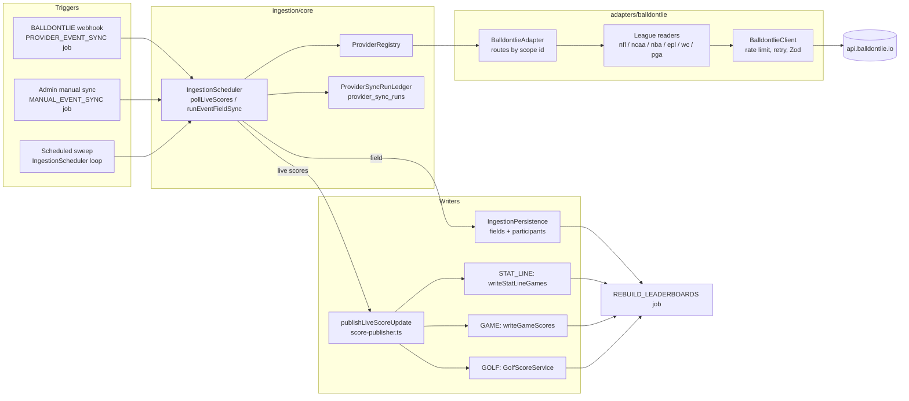
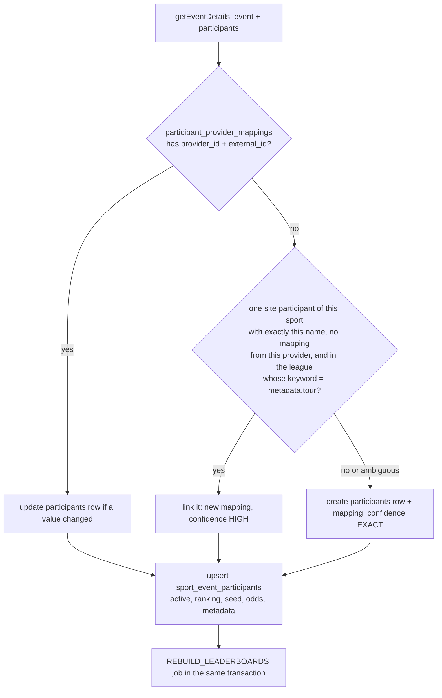
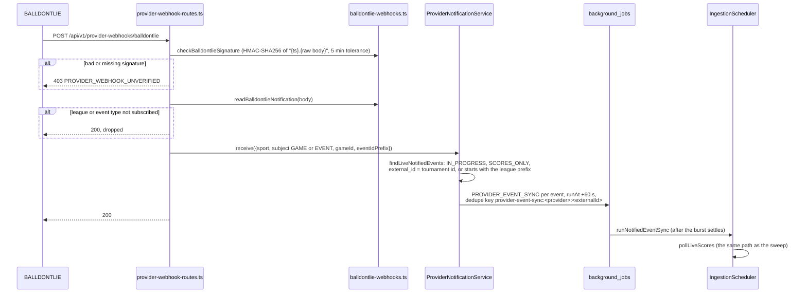

# Live Sports Data Sync

How a sport league's data gets from a provider (BALLDONTLIE today) into PoolMaster's tables,
end to end: what has to be in the database before a sync can do anything, what starts a sync,
the one path every sync takes, and what each league adds on top. It is written for reviewing
provider PRs, so each section ends with the files to read and what a change there should touch.

The plan behind the work, and the decisions Derek made on it, are in
`plans/live-sports-data-balldontlie.md` (epic #1494). This page describes the code as it is on
`main`; the plan says what is still to come.

## The short version

- **Admins author events; providers only feed them** (ADR 0009). A sync never creates a
  `sport_events` row and never moves an event's status. It writes scores, fields and links onto
  rows an admin made or imported.
- **Every sync is one event.** An event is linked to a provider by `(provider_id, external_id)`.
  The external id is the provider's id for the event, or for providers like BALLDONTLIE that have
  games but no events, a *scope id* the adapter invents and parses back (`nfl-2026-week-12`,
  `nba-2025-postseason`).
- **There are three triggers and one path.** The scheduled sweep, an admin's manual sync and a
  webhook all end in `IngestionScheduler.pollLiveScores` → `provider.getLiveScores(externalId)` →
  `publishLiveScoreUpdate` → the event's scoring family's writer.
- **Each league adds a reader, not a pipeline.** A league is a scope id format, a few vendor
  reads, a mapping into one of three shared shapes (`GOLF`, `GAME`, `STAT_LINE`), and a
  `match_keyword` on its sport league so imports and name links find it.

## The pieces



## 1. Boot: which providers exist

Nothing about a provider is in the database. It is configuration, read once at startup.

| Setting | What it does |
|---|---|
| `SPORT_DATA_DEFAULT_PROVIDER` | The provider that is PRIMARY for every sport it covers: the catalog browse and new links start with it. |
| `SPORT_DATA_PROVIDER_BINDINGS_JSON` | `{"providers": {"balldontlie": {"baseUrl": "…", "requestsPerMinute": 60}, "mock-contest-feed": {…}}}`. Every bound provider is built; the non-default ones register as SECONDARY and serve the events linked to them. |
| `BALLDONTLIE_API_KEY` | The vendor key, from Secrets Manager through the task definition; never in the bindings JSON. |
| `BALLDONTLIE_WEBHOOK_SECRET` | The webhook signing secret. Unset, every delivery is refused with 403. |

`registerConfiguredProviders` (`ingestion/core/provider-bindings.ts`) builds each adapter and
calls `ProviderRegistry.register(sport, provider, priority)` for each sport in its
`sportsCovered`. The BALLDONTLIE adapter covers `GOLF`, `AMERICAN_FOOTBALL`, `BASKETBALL` and
`SOCCER` (`balldontlie-adapter.ts`, the `leagues` map). Staging and prod refuse the mock unless an
override with a reason is set.

The *schedule* is the one runtime setting: the `INGESTION_SCHEDULE_CONFIG` settings group
(`platform/ingestion-config-service.ts`), edited on the root admin's ingestion page. Defaults:
every supported sport scheduled, live scores every 300 seconds, field loads off, health checks
every 5 minutes, with per-sport overrides.

## 2. Registration: the rows a sync needs first

A sync writes onto rows that must already exist. This is the "registration" a league needs, in
the order it happens.

### 2a. Seed rows, by migration

| Table | Row | Why the sync needs it |
|---|---|---|
| `sports` | One per sport (baseline). | Participants and events hang off it. |
| `sport_leagues` | One per league or Clutch Card league (baseline `20271114000100_baseline_reference_data`). Carries `scoring_family`, `round_names` and `match_keyword` (`round_series_lengths` is added by the next row's migration). | The scoring family, which picks the writer, is the sport's own unless the league overrides it to `COMPOSITE` (a stat pool, such as a Clutch Card league); the column is `NULL` for every other league, and a new league needs nothing set there. `match_keyword` is how the year import and the participant name link find the league's provider events and teams. |
| `sport_leagues.match_keyword` | Set per league by a small migration, only where `NULL`, so an admin's own keyword is never overwritten. | Must equal the `metadata.tour` the adapter puts on that league's events and participants, ignoring case (`core/league-keyword.ts`, `isLeagueTour`). |
| `sport_leagues.round_series_lengths` | `20271117000200_add_round_series_lengths`: NBA and NHL `[7,7,7,7]`, WNBA `[3,5,7]` (seeded `[3,7,7]`, corrected by `20271118002300_wnba_semifinals_best_of_five`), MLB `[3,5,7,7]`, MLS `[1,3,1,1,1]`. | The GAME writer counts a series' wins against it (#1545). Empty means single games. |
| `background_jobs` enum | `20271118000000_add_provider_event_sync_job_type` adds `PROVIDER_EVENT_SYNC`. | The webhook's job type. |

The keyword migrations on `main`, and the tour each matches:

| Sport league | `match_keyword` | Migration | Adapter tour constant |
|---|---|---|---|
| NFL | `NFL` | baseline | `NFL_LEAGUE_NAME` (`nfl-mapping.ts`) |
| NCAA Division I Men (basketball) | `NCAAM` | `20271116000000_set_ncaab_mens_match_keyword` | `NCAA_MEN.tour` (`ncaa-tournament-mapping.ts`) |
| NCAA Division I Women (basketball) | `NCAAW` | `20271116000100_set_ncaaw_womens_match_keyword` | `NCAA_WOMEN.tour` |
| Premier League | `EPL` | `20271116000200_set_premier_league_match_keyword` | `EPL_TOUR` (`epl-mapping.ts`) |
| FIFA World Cup | `FIFAWC` | `20271117000100_set_fifa_world_cup_match_keyword` | `FIFA_WC_TOUR` (`fifa-world-cup-mapping.ts`) |
| NBA | `NBA` | `20271117000300_set_nba_match_keyword` | `NBA_PLAYOFFS.tour` (`nba-mapping.ts`) |
| NBA Finals, NBA Conference Finals (Clutch Card) | the league's own name | `20271117000500_set_nba_clutch_card_match_keywords` | the round's `name` in `NBA_PLAYOFFS.rounds` |
| PGA TOUR | `NULL` in the seed (see *Gaps* below) | none | `PGA_TOUR_NAME` (`pga-mapping.ts`) |
| NHL | `NHL` | `20271118001000_set_nhl_match_keyword` | `NHL_PLAYOFFS.tour` (`nhl-mapping.ts`) |
| MLB | `MLB` | `20271118002100_set_mlb_match_keyword` | `MLB_POSTSEASON.tour` (`mlb-mapping.ts`) |
| WNBA | `WNBA` | `20271118002200_set_wnba_match_keyword` | `WNBA_PLAYOFFS.tour` (`wnba-mapping.ts`) |

### 2b. Event rows, by an admin action

An event is created and linked in one of three ways, all root admin routes under
`/api/v1/events` (`events/routes.ts`):

| Action | Route | What it writes |
|---|---|---|
| Year import | `POST /import-year-from-provider` | `EventScoreSourceService.listTourEventsForYear` asks the adapter for the year's events and keeps those whose `metadata.tour` matches the league's `match_keyword` (422 `SPORT_LEAGUE_HAS_NO_MATCH_KEYWORD` without one). `SportEventService.importProviderEventYear` then creates an `event_series` (find-or-create by name) and a `sport_events` row per event, with `provider_id`, `external_id` and `sync_scope = SCORES_ONLY`. Re-runnable: linked events and existing editions are skipped. |
| Create from a browsed event | `POST /from-provider-event` | The same, for one event picked in the catalog browse (`GET /api/v1/ingestion/providers/:providerId/catalog-events`). |
| Link an existing event | `PUT /:eventId/score-source` | `EventScoreSourceService.linkScoreSource` sets `provider_id`, `external_id` and `sync_scope = SCORES_ONLY` on an admin-made event. `DELETE` puts it back to the manual-admin placeholder and `sync_scope = NONE`. |

`sport_events` has `@@unique([provider_id, external_id])`, so one provider event links to at most
one site event (409 `EXTERNAL_EVENT_ALREADY_LINKED`).

For a bracket, the admin still builds the bracket (`sport_event_rounds`, `sport_event_matches`)
the usual way. For a Clutch Card, the event's rounds are its games (game N is round N).

### 2c. Participant rows, by the field load

"Load Participant Field" (`POST /api/v1/events/:eventId/participants/refresh`, or the scheduled
field loop when it is on). The route queues a `MANUAL_EVENT_SYNC` job for the participants feed, and that job runs `runEventFieldSync` → `provider.getEventDetails(externalId)` →
`IngestionPersistence.persistEventDetailWithDiagnostics`
(`ingestion/persistence/ingestion-persistence.ts`):



| Table | Key | Written |
|---|---|---|
| `participants` | `id` | Created only when no mapping and no unique same-name match exists. |
| `participant_provider_mappings` | `@@unique([provider_id, external_id])` | One per provider participant. `EXACT` when created, `HIGH` when linked by name. This mapping is how every later sync finds the participant. |
| `sport_event_participants` | `(sport_event_id, participant_id)` | The event's field row. A released bracket's seeds are kept as they were (#698). |
| `sport_events.participant_count` | | Updated if the provider's count changed. |

The name link is what stops a team loaded from a data file being created twice. A tour on the
participant narrows the match to the league's own affiliated participants, so a school's men's and
women's teams each link to their own row. A name two candidates share is never guessed; it is
created, and an admin merges by hand.

Participant external ids are prefixed by league (`nfl-team-12`, `nba-player-3202`) because one
provider's ids share one namespace. PGA TOUR golfers are the exception: their id is the vendor's
bare player id.

## 3. Triggers

All three record a `provider_sync_runs` row through `ProviderSyncRunLedger`
(`ingestion/persistence/provider-sync-run-ledger.ts`), which the root admin's sync history lists,
and all three go through `SyncOrchestrator.normalizeRequest` (`core/sync-orchestrator.ts`), which
checks the source and actor agree.

| Trigger | Source / actor | Run type | Starts from | Notes |
|---|---|---|---|---|
| Scheduled sweep | `SCHEDULED` / `SYSTEM:scheduler` | `SCHEDULED_EVENT_SYNC` | `IngestionScheduler.runConfiguredLiveScoreSweep`, one loop per scheduled sport, under the job lock `ingestion:<sport>:live-scores` | Lists events with `createScheduledEventReader` (`core/scheduled-event-reader.ts`): linked to a provider serving the sport, `status = IN_PROGRESS`, `sync_scope = SCORES_ONLY`, at least one field row. Every interval (default 300 s). |
| Manual sync | `MANUAL` / `ROOT_ADMIN` | `MANUAL_EVENT_SYNC` | `POST /api/v1/ingestion/sports/:sport/events/:eventId/sync` → `IngestionService.syncEventData` → `MANUAL_EVENT_SYNC` job → `runManualEventSync` | Either feed. The field refresh button uses the same path. |
| Webhook | `WEBHOOK` / `SYSTEM:webhook` | `WEBHOOK_EVENT_SYNC` | `POST /api/v1/provider-webhooks/balldontlie` → `ProviderNotificationService.receive` → `PROVIDER_EVENT_SYNC` job → `IngestionScheduler.runNotifiedEventSync` | See below. |
| Field loop | `SCHEDULED` | `SCHEDULED_EVENT_SYNC` | `runConfiguredSportFieldSync`, off by default | Each provider's next two `DRAFT` or `SCHEDULED` events with `sync_scope = SCORES_ONLY`, starting inside the lookahead window (default 14 days). |

### The webhook path (#1498)



The delivery is a trigger, never a record: nothing in the body is written. A game notification
syncs the event whose match holds that `external_game_id`; while no match holds it (before the
first sync links it, or a series, which links no game), it syncs every in-progress event of the
league. Duplicates inside the 60 seconds coalesce on the dedupe key, which is released when a
worker claims the job.

The subscribed types are in `BALLDONTLIE_WEBHOOK_EVENT_TYPES`: `game.started`,
`game.period_ended` (`game.halftime` for soccer) and `game.ended` for each league in
`BALLDONTLIE_WEBHOOK_GAME_LEAGUES`, and for golf `pga.tournament.started`,
`pga.tournament.round_started`, `pga.player.round_completed` and `pga.tournament.ended`. Not each
hole: once #1499 lands, golf will poll every 2 minutes during a round instead.

## 4. The one sync path

```mermaid
sequenceDiagram
  participant S as IngestionScheduler.pollLiveScores
  participant A as BalldontlieAdapter.getLiveScores
  participant RD as League reader
  participant P as publishLiveScoreUpdate
  participant F as Scoring family writer
  S->>A: getLiveScores(externalId)
  A->>A: parse the scope id (nfl-, ncaab-, nba-…-round-N, nba-…, epl-, fifa-wc-, else a PGA tournament id)
  A->>RD: liveScores(scope)
  RD->>RD: BalldontlieClient: paced to requestsPerMinute, retries 429/5xx, every page, Zod-parsed
  RD-->>S: LiveScoreResult {category GOLF | GAME | STAT_LINE, externalEventId, …}
  S->>P: onLiveScores(result, providerId)
  P->>P: Zod-validate (LiveScoreResultSchema)
  P->>P: find sport_events by (provider_id, external_id); skip unless IN_PROGRESS
  P->>F: scoring family's liveScores.persist, only if its category matches
  F-->>P: rows written + REBUILD_LEADERBOARDS job in the same transaction
```

`publishLiveScoreUpdate` is `ingestion/core/score-publisher.ts`. The family is the event's sport's own, unless its sport league
(`event_series → sport_leagues.scoring_family`) overrides it to `COMPOSITE`
(`scoringFamilyForEvent`, `shared/domain/sports/sport-league-definition.ts`,
`scoring-families/registry.ts`). Each family that takes live scores accepts exactly one category;
finish position (racing) accepts none, and its batches are skipped with
`liveScore.publish.categoryNotAccepted`:

| Category | Family | Writer | Tables written |
|---|---|---|---|
| `GOLF` | stroke play | `GolfScoreService.persistRoundUpdatesForSportEvent` (`golf/golf-score-service.ts`) | `sport_event_participant_rounds`, `sport_event_participant_golf_rounds`, `sport_event_participant_standings` + `…_golf_standings`. A round the admin did not schedule, or a hole past 18, is skipped. |
| `GAME` | head to head | `writeGameScores` (`scoring-families/head-to-head/game-score-writer.ts`) | `sport_event_matches`: links `external_game_id`, writes live scores, and records finals through `MatchResultService.recordResult`, the admin's own path (`result_source = PROVIDER`). |
| `STAT_LINE` | composite | `writeStatLineGames` (`scoring-families/composite/stat-line-writer.ts`) → `StatLineService.applyGames` | `sport_event_participant_rounds` (one per star per game), `sport_event_participant_stat_lines` (`@@unique([participant_round_id, stat])`). |

### GAME: how a provider game finds its match

A `GameScoreUpdate` carries the vendor game id, both teams' prefixed external ids, a state and the
score. The writer maps the two teams through `participant_provider_mappings` to field rows, then:

1. **Single-game rounds** (NFL, NCAA, World Cup, Premier League). A game no match holds yet is
   linked to the one open match whose two sides are those teams (`gamesToLink`). Two candidates
   either way link nothing; a later sync tries again. Once linked, `@@unique([sport_event_id,
   external_game_id])` holds it.
2. **Best-of series** (`round_series_lengths[round] > 1`: NBA, NHL, MLB, WNBA). The match links no
   game. Every sync the reader hands over *every* game of the event; the writer counts each final
   game's winner between the match's two teams and writes the wins so far as the live score, and
   the result once a side has more than half.
3. **Final** → `recordResult`. An admin's result stands (#1531): a different provider final is
   logged, not written. Clearing it hands the match back to the provider.
4. **Live** → `applyLiveScores`, read-only (`status = IN_PROGRESS`, no winner).
5. A level knockout game with a shoot-out (World Cup) takes its winner from the shoot-out scores
   (#1532).

### STAT_LINE: how a box score finds a star

A `StatLineGameUpdate` carries the vendor game id, the event's game number, a state and each
player's lines. The writer maps each `nba-player-<id>` through `participant_provider_mappings` to
the event's field; a player who is not a mapped star is counted and left out. Final lines are
stored `COMPLETED`, live ones `IN_PROGRESS` and rewritten each sync. A completed line is never
reopened. The sync overwrites an admin's correction (admin entry is the stop gap for leagues with
no feed). The lifecycle sweep will not complete an event holding a line still in progress (#1660,
`events/event-lifecycle-scheduler.ts`).

### What moves an event's status

Not the sync. `EventLifecycleScheduler` (every 5 minutes) moves `SCHEDULED → IN_PROGRESS →
COMPLETED` from the event's round schedule, unless `auto_lifecycle_enabled` is off, and settlement
and emails follow from that as background jobs (see `docs/BACKGROUND-JOBS.md`). Until an event is
`IN_PROGRESS`, every live score for it is skipped with the warning
`liveScore.publish.eventNotInProgress`.

## 5. Per league

The adapter routes by the event's external id in `BalldontlieAdapter.getEventDetails` and
`getLiveScores`; any id no league parser claims is read as a PGA TOUR tournament id. All files are
under `packages/core-api/src/modules/ingestion/adapters/balldontlie/`, and every league has a
vendored OpenAPI document and fixtures under `tests/fixtures/balldontlie/` (see its README and
`rules/testing-rules.md` on the fake API).

| League | Event (external id) | Participants | Vendor reads | Category | Files | Webhooks |
|---|---|---|---|---|---|---|
| PGA TOUR | the vendor's tournament id (`18`) | golfer, bare vendor id | `/pga/v2/tournaments`, `/pga/v2/tournament_competitors` (GOAT), `/pga/v1/players` (OWGR), `/pga/v2/tournament_results` (ALL-STAR) | `GOLF` | `pga-contract.ts`, `pga-mapping.ts`, the PGA half of `balldontlie-adapter.ts` | 4 tournament events |
| NFL | `nfl-<season>-week-<n>`, `nfl-<season>-postseason` | `nfl-team-<id>` | `/nfl/v1/games`, `/nfl/v1/teams` | `GAME` | `nfl-contract.ts`, `nfl-mapping.ts`, `nfl-reader.ts` | `nfl.game.*` |
| NCAA men / women | `ncaab-<season>-tournament`, `ncaaw-<season>-tournament` | `ncaab-team-<id>`, `ncaaw-team-<id>` | `/ncaab/v1/bracket` (GOAT), `/ncaab/v1/teams` (and `ncaaw`) | `GAME` | `ncaa-tournament-contract.ts`, `-mapping.ts`, `-reader.ts` | `ncaab.game.*`, `ncaaw.game.*` |
| NBA playoffs (bracket) | `nba-<season>-postseason` | `nba-team-<id>` | `/nba/v1/games` (postseason), `/nba/v1/teams` | `GAME`, as series | `nba-contract.ts`, `nba-mapping.ts`, shared `series-playoffs.ts`, `series-playoffs-reader.ts` | not yet (see *Gaps*) |
| NBA round (Clutch Card) | `nba-<season>-postseason-round-<r>` | `nba-player-<id>` | `/nba/v1/games`, `/nba/v1/stats` (`game_ids[]`), `/nba/v1/players/active` (`team_ids[]`) | `STAT_LINE` | the above plus `series-playoff-rounds.ts` | not yet |
| NHL playoffs (bracket) | `nhl-<season>-postseason` | `nhl-team-<id>` | `/nhl/v1/games` (`seasons`, postseason), `/nhl/v1/teams` | `GAME`, as series | `nhl-contract.ts`, `nhl-mapping.ts`, shared `series-playoffs.ts`, `series-playoffs-reader.ts` | `nhl.game.*` (names assumed, see below) |
| MLB postseason (bracket) | `mlb-<season>-postseason` | `mlb-team-<id>` | `/mlb/v1/games` (`seasons[]`, postseason), `/mlb/v1/teams` | `GAME`, as series | `mlb-contract.ts`, `mlb-mapping.ts`, shared `series-playoffs.ts`, `series-playoffs-reader.ts` | `mlb.game.*` (names assumed, see below) |
| WNBA playoffs (bracket) | `wnba-<season>-postseason` | `wnba-team-<id>` | `/wnba/v1/games` (the whole season: no postseason filter), `/wnba/v1/teams` | `GAME`, as series | `wnba-contract.ts`, `wnba-mapping.ts`, shared `series-playoffs.ts`, `series-playoffs-reader.ts` | `wnba.game.*` (names assumed) |
| Premier League | `epl-<season>-matchweek-<n>` | `epl-team-<id>` | `/epl/v2/matches`, `/epl/v2/teams` | `GAME` (a draw is a result) | `soccer-contract.ts`, `epl-mapping.ts`, `epl-reader.ts` | `epl.game.*` |
| FIFA World Cup | `fifa-wc-<year>-knockout` | `fifa-wc-team-<id>` | `/fifa/worldcup/v1/matches` (GOAT), `/fifa/worldcup/v1/teams` | `GAME` with shoot-outs | `fifa-world-cup-contract.ts`, `-mapping.ts`, `-reader.ts` | `worldcup.game.*` |

### PGA TOUR (#1495)

- **Registration.** PGA TOUR sport league (seeded; golf scores by stroke play). Events come from
  the catalog browse or a link; the field load reads the competitors, then the world rankings in
  pages of 100, and writes each golfer's `ranking`.
- **Sync.** `getLiveScores(id)` finds the tournament, refuses any format but `STROKE_PLAY`
  (`requireStrokePlay`), reads every result page and maps each started round of each golfer to a
  `GolfRoundUpdate` (`toGolfRoundUpdates`). `GolfScoreService` writes rounds and re-ranks the
  standings.
- **Key code.** `BalldontlieAdapter.getEventDetails` / `getLiveScores` (PGA branch),
  `pga-mapping.ts` `toSportEvent`, `toFieldParticipants`, `toGolfRoundUpdates`.

### NFL (#1496 parts 1 to 2c)

- **Registration.** NFL sport league, keyword `NFL` (baseline). An event is a regular season week
  or the postseason; its event year is the calendar year it is played in. Teams link by name to
  the data-file teams the first time, then by mapping.
- **Sync.** `NflReader.liveScores(scope)` reads the scope's games and returns every game as a
  `GameScoreUpdate`; the writer links each to its match by the two teams.
- **Key code.** `nfl-mapping.ts` `parseNflScope`, `nflScopeId`, `nflTeamExternalId`;
  `nfl-reader.ts`.

### NCAA men's and women's tournaments (#1496 parts 4a, 4b)

- **Registration.** Keywords `NCAAM` / `NCAAW` by migration. One event per season. The bracket
  starts at the round of 64; First Four games carry no score. Teams carry their seed and their
  league's tour, so a school's men's and women's teams link to their own rows.
- **Sync.** `NcaaTournamentReader.liveScores(season)` reads the bracket; one reader class serves
  both, configured by `NCAA_MEN` / `NCAA_WOMEN`.
- **Key code.** `ncaa-tournament-mapping.ts` (`parseNcaaTournamentScope`, the league configs),
  `ncaa-tournament-reader.ts`.

### NBA playoffs bracket (#1496, PR #1656)

- **Registration.** NBA sport league, keyword `NBA` (`20271117000300`), `round_series_lengths
  [7,7,7,7]` (`20271117000200`). One event per season (`nba-2025-postseason`, played in 2026:
  `playoffYearOffset: 1`).
- **Sync.** `PlayoffsReader.liveScores(season)` reads every postseason game of the season and
  hands all of them over every time, because the GAME writer counts series wins from the batch.
  The event is complete when N teams have played N − 1 series and a side has won the final.
- **The shared shape.** `series-playoffs.ts` defines `PlayoffsLeague`: `key`, `tour`, `sport`,
  `eventName`, `rounds[]` (`{ name, seriesLength, seriesCount }` per round, first to final),
  `playoffYearOffset` and `seasonRolloverMonth`. A league supplies a `PlayoffsSource`
  (`series-playoffs-reader.ts`): its config plus its games and teams, already normalized into
  `PlayoffGame` and `PlayoffTeam`, read by `PlayoffsReader`. A league whose rounds are Clutch Card
  events supplies a `PlayoffRoundsSource` instead, adding `PlayoffStatLine` and `PlayoffPlayer`
  reads, and is read by `PlayoffRoundsReader`. Only that reader lists round events, so a league
  without box scores lists none it could not answer for. Either reader keeps only the games the
  vendor marks `postseason` for the asked `season`, whatever the query's filters did, so every
  normalizer must read the flag.
- **Key code.** `nba-mapping.ts` `NBA_PLAYOFFS`, `nbaPlayoffsSource`, `toNbaPlayoffGame`;
  `series-playoffs.ts` `toPlayoffsEvent`, `toPlayoffsGameScoreUpdates`, `isComplete`;
  `series-playoffs-reader.ts` `PlayoffsReader`, `PlayoffRoundsReader`.

### NHL playoffs bracket (#1496, PR #1662)

- **Registration.** NHL sport league, keyword `NHL` (`20271118001000`), `round_series_lengths
  [7,7,7,7]` (`20271117000200`). One event per season (`nhl-2025-postseason`, played in 2026:
  `playoffYearOffset: 1`). `NHL_PLAYOFFS.rounds` names the four rounds a future NHL Clutch Card
  league would key to (*NHL First Round*, *NHL Second Round*, *NHL Conference Finals*, *Stanley
  Cup Final*), but the NHL reads no box scores yet, so it is a `PlayoffsReader` and lists no round.
- **Sync.** As the NBA bracket's. The vendor's NHL games endpoint declares its season filter as
  `seasons`, not `seasons[]`; a game is placed on its `game_date`, since `start_time_utc` has no
  documented format. The teams list keeps only teams in a conference, leaving out a moved or folded
  franchise.
- **Key code.** `nhl-contract.ts`; `nhl-mapping.ts` `NHL_PLAYOFFS`, `nhlPlayoffsSource`,
  `toNhlPlayoffGame`, `isNhlFranchise`.

### MLB postseason bracket (#1496)

- **Registration.** MLB sport league, keyword `MLB` (`20271118002100`), `round_series_lengths
  [3,5,7,7]` (`20271117000200`). One event per season (`mlb-2026-postseason`, played the same
  year: `playoffYearOffset: 0`). `MLB_POSTSEASON.rounds` names *MLB Wild Card Series*, *MLB
  Division Series*, *MLB League Championship Series* and *World Series*; the four top seeds' byes
  are no series, so their first series is round 2. No round is listed until MLB reads box scores.
- **Sync.** As the NBA bracket's, a side's runs being its score. The teams list keeps only the
  American and National League clubs, so an All-Star side is left out.
- **Key code.** `mlb-contract.ts`; `mlb-mapping.ts` `MLB_POSTSEASON`, `mlbPostseasonSource`,
  `toMlbPlayoffGame`, `isMlbClub`.

### WNBA playoffs bracket (#1496)

- **Registration.** WNBA sport league, keyword `WNBA` (`20271118002200`), `round_series_lengths
  [3,5,7]` (`20271118002300` corrects the seeded `[3,7,7]`: the semifinals are best of five). One
  event per season (`wnba-2026-postseason`, played the same year: `playoffYearOffset: 0`).
  `WNBA_PLAYOFFS.rounds` names *WNBA First Round*, *WNBA Semifinals* and *WNBA Finals*; no round
  is listed until the WNBA reads box scores.
- **Sync.** As the NBA bracket's. The vendor's WNBA games endpoint documents no postseason filter,
  so the whole season is read (about three pages) and the shared reader keeps the playoffs by each
  game's `postseason` flag. The event picker matches a keyword in an event's name only as whole
  words, so the NBA league, whose keyword "WNBA" contains, never lists WNBA events.
- **Key code.** `wnba-contract.ts`; `wnba-mapping.ts` `WNBA_PLAYOFFS`, `wnbaPlayoffsSource`,
  `toWnbaPlayoffGame`, `isWnbaFranchise`; `isLeagueEvent` in `event-score-source-service.ts`.

### NBA Clutch Card rounds (#1497, PRs #1659, #1661, #1663)

- **Registration.** Each round reached is listed as an event of its own
  (`nba-2025-postseason-round-4`), named and toured by `NBA_PLAYOFFS.rounds[r-1].name`. The two
  Clutch Card sport leagues, *NBA Finals* and *NBA Conference Finals*, are keyed to their own names
  (`20271117000500`), so each league's import finds only its round, and the NBA league's import
  finds only the season. Rounds 1 and 2 are listed but no sport league imports them. The field is
  the round's teams' active players, `nba-player-<id>`, toured by the round name so they link by
  name to the stars already loaded from the round's data file. PR #1663 (open) proves the existing
  Load Participant Field does this, so no "load stars" endpoint is needed.
- **Round numbering.** The vendor names no round, so `playoffSeries` works it out: a team's first
  series is round 1, and each later series is one past the later of its two teams' previous
  series. That puts MLB's bye teams in round 2. Each series' games are numbered by start time, and
  each series' Game N is the event's game N.
- **Sync.** `PlayoffRoundsReader.roundLiveScores(season, round)` reads the season's games, keeps the
  round's series, reads stats for every game live or final in one call, and maps each player who
  played (non-zero minutes) to points, rebounds and assists (`toNbaStatLine`, Triple Threat).
- **Key code.** `series-playoff-rounds.ts` `parsePlayoffRoundScope`, `playoffSeries`,
  `toPlayoffRoundEvent`, `toPlayoffRoundBoxScores`, `toPlayoffPlayerParticipant`;
  `nba-mapping.ts` `toNbaStatLine`, `toNbaPlayoffPlayer`.

### Premier League (#1496 part 4c) and World Cup (#1496 part 4d)

- **Registration.** Keywords `EPL` / `FIFAWC` by migration. A Premier League matchweek is the
  season's matches grouped by round number and forms no bracket, so a draw is a result. A World
  Cup edition's knockout bracket is one event.
- **Sync.** `EplReader.liveScores` / `WorldCupReader.liveScores`. World Cup games level after
  extra time carry shoot-out scores, which the writer uses to name the winner.
- **Key code.** `epl-mapping.ts`, `epl-reader.ts`, `fifa-world-cup-mapping.ts`,
  `fifa-world-cup-reader.ts`, shared `competition-status.ts` (the vendor's game states to ours).

## 6. In flight

| Work | Where | What it adds |
|---|---|---|
| Clutch Card stars from the provider | PR #1663 (open) | Proves the field load links stars by name; adds `ScoreSyncNotice` on the stat pool results page. |
| Safety-net poll, reconciliation, quiet alert | #1499 | Per-event cadence (golf 2 min during a round, else 15 min), a second sync 10 minutes after `game.ended` / `tournament.ended` under its own dedupe key, and a new `sport_events.last_provider_notification_at` set by the receiver for a quiet-feed alarm. |
| Not read yet | | College Football Playoff (the vendor marks no postseason), UCL two-leg ties, MLS best-of-three. |

## 7. Reviewing a provider PR: what a new league should touch

A new league usually touches all of these, and nothing in the core:

1. **Vendored spec and fixtures**: `tests/fixtures/balldontlie/openapi/<league>.yml` and fixtures
   that fit it; a contract test comparing the Zod schemas with the vendor's components.
2. **Contract**: `<league>-contract.ts`, Zod schemas for exactly the fields read.
3. **Mapping**: a scope id format with a `parse…Scope` that cannot claim another league's ids, a
   prefixed participant id, a `tour` equal to the sport league's keyword, and the vendor states
   mapped through `competition-status.ts`.
4. **Reader**: the reads, through `BalldontlieClient` only (so pacing, retries and payload capture
   apply). A series league supplies a `PlayoffsSource` instead of a reader.
5. **Adapter routing**: a branch in `getEventDetails` and `getLiveScores`, ahead of the PGA
   fallback, and the league's events and teams added to its sport in the `leagues` map.
6. **Migration**: `match_keyword` on the sport league, only where `NULL`; `round_series_lengths`
   for a series league.
7. **Webhooks**: an entry in `BALLDONTLIE_WEBHOOK_GAME_LEAGUES` with the scope prefix, or its
   notifications are acknowledged and dropped. The vendor dashboard's subscribed list follows
   `BALLDONTLIE_WEBHOOK_EVENT_TYPES`.
8. **Docs**: the tables in this page and the plan's narrative.

What should *not* change for a new league: `score-publisher.ts`, the scheduler, the writers, or
the persistence layer. A PR that does change one is changing every league, and needs that said in
its description.

## 8. Gaps noticed while writing this page

These are on `main` as of the NBA Clutch Card merge (#1661) and the webhook receiver (#1657).
None is fixed here; each is for the owning thread to confirm.

- **NBA has no webhook entry.** `BALLDONTLIE_WEBHOOK_GAME_LEAGUES` lists `nfl`, `ncaab`, `ncaaw`,
  `epl` and `worldcup`, not `nba`, so an NBA notification is acknowledged and dropped and NBA
  events sync on the scheduled sweep alone. The prefix `nba-` would cover both the bracket and the
  round events. NHL has its entry (#1662).
- **NHL, MLB and WNBA webhook event names are assumed.** Their entries subscribe to `game.started`,
  `game.period_ended` and `game.ended`, the NFL and NCAA names. The vendor's webhook document
  has not been checked for hockey, baseball or the WNBA (an inning may not be a "period"); confirm the
  names once the key exists.
- **PGA TOUR's `match_keyword` is seeded `NULL`.** The comment on `PGA_TOUR_NAME` says the league
  finds these events "with no keyword set by hand", but `listTourEventsForYear` refuses a league
  with no keyword (422), and the browse with a league filter falls back to no filter. Either an
  admin has set it on QA by hand, or PGA TOUR needs a keyword migration like the others.
- **`PROVIDER_EVENT_SYNC` was missing from `docs/BACKGROUND-JOBS.md`**, whose rule is that a new
  job type is added to its table. This PR adds the row.
