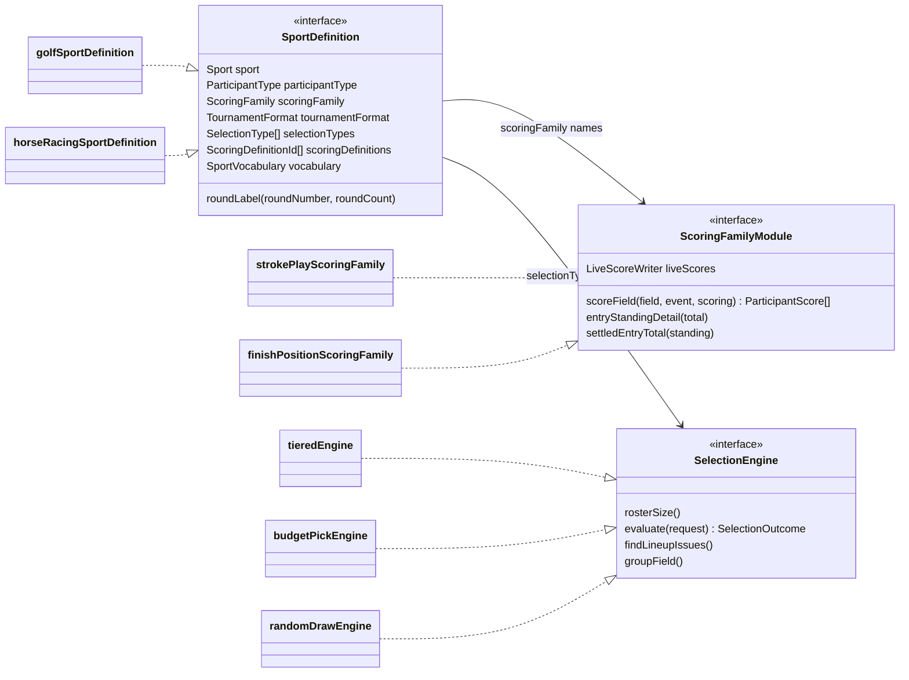
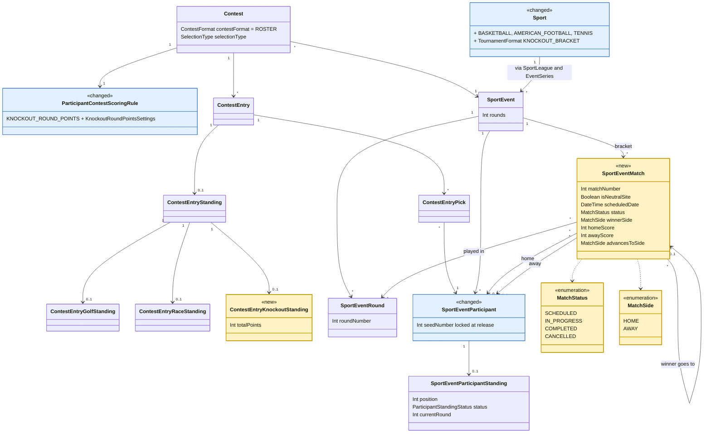
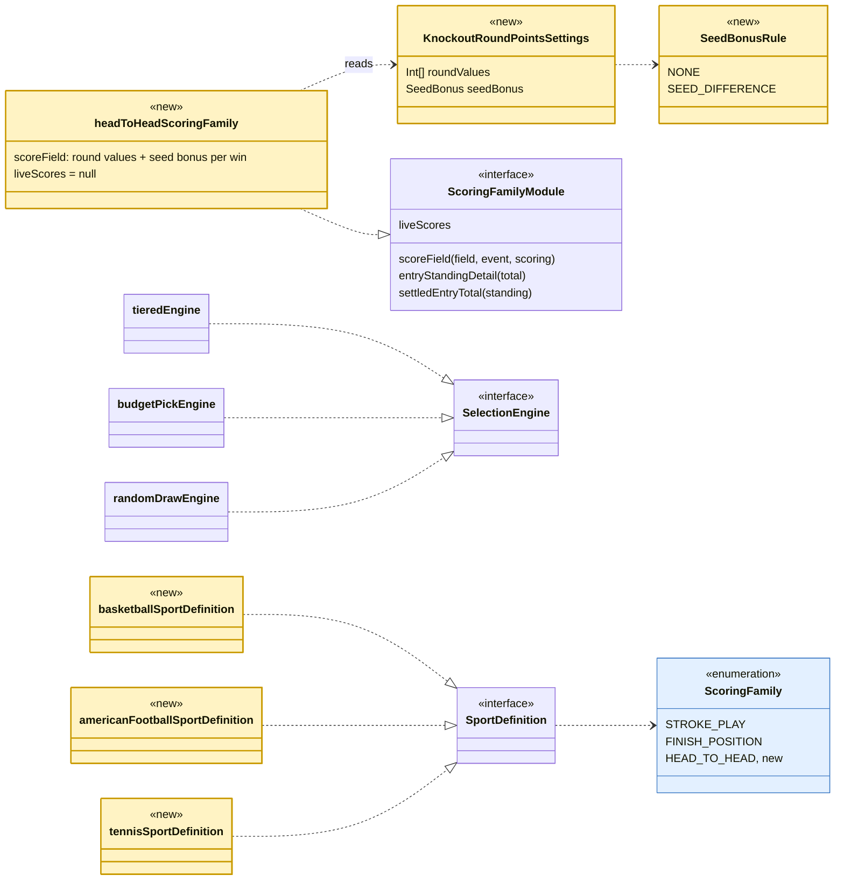
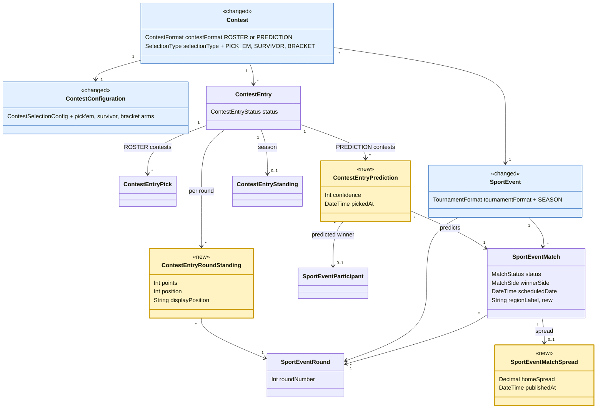
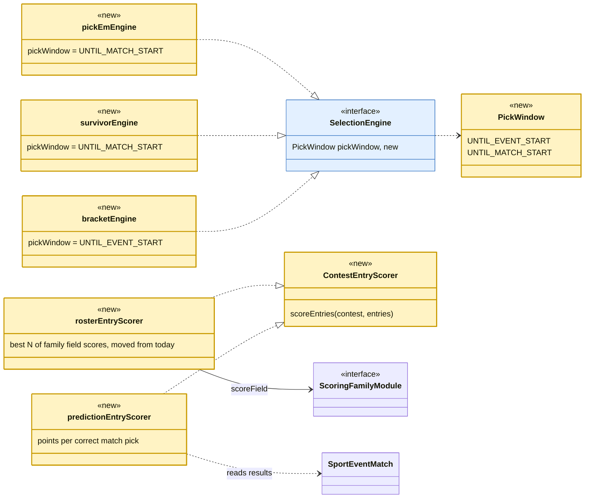

# Knockout pools and pick'em pools: domain design

**Tracking issue:** #599 (knockout, under the next-sport umbrella); pick'em is #607

Written 2026-10-14 for Derek's model review: one design for **knockout pools** (pick teams or
players, score by how far they advance) and **pick'em pools** (predict the winner of each game),
with knockout built first. Checked against the code on `main` at `8bd4548`. Inputs:
`plans/next-sport-adoption.md` §1 and §3 (knockout scoring rules, March Madness, tennis, NFL),
`plans/pickem-pools.md` (pick'em catalog and first design), the sport extension architecture
(the sport registry and scoring families, #602 to #606), and `rules/domain-model-concepts.md`.

Open questions sit inside the section they belong to, marked **Q**, each with a recommendation.
Nothing here waits on an answer: implementation planning can follow the recommendations.
Where this doc and `plans/pickem-pools.md` differ, this doc is the newer design; the pick'em
plan keeps the sport research and the style catalog.

---

## TL;DR

- **Both pool kinds share one new thing: the match.** A `SportEventMatch` records who played
  whom in which round of an event, and who won. Knockout needs it for the seed bonus (you can
  only give a 12 seed a bonus if you know it beat a 5 seed); pick'em needs it because a pick
  *is* a prediction about a match. It is built once, in the knockout work, already shaped for
  brackets and pick'em (bracket slots, where the winner goes next, empty sides until decided).
- **Knockout pools are a new scoring family, not a new kind of contest.** Entries pick a
  roster exactly as in golf and racing today (tiered, budget, random draw). Only results and
  scoring are new: the event's results are matches, and a pick scores
  `round value + seed bonus` for every match it wins.
- **Pick'em pools are a new kind of contest.** An entry holds predictions, not a roster. That
  needs a `PREDICTION` contest format beside today's `ROSTER`, a match-pick table, a lock per
  match instead of per contest, and standings per round. It reuses the match, the scoring
  settings (round values, seed bonus) and everything on the pool side.
- **New model objects for knockout (built first):** `SportEventMatch`,
  `ContestEntryKnockoutStanding`, three enums (`MatchStatus`, `MatchSide`, plus new values in
  `ScoringFamily`, `TournamentFormat` and `Sport`), the `KNOCKOUT_ROUND_POINTS` scoring
  definition with typed settings, and new sport definitions (basketball first).
- **New model objects for pick'em (built later):** `ContestEntryPrediction`,
  `ContestEntryRoundStanding`, `SportEventMatchSpread` (spreads), `ContestFormat.PREDICTION`,
  three selection types (`PICK_EM`, `SURVIVOR`, `BRACKET`) and a tournament format per event.
- **Order:** knockout foundation and basketball, then a January pilot (NFL playoffs; the
  Australian Open optionally), then March Madness for Selection Sunday (about March 14, 2027).
  Pick'em follows for the 2027 NFL season. Ticket breakdown in section 6.

Every new name, and the existing name it is patterned on, is in section 0 (naming questions
N1 to N8). The decisions that most shape the model, for a quick read: Q2.1 (the family is "head to head",
not "knockout"), Q2.2 (matches point at field rows), Q3.4 (settled totals table), Q5.1 (contest
format `PREDICTION` is the roster/pick'em switch) and Q5.3 (a pick names the team, not
home/away).

---

## 0. Names for the new objects

*Added 2026-10-14 on Derek's request:* names that follow the existing domain model. The rules
behind them are `rules/domain-model-conventions-rules.md` §10 *Naming Disambiguation* (prefix a
name only where a bare noun would collide, and then the longer name wins) and §2 *Closed Sets Are
Enums*, plus the #544 vocabulary in `rules/domain-model-concepts.md` §2 (selection is the
process; a pick is one participant chosen). The rest of this doc uses these names.

**Tables (persisted entities)**

| Name | What it is | Pattern it follows |
|---|---|---|
| `SportEventMatch` | One match in one round of one event | An event-owned child, like `SportEventRound` and `SportEventTier`. Prefixed because bare "match" already means provider matching (`SportLeague.matchKeyword`, participant mapping confidence) |
| `ContestEntryKnockoutStanding` | A knockout entry's settled points | `ContestEntry<Result>Standing`, like `ContestEntryGolfStanding` and `ContestEntryRaceStanding` |
| `ContestEntryPrediction` | One pick'em prediction on one match | `ContestEntry<Thing>`, like `ContestEntryPick` and `ContestEntryStanding` |
| `ContestEntryRoundStanding` | An entry's points and position for one round | `ContestEntryStanding` narrowed to a round, as `SportEventParticipantRound` narrows its parent |
| `SportEventMatchSpread` | A match's published spread | A child of `SportEventMatch`, named for what it holds |

**Columns**

| Name | Pattern it follows |
|---|---|
| `matchNumber` | `roundNumber`, `tierNumber`, `entryNumber` |
| `homeSportEventParticipantId`, `awaySportEventParticipantId` | A foreign key is named after the model it points at (`ContestEntryPick.sportEventParticipantId`), with the side in front |
| `winnerSide` | An enum, not a third foreign key, so the winner can only be one of the two sides |
| `advancesToMatchId`, `advancesToSide` | Says the direction; "next" could mean next in time or next by number |
| `isNeutralSite` | `is` for booleans, like `isActive` and `isOfficial` |
| `scheduledDate` | `SportEventRound.scheduledDate` and `SportEvent.startDate` |
| `homeScore`, `awayScore` | Plain value columns |
| `regionLabel` (bracket, later) | `SportEventTier.label` |
| `sportEventParticipantId`, `confidence`, `pickedAt` on a prediction | The same names as on `ContestEntryPick` |

**Enums and values**

| Name | Pattern it follows |
|---|---|
| `MatchStatus`: `SCHEDULED`, `IN_PROGRESS`, `COMPLETED`, `CANCELLED` | `<Entity>Status`, in the short form `RaceResultStatus` uses; the values reuse `SportEventStatus` words |
| `MatchSide`: `HOME`, `AWAY` | A closed set, as an enum |
| `ScoringFamily.HEAD_TO_HEAD` | Names how results are stored, like `STROKE_PLAY` and `FINISH_POSITION` |
| Scoring definition `KNOCKOUT_ROUND_POINTS` | `<what is scored>_POINTS`, like `FINISH_POSITION_POINTS` |
| `KnockoutRoundPointsSettings` | `<Definition>Settings`, like `FinishPositionPointsSettings` |
| `SeedBonusRule`: `NONE`, `SEED_DIFFERENCE` | Derek's term for the rule (2026-10-11) |
| `TournamentFormat.KNOCKOUT_BRACKET`, `TournamentFormat.SEASON` | Describes the event's structure, like `STROKE_PLAY_TOURNAMENT` and `RACE` |
| `Sport.BASKETBALL`, `Sport.AMERICAN_FOOTBALL`, `Sport.TENNIS` | Like `AUTO_RACING`: the sport itself, with the competitions as sport leagues |
| `ContestFormat.PREDICTION` | Beside `ROSTER`: what an entry holds |
| `SelectionType.PICK_EM`, `SURVIVOR`, `BRACKET` | Names the process, like `TIERED`, `BUDGET_PICK` and `RANDOM_DRAW` |
| `PickWindow`: `UNTIL_EVENT_START`, `UNTIL_MATCH_START` | The selection code's existing "pick window"; the model has no "lock" action (`rules/domain-model-concepts.md` §4, "entries close") |
| Error code `SPORT_EVENT_MATCH_RESULT_LOCKED` | `<ENTITY>_<PROBLEM>`, like `SPORT_EVENT_INVALID_TRANSITION` |

**Code**

| Name | Pattern it follows |
|---|---|
| `headToHeadScoringFamily` in `scoring-families/head-to-head/` | `finishPositionScoringFamily` in `scoring-families/finish-position/` |
| `basketballSportDefinition`, `americanFootballSportDefinition`, `tennisSportDefinition` | `horseRacingSportDefinition` |
| `SportVocabulary.match`: "game" for basketball and football, "match" for tennis | The existing vocabulary nouns (`event`, `round`), so screens say the sport's word |
| `ContestEntryScorer`, `rosterEntryScorer`, `predictionEntryScorer` | `SelectionEngine` / `tieredEngine`: an interface and one implementation per kind |

Naming questions:

- **N1 Match, game or fixture?** *Recommendation:* `SportEventMatch` in the model, with the
  sport's vocabulary showing "game" or "match" on screen. *Rationale:* "match" is the
  cross-sport word (tennis, soccer, rugby, darts), and the vocabulary already handles words
  like this ("tournament" or "race").
- **N2 `ContestEntryPrediction` or `ContestEntryMatchPick`?** *Recommendation:*
  `ContestEntryPrediction`; screens still say "pick". *Rationale:* #544 made a pick one
  participant chosen, and a predicted draw or exact score is not a participant. The name also
  matches `ContestFormat.PREDICTION`.
- **N3 Seed bonus or upset bonus?** *Recommendation:* "seed bonus" in code and on screen.
  *Rationale:* it is Derek's term from 2026-10-11 and the earlier docs; one word everywhere.
- **N4 `ContestEntryKnockoutStanding` or `ContestEntryHeadToHeadStanding`?** *Recommendation:*
  `Knockout`. *Rationale:* the existing extensions are named for the result they hold (`Golf`,
  `Race`), not for the family (`StrokePlay`, `FinishPosition`), and knockout points are the only
  roster scoring on the family for now.
- **N5 `SEASON`, `LEAGUE_SEASON` or `REGULAR_SEASON`?** *Recommendation:* `SEASON`.
  *Rationale:* "league" would collide with `League`, the office pool (§10), and soccer and AFL
  seasons are not called "regular".
- **N6 Spread or line?** *Recommendation:* `SportEventMatchSpread`. *Rationale:* "line" already
  means a seed line (tiers) and a bracket line.
- **N7 Prisma enum names.** Most status enums carry a `Prisma` prefix in the schema
  (`PrismaContestStatus`, the #186 convention), but `RaceResultStatus` does not.
  *Recommendation:* `PrismaMatchStatus` and `PrismaMatchSide`, following #186. *Rationale:*
  the prefix stops the generated Prisma type from colliding with the domain type of the same
  name when a file imports both.
- **N8 Should one prediction row hold every format's columns?** `rules/domain-model-conventions-rules.md`
  §9 says a column that only means something for some rows belongs in its own table.
  *Recommendation:* `confidence` stays on the prediction (as `cost` sits on `ContestEntryPick`
  for budget contests). *Decided by Derek 2026-10-16:* no per-team score predictions to start,
  in any sport, soccer included; a predicted score is a single total-points tiebreaker (section
  5.2). A `ContestEntryPredictionScore` extension (predicted home and away score) is added later
  only if exact-score pools are wanted.

---

## 1. Today's domain model

The model has a pool side (one league's data) and a sport side (global), meeting at the pick
(`rules/domain-model-concepts.md` §1). Results live in per-family extension tables: golf rounds
and standings for stroke play, a race result for finish position. Every scoring difference is
reached through the sport's definition and its scoring family, never by comparing sports
(`rules/architecture-rules.md` §4 *Sport extension*).

**Figure 1: the persisted model today** (selected columns only).


**Figure 2: the code seams today.** A sport is supported when it has a `SportDefinition` in the
registry; the definition names its scoring family; a family module stores results and scores a
field; a selection engine decides roster rules.



What already fits both pool kinds, unchanged:

- **Teams are participants.** `Participant.participantType` is `INDIVIDUAL` or `TEAM`, and a
  field member (`SportEventParticipant`) already carries `seedNumber`, `ranking` and
  `oddsToWin`.
- **Rounds are cross-sport.** `SportEventRound`'s own schema comment already describes "an NFL
  week's set of games"; tennis rounds and March Madness rounds fit the same rows.
- **Tiers and prices live on the event** and work for any field: seed lines as tiers,
  ranking-based prices.
- **Ranking is direction-free.** `compareScores` and `rankSortedScores` handle
  higher-is-better points (racing already uses them).
- **"Knocked out" exists.** `ParticipantInactiveReason.ELIMINATED` and
  `ParticipantStandingStatus.ELIMINATED` are already cross-sport.
- **Typed scoring settings exist.** `ContestScoringSettings` is a union keyed by scoring
  definition, with a Zod schema per definition (racing's points table is the precedent).
  Contest templates can be per sport league (`ContestConfigTemplate.sportLeagueId`), which
  gives per-league presets.

What does not exist yet: nothing records **who played whom**. Results are per participant
(strokes, a finishing place), never per pairing.

---

## 2. The shared foundation: matches

### 2.1 What a match is

A `SportEventMatch` is one game or match within one round of one event: two sides, a schedule,
a status, scores, and a winner. In a knockout event it is also a **bracket slot**: it knows
which match its winner moves on to. The same row serves:

| Use | What it needs from the match |
|---|---|
| Knockout pool scoring (this build) | Who won, in which round, against whom (for the loser's seed) |
| Admin results entry (this build) | Mark a winner; the winner fills the next match's side automatically |
| Event standings (this build) | Round reached per participant, eliminated on a loss |
| Pick'em (later) | The thing a pick predicts; its kickoff is the pick's lock |
| Bracket pick'em (later) | Slots that exist before their teams are known |
| Survivor (later) | Which team won each game of a round |
| Soccer group stages (later) | Draws (a completed match with no winner) and scores |

**Q2.1 Should the scoring family be called "knockout advancement" or "head to head"?**
The architecture plan named the family `KNOCKOUT_ADVANCEMENT`. But a scoring family means
"how a sport's results are stored", and the NFL is one sport whose results are always matches,
whether the event is the playoffs (a knockout) or the regular season (a pick'em season).
A sport has exactly one family (`SportDefinition.scoringFamily`). *Recommendation:* name the
family `HEAD_TO_HEAD` (results are matches), and make "knockout advancement" its first
**scoring definition**, `KNOCKOUT_ROUND_POINTS`. *Rationale:* the NFL, college basketball and
soccer then have one family each that serves both their knockout pools and, later, their
pick'em pools. Calling the family "knockout" would force a second family, or a rename, the day
an NFL season event arrives.

### 2.2 Shape

```
SportEventMatch
  id
  sportEventId            -> SportEvent
  sportEventRoundId       -> SportEventRound          (the round it is played in)
  matchNumber   Int       unique per event; the bracket slot and display order
  homeSportEventParticipantId? -> SportEventParticipant (null until decided, in a bracket)
  awaySportEventParticipantId? -> SportEventParticipant
  isNeutralSite Boolean   true for tennis, March Madness, the Super Bowl
  scheduledDate DateTime? kickoff, tip-off, or the order-of-play time
  status        MatchStatus  SCHEDULED | IN_PROGRESS | COMPLETED | CANCELLED
  winnerSide    MatchSide?   HOME | AWAY; null while undecided, or for a draw
  homeScore     Int?
  awayScore     Int?
  advancesToMatchId?      -> SportEventMatch          (where the winner goes)
  advancesToSide MatchSide?  which side of that match the winner fills
```

Database checks (enforced in Postgres, as the race result does): the two sides differ;
`advancesToSide` is set exactly when `advancesToMatchId` is; `winnerSide` is set only on a
`COMPLETED` match; unique `(sportEventId, matchNumber)` and unique
`(advancesToMatchId, advancesToSide)` (two matches cannot feed the same side). That a side belongs
to the match's own event is a service check (Postgres cannot check it across tables cheaply).
Both enums are Postgres enums mirroring domain consts, like every status column.

Draws: a `COMPLETED` match with no `winnerSide` is a draw. A knockout event never allows one
(a shootout or tiebreak always decides); the head-to-head family refuses a knockout result
with no winner. Soccer group stages will use it.

**Q2.2 Should a match point at the field row (`SportEventParticipant`) or the participant?**
*Recommendation:* the field row. *Rationale:* the seed that the seed bonus reads lives on the
field row, picks already point at field rows (`rules/domain-model-concepts.md` §1, "a pick
points at a `SportEventParticipant`"), and it guarantees a match can only involve teams entered
in that event.

**Q2.3 "Home and away", or neutral "side A and side B"?**
Tennis and March Madness have no home team. *Recommendation:* `HOME` / `AWAY` with an
`isNeutralSite` flag; on a neutral site, `HOME` is the upper line of the bracket. Screens say
"vs" on a neutral site and "@" otherwise. *Rationale:* pick'em needs a real home team (NFL
spreads are quoted from the home side, and "Bills @ Chiefs" is how fans read a slate), and
one naming scheme for every sport keeps the enums and the API single.

**Q2.4 How should the bracket be linked: "where the winner goes" or "which two matches feed
this one"?**
*Recommendation:* each match names where its winner goes (`advancesToMatchId`, `advancesToSide`).
*Rationale:* one link per match, and irregular brackets fall out naturally: an NFL top seed's
bye is just a team placed straight into a Divisional match; a March Madness First Four game
feeds one side of a Round of 64 game. "Fed by" needs two links and breaks on byes.

**Q2.5 Should a match record how it was decided (walkover, retirement, forfeit)?**
*Recommendation:* not now. A walkover is a win with no score. *Rationale:* scoring treats every
win the same, and under the dead-code goal a column no screen shows should not be built. Add a
`MatchDecision` enum when a tennis screen needs to print "w/o" or "ret.".

### 2.3 Where matches sit in the code

Matches are core event data, not knockout data: the table sits beside `SportEventRound` in the
events module, with its own service for bracket setup and reads. Writing a **result** belongs to
the head-to-head family (section 3), the same split as racing, where the field belongs to
events and the finishing order to the finish-position family.

---

## 3. Knockout pools (build first)

### 3.1 How a knockout pool plays

A commissioner creates a contest on a released knockout event (the 2027 NCAA Tournament, the
Australian Open men's singles). Entries pick a roster with any built selection type:

- **Tiered:** seed lines as tiers (seeds 1-4, 5-8, 9-12, 13-16), one or two per tier.
- **Budget:** teams priced by seed or odds with the existing pricing curve.
- **Random draw:** the sweepstake, each entry dealt teams at random (#601).

Picks lock at the event's start, as today. During the event every pick earns, **for each match
it wins**, the value of that round plus an seed bonus when it beats a better seed. The entry's
total is the sum of its best `countedScores` picks, as today. Ranking is higher-is-better.

### 3.2 Scoring rules (decided by Derek 2026-10-11)

1. **Round values.** Each win is worth the value set for its round, for example 1, 2, 4, 8,
   16, 32 (doubling) or flat 1s.
2. **Seed bonus.** When a worse seed (a higher number) beats a better seed, the winner also
   earns the seed difference: a 12 seed beating a 5 seed in round 1 scores 1 + (12 - 5) = 8.
   No bonus when the better seed wins or the seeds are equal.

A pick's score is `sum over its wins of (roundValues[round] + seedBonus(win))`.

Typed settings for the new scoring definition, in `packages/shared/domain/contest-scoring.ts`
beside the finish-position points table:

```ts
export const SeedBonusRule = {
  NONE: 'NONE',
  /** Winner's seed minus loser's seed, when the winner is the worse seed. */
  SEED_DIFFERENCE: 'SEED_DIFFERENCE',
} as const;

KnockoutRoundPointsSettings = {
  /** roundValues[0] is a round-1 win, roundValues[1] a round-2 win, ... One per event round. */
  roundValues: int[]            // 1..8 entries, each >= 0
  seedBonus:
    | { rule: 'NONE' }
    | { rule: 'SEED_DIFFERENCE'; multiplier: int >= 1 }
}
```

Presets ship as contest templates per sport league (`ContestConfigTemplate.sportLeagueId`):
"Doubling" and "Doubling + seed bonus" for every knockout league, with round counts to match
(six rounds for March Madness, seven for a Slam draw, four for the NFL playoffs).

**Q3.1 What does an unseeded participant get?** Tennis seeds 32 of 128 players.
*Recommendation:* no bonus when either side is unseeded. *Rationale:* an unseeded player
beating a 30 seed is not the kind of upset the rule rewards, and inventing a seed (33) makes
the bonus arbitrary. A ranking-based bonus for tennis can come later if leagues ask. March
Madness and the NFL seed every team, so it does not arise there.

**Q3.2 Should the bonus have a multiplier or a cap?** *Recommendation:* a multiplier defaulting
to 1, no cap. *Rationale:* a multiplier is one integer and covers the "double the bonus" house
rule; caps and "from round 2 on" variants are rare and can be added to the union later without
a migration (the settings are JSON validated by the schema).

**Q3.3 Must the round values table match the event's round count?** *Recommendation:* yes;
creating or changing a contest refuses a table whose length differs from the event's rounds.
*Rationale:* a short table silently scoring late rounds as 0 is exactly the kind of quiet
default the rules forbid, and the commissioner sees the error at setup, not at the Final.

**Q3.4 Byes.** The NFL's top seeds skip Wild Card weekend. *Recommendation:* a bye scores
nothing; the team is placed straight into its next-round match. *Rationale:* points are for
wins, which is how NFL playoff pools score byes; it also needs no "bye match" rows.

### 3.3 Results and standings

- **Bracket setup (events module).** The admin loads the bracket with the event: the round-1
  pairings plus the empty later-round slots and their links. The source is the sport data file
  (the `load-sport-data` skill's envelope gains a `matches` list) or an admin screen for edits.
- **Results entry (head-to-head family).** Per round, the admin marks each match's winner
  (scores optional). Saving a result in one transaction: sets the match `COMPLETED`; fills the
  winner into `advancesToMatchId`'s side; marks the loser's standing `ELIMINATED`; and recomputes the
  event standings (`position` by round reached and wins, champion 1, runner-up 2, semifinal
  losers T3, and so on; `currentRound` = round reached).
- **Corrections.** A result can be changed until the winner's next match has a result.
  *Recommendation:* refuse a change after that with a typed error
  (`SPORT_EVENT_MATCH_RESULT_LOCKED`); the admin clears the later result first. *Rationale:*
  changing an early winner silently would leave a later match between the wrong teams.
- **Who enters results:** the root admin, as for racing results. No live feed: 67 March
  Madness games or 13 NFL playoff games are light work. The family's `liveScores` is `null`.
- **Event lifecycle** is unchanged: the round schedule starts the event, and the admin
  completes it after the final; settlement then freezes each entry's total.

**Q3.5 Seeds frozen at release?** Today a field refresh can still change `seedNumber`.
*Recommendation:* release locks seeds on knockout events, as it already locks tiers and prices.
*Rationale:* the seed bonus is computed from seeds, so a seed changed mid-event would rewrite
every past score. (`next-sport-adoption.md` §1 already assumes seeds "as they stood at the
event's release".)

**Q3.6 Release readiness.** *Recommendation:* releasing a knockout event also requires every
round-1 match to have both sides (or a bye placement) and every active field member to appear
in the bracket. *Rationale:* a contest on a bracket with holes cannot score; release is the
existing gate for "ready for commissioners".

**Q3.7 March Madness First Four.** The field is announced Sunday as 68 teams; four play-in games
on Tuesday and Wednesday decide the last four Round of 64 places; the Round of 64 starts
Thursday. *Recommendation:* a 68-team field released on Selection Sunday, event start (the pick
lock) at the first Round of 64 tip, and the First Four entered as matches in the bracket feeding
their Round of 64 slots but worth no points (they are played before the event's first round, so
they are not a scored round). A First Four loser is eliminated before the lock, so entries that
picked it can swap. *Rationale:* commissioners can open contests on Sunday night, which is when
people want to pick, and nobody is stuck with a team that never reached the Round of 64. To
confirm in implementation: what an already submitted entry shows when one of its picks is
eliminated before the lock (inferred, not checked: the same path as a golfer withdrawing before
tee-off).

**Q3.8 Should each field row cache its wins (a knockout extension table, like golf's
standing)?** *Recommendation:* no; the family computes wins from the event's matches.
*Rationale:* an event has at most 127 matches, so the read is small, and a cache is a second
copy that a correction must keep in step.

### 3.4 What the family module does

`headToHeadScoringFamily` implements `ScoringFamilyModule` unchanged:

- `scoreField(field, event, scoring)`: for each field row, sum its won matches' round values and
  seed bonuses under the contest's `KNOCKOUT_ROUND_POINTS` settings. The field read attaches
  each row's matches the way it attaches `raceResult` for racing (the interface's own comment
  anticipated this: "it reads matches ... as its own field read").
- `liveScores: null`.
- `entryStandingDetail(total)` / `settledEntryTotal(standing)`: write and read the new
  `ContestEntryKnockoutStanding.totalPoints`.
- The leaderboard's `ParticipantScoreDetail` gains a head-to-head arm:
  `{ scoringFamily: HEAD_TO_HEAD, wins, seedBonusPoints, isAlive, roundReached }`, so a pick
  shows "3 wins, +7 seed bonus, still alive".

**Q3.9 Settled totals: a new `ContestEntryKnockoutStanding`, or share racing's table?**
`ContestEntryRaceStanding` holds exactly one column, `totalPoints`, which is what knockout
needs too. *Recommendation:* a new `ContestEntryKnockoutStanding`, following the existing rule
that each family owns its own extension tables. *Rationale:* settlement already dispatches the
extension per family; sharing would mean renaming the racing table (a migration in a sport that
just shipped) and a table whose meaning depends on which family wrote it. The cost is one small
table. (The alternative, renaming it to `ContestEntryPointsStanding` for every points-based
family, is reasonable if Derek prefers fewer tables.)

**Q3.10 "Max possible points" on the leaderboard?** March Madness pools often show how many
points an entry can still reach. *Recommendation:* not in the first release; a follow-up ticket
once the bracket is live. *Rationale:* it needs each alive pick's remaining path through the
bracket, and the leaderboard is useful without it.

### 3.5 Sports

Each sport is its own ticket through the `add-sport` skill (refine, registry entry, storage,
admin results, contest setup, web vocabulary, tests, first event, reflect). All three share the
head-to-head family and `TournamentFormat.KNOCKOUT_BRACKET` (a new value, valid for the `ROSTER`
contest format).

| Sport (new `Sport` value) | Participants | Sport leagues | First events | Round labels |
|---|---|---|---|---|
| `BASKETBALL` | Teams | NCAA Division I Men, NCAA Division I Women | 2027 NCAA Tournaments (Selection Sunday about March 14, 2027) | First Round, Second Round, Sweet 16, Elite Eight, Final Four, National Championship |
| `AMERICAN_FOOTBALL` | Teams | NFL | 2027 NFL Playoffs (Wild Card weekend mid-January 2027, inferred) | Wild Card, Divisional, Conference Championship, Super Bowl |
| `TENNIS` | Individuals | ATP Tour, WTA Tour | 2027 Australian Open men's and women's singles (mid-January 2027, inferred) | First Round ... Fourth Round, Quarterfinal, Semifinal, Final |

Seeding data: `ranking` holds the overall order (the committee's 1-68 S-curve for March Madness,
the ATP/WTA ranking for tennis), so ranking-based tiers give seed lines with no new valuation
source; `seedNumber` holds the bracket seed (1-16 per region, 1-7 per NFL conference, 1-32 in a
Slam draw).

**Q3.11 Sport naming: `BASKETBALL` with NCAA leagues, or `NCAA_BASKETBALL` as the sport?**
*Recommendation:* `BASKETBALL`, with the men's and women's NCAA tournaments as sport leagues
(and the NBA as another league later); likewise `AMERICAN_FOOTBALL` with the NFL (college
football later). *Rationale:* it follows Derek's auto racing decision (one sport, series as
sport leagues), and the NBA playoffs and college football then need only data.

**Q3.12 The word "team" means two things on screen.** A squad is called "team" on screen
(`rules/poolmaster-webapp-rules.md` §1), and a March Madness participant is also a "team"
("pick 8 teams for your team"). *Recommendation:* the sport vocabulary says "team" for the
participant, and knockout screens refer to the squad by its name or as "your entry", never
"your team"; the web ticket sweeps the picker, entry and leaderboard copy for it.
*Rationale:* "team" is the only word fans use for a basketball team, while the squad already has
a name to show; renaming the squad on screen would ripple through every league page.

**Q3.13 Which event pilots the foundation?** *Recommendation:* the NFL playoffs in January
(13 games, light to enter) if the foundation merges by early January; the Australian Open as an
optional second pilot; March Madness as the launch. *Rationale:* the NFL playoffs are a real
event with real interest, small enough to enter by hand; the Australian Open is 254 singles
matches over two weeks, a heavy admin load for a pilot.

### 3.6 Model change for knockout

**Figure 3: knockout additions.** New objects are marked `<<new>>` and shaded yellow; changed
ones are marked `<<changed>>` and shaded blue. Unchanged pool-side classes are trimmed to the ones knockout touches.



**Figure 4: knockout additions to the code seams** (yellow new, blue changed).



No selection engine changes: tiered, budget and random draw work on a knockout field as they
are. Snake draft (#199), the classic "draft the 64 teams" pool, stays deferred.

**Q3.14 `Contest.scoringStopsOnElimination` is dead.** The column is mapped by the contest
repository but no code reads it to change a score. Its meaning would suit survivor pools later.
*Recommendation:* delete it in the first knockout ticket under the dead-code goal; survivor adds
its own typed rule in its contest config when it is built. *Rationale:* a column nothing honours
invites someone to assume it works.

---

## 4. How the rest of the system sees knockout

| Area | Change |
|---|---|
| Event admin | A bracket tab on knockout events: matches by round, edit pairings before release, mark winners after start |
| Release | Also requires a complete round-1 bracket (Q3.6); locks seeds (Q3.5) |
| Contest setup | The knockout scoring definition with round values and seed bonus; presets from league templates |
| Selection room | Unchanged engines; sport vocabulary for team or player; seed shown beside each pick |
| Leaderboard | Points, wins, seed bonus, alive or out per pick; round labels from the sport definition |
| Settlement | Unchanged flow; the family writes `ContestEntryKnockoutStanding` |
| Contracts | New DTOs for matches and results (mapped from domain types, `rules/service-rules.md` §4); the leaderboard detail union gains the head-to-head arm |
| Lint | No sport branching: knockout rules are configuration and the family, never `sport === BASKETBALL` |

---

## 5. Pick'em pools (designed now, built after knockout)

The pick'em catalog (straight-up, against the spread, confidence, tipping, score predictor,
survivor, bracket) and sport research stay in `plans/pickem-pools.md` §1 to §2, along with its
questions on sports, squares, data and dates (its Q1.1, Q1.2, Q2.1, Q2.2, Q4.1, Q5.1). This
section is the model.

### 5.1 The roster/prediction split

Today every contest is `ContestFormat.ROSTER`: an entry holds field members, and the sport's
family scores those field members. A pick'em entry holds **predictions about matches**, and its
score depends on the prediction (the side, the confidence weight, the spread), not on a field
member alone.

**Q5.1 How does the system tell roster contests from pick'em contests?**
*Recommendation:* add `ContestFormat.PREDICTION`. A contest's format decides how entries are
scored: `ROSTER` asks the sport's scoring family to score the field and sums each entry's best
picks (today's path); `PREDICTION` scores each entry's match picks against match results.
*Rationale:* `ContestFormat` exists for exactly this distinction (its validity matrix against
`TournamentFormat` is already in `contest-validity.ts`), and it keeps the scoring family
interface about results, not about pools. The pick'em plan proposed an entry-level hook on the
family instead; the family interface shipped in #606 without one, and a format switch avoids
widening it.

**Q5.2 Where does an event's tournament format live?** Today it is per sport
(`Sport.tournamentFormat`). The NFL needs a knockout event (playoffs) and a season event
(weeks of games) in the same sport. *Recommendation:* in the pick'em phase, add
`SportEvent.tournamentFormat`, with the sport definition listing allowed formats and a default;
add `TournamentFormat.SEASON`. Validity: `KNOCKOUT_BRACKET` allows `ROSTER` and
`PREDICTION` (team pools and bracket or game pick'em); `SEASON` allows `PREDICTION`.
*Rationale:* it is the smallest change that lets one sport run both; not needed for knockout,
so it waits.

### 5.2 New objects

- **`ContestEntryPrediction`**: entry, match (`sportEventMatchId`), the team predicted to win
  (`sportEventParticipantId`, the same column name as on `ContestEntryPick`; null for a predicted
  draw), optional `confidence`, `pickedAt`. Unique on (entry, match).
- **Tiebreakers are one number: total points scored** (*decided by Derek 2026-10-16*). An entry
  predicts the combined points of a named match, both teams together (3 for a 2-1 soccer
  score), as NCAA tournament pools do for the final and NFL pools do for the Monday night game.
  This applies to every sport, soccer included. A bracket or one-event pool uses the existing
  `ContestEntry.tiebreakerValue`; a weekly pick'em pool needs one value per entry per round,
  a small (entry, round, value) row designed with the round standings slice. Predicting each
  team's score (exact-score soccer pools) is left for later, as a `ContestEntryPredictionScore`
  extension if wanted.
- **`ContestEntryRoundStanding`**: an entry's points and position for one round (weekly
  winners), beside the season `ContestEntryStanding`.
- **`SportEventMatchSpread`**: a match's spread from the home side, with when and by whom it was
  published. Publishing is an explicit admin action per round, not a time-based lock.
- **Selection types** `PICK_EM` (straight-up, confidence, against the spread as configuration),
  `SURVIVOR` and `BRACKET`, each with a typed arm in `ContestSelectionConfig`.
- **Engine pick window.** Each engine declares when its picks close and are revealed:
  `UNTIL_EVENT_START` (roster engines and bracket, as today) or `UNTIL_MATCH_START` (pick'em
  and survivor). The shared
  pick window (`areContestEntriesOpen`) asks the engine instead of assuming the event start.

**Q5.3 Should a match pick name the team, or say HOME/AWAY?**
*Recommendation:* name the team (`sportEventParticipantId`, a field row). *Rationale:* a bracket pick
for a later round is "Duke wins match 61" before anyone knows Duke's opponent, so HOME/AWAY
cannot express it; survivor's "each team once a season" is a direct check on the team; and an
against-the-spread pick is still "this team covers". One rule serves every format.
(`plans/pickem-pools.md` Q3.1 already chose a new table over extending `ContestEntryPick`; this
keeps that.)

**Q5.4 Entry status for pick'em.** Entries are `DRAFT` until submitted, and only `SUBMITTED`
entries count. *Recommendation:* pick'em and survivor entries are created `SUBMITTED` (each pick
saves on its own, and the round screen shows "6 of 14 picked"); bracket entries keep the draft
and submit flow, refused until every game is picked. *Rationale:* a season-long pool has no
moment at which a lineup is "complete", while a bracket does.

**Q5.5 What does `ACTIVE` mean for a pick'em contest?** *Recommendation:* the same statuses
for every contest; for pick'em, `ACTIVE` keeps accepting picks on matches not yet started,
because the engine's lock scope says so. `rules/domain-model-concepts.md` §4 is updated when
this is built. *Rationale:* a second status set would ripple through every contest screen
(same as `plans/pickem-pools.md` Q3.2).

**Q5.6 Late joiners.** *Recommendation:* allow entering a pick'em contest while it is `ACTIVE`,
scoring zero for rounds already played, with a commissioner switch to close joining.
*Rationale:* season pools routinely take people in week 3 (same as `plans/pickem-pools.md`
Q3.3).

**Q5.7 Bracket regions.** March Madness brackets are drawn in four named regions.
*Recommendation:* a short display label on the match (`regionLabel`), added with the bracket
selection type. *Rationale:* regions only group matches on screen; the links between matches
already define the structure.

Scoring reuse: a correct bracket pick scores with the same `KnockoutRoundPointsSettings` as a
knockout pool (round value plus seed bonus), so commissioners meet one set of scoring words.

### 5.3 Model change for pick'em

**Figure 5: pick'em additions on top of the knockout model.** New in this phase: `<<new>>`,
yellow; changed: `<<changed>>`, blue. The match is plain because knockout already built it.



**Figure 6: pick'em additions to the code seams** (yellow new, blue changed).



The `ContestEntryScorer` seam (keyed by `ContestFormat`, exhaustive like the family registry) is where
"how an entry is scored" lives once there are two answers. Today the leaderboard calculator and
settlement do the roster sum inline; moving that behind `rosterEntryScorer` happens in the first
pick'em ticket, not before, so the seam is shaped by its second user (the #323 lesson the
architecture plan cites).

### 5.4 Pick'em slices (after knockout; not filed)

Kept from `plans/pickem-pools.md` §5 with the model above: (1) per-event tournament format,
`SEASON`, and an NFL season event with weeks as rounds and its matches loaded; (2)
`PREDICTION` format, `ContestEntryPrediction`, the `PICK_EM` engine (straight-up and confidence),
per-match lock and reveal; (3) prediction scoring, round standings and weekly winners; (4) the
round entry screen and season/week leaderboard; (5) survivor; (6) spreads; (7) bracket, using
the bracket links knockout already built. Target: the 2027 NFL season (early September 2027).

---

## 6. Knockout implementation tickets

To be filed under #599 after Derek's review. Each is one PR opened against main, through the
named skill. The order keeps every merge free of dead code: each ticket ships something its
successor or an admin uses.

1. **Basketball and the bracket** (`add-sport`, `model-change`). `Sport.BASKETBALL` with the
   NCAA men's and women's sport leagues (reference data in the migration);
   `TournamentFormat.KNOCKOUT_BRACKET`; `ScoringFamily.HEAD_TO_HEAD` registered with a module
   that has no scoring definition yet; `SportEventMatch` with `MatchStatus` and `MatchSide`;
   admin API to load and edit a bracket; release checks (Q3.6) and seed lock (Q3.5); delete
   `Contest.scoringStopsOnElimination` (Q3.14). Integration tests for the bracket queries and
   the database checks.
2. **Knockout scoring and results** (`add-endpoint`). `KNOCKOUT_ROUND_POINTS` with
   `KnockoutRoundPointsSettings` and `SeedBonusRule`; results entry API (mark winner, advance,
   eliminate, standings, correction lock); `scoreField`, leaderboard detail arm, settlement into
   `ContestEntryKnockoutStanding`; round-values length check (Q3.3); the "Doubling" and
   "Doubling + seed bonus" templates for both NCAA leagues. Unit tests for the scoring math
   (seed bonus, unseeded, equal seeds, multiplier, byes) and a functional test from release to
   settlement.
3. **Admin bracket and results screens** (`add-frontend-feature`). A bracket tab on knockout
   events: matches by round with labels from the sport definition, pairing edits before release,
   one tap to mark a winner after start, correction errors shown in product copy.
4. **Commissioner and member screens** (`add-frontend-feature`). Scoring setup for round values
   and the seed bonus with presets; seeds in the selection room; leaderboard wins, seed bonus points
   and alive/out per pick; the "team" copy sweep (Q3.12).
5. **NFL playoffs** (`add-sport`, then `load-sport-data`). `Sport.AMERICAN_FOOTBALL`, the NFL
   league, byes in the bracket (Q3.4), four-round templates; the 2027 playoff bracket loaded
   once seeds are set (early January). The pilot (Q3.13).
6. **Matches in sport data files** (`load-sport-data`). The data file envelope gains a
   `matches` list with bracket links, cross-checked against a second source like fields are;
   used by 5 and 8. Could merge before 5 if 5 needs it first.
7. **Tennis** (`add-sport`, optional pilot). `Sport.TENNIS`, ATP and WTA leagues, seven-round
   templates, unseeded rule (Q3.1); the 2027 Australian Open singles draws if Derek wants the
   second pilot.
8. **March Madness 2027 launch** (`load-sport-data`). Men's and women's 68-team fields and
   brackets loaded on Selection Sunday (about March 14, 2027), First Four handling (Q3.7);
   applied only on Derek's yes, per the skill.
9. **Later:** "max possible points" (Q3.10); snake draft for team pools (#199); soccer
   knockouts and the Champions League (data on the same family).

Ticket 1 and ticket 2 can be planned together and built back to back; 3 and 4 can run in
parallel once 2 has merged. Everything through 5 should merge by early January for the NFL
pilot; 8 needs only data once 1 to 4 and 6 are in.

---

## 7. Rules and docs this work updates

Recorded here so the tickets carry them (docs ride with code, `rules/workflow-rules.md` §6):

- `rules/domain-model-concepts.md`: the match, bracket words ("bye", "seed bonus", "seed"),
  the second meaning of "team" (Q3.12), and, in the pick'em phase, the prediction contest and
  `ACTIVE` accepting picks.
- `rules/architecture-rules.md` §4 *Sport extension*: the head-to-head family, and later the
  entry scorer seam keyed by contest format.
- `docs/DOMAIN-OPERATIONS.md`: bracket setup and result entry operations with their error codes.
- A `docs/` setup procedure for knockout events, like `docs/RACE-SETUP-PROCEDURES.md`.
