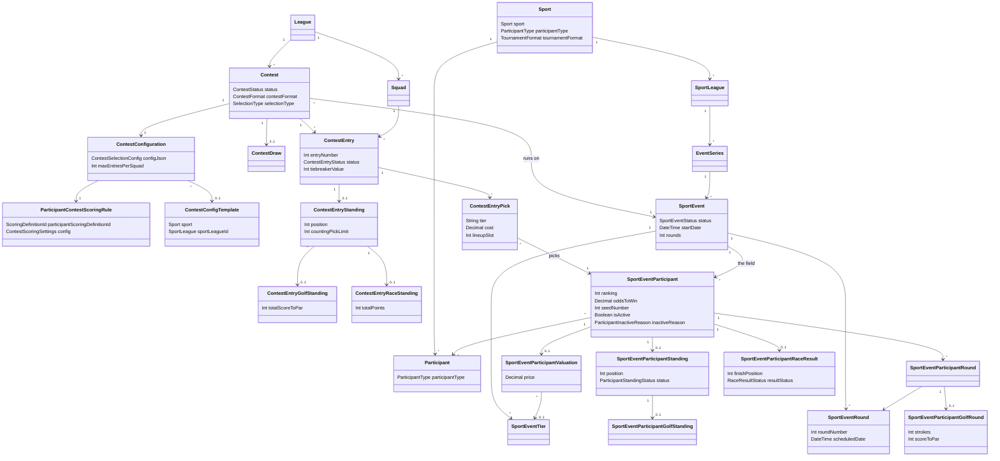
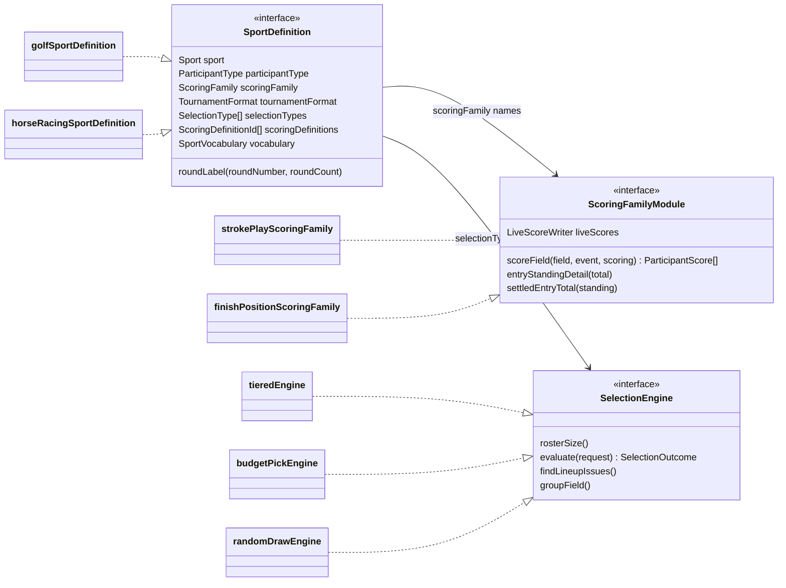
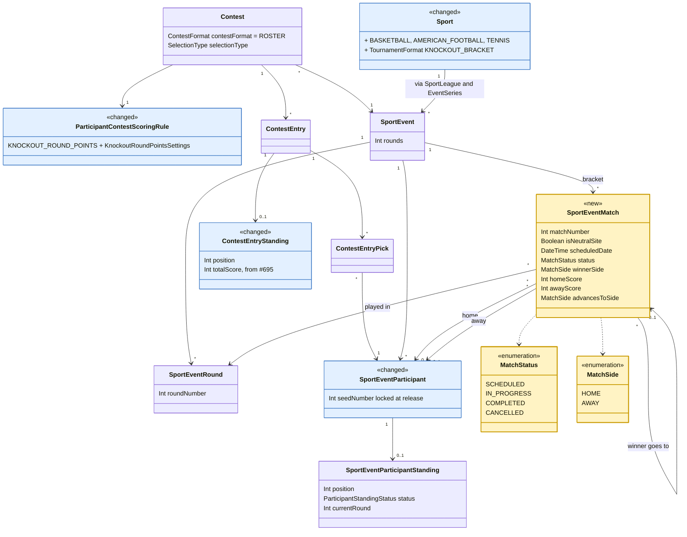
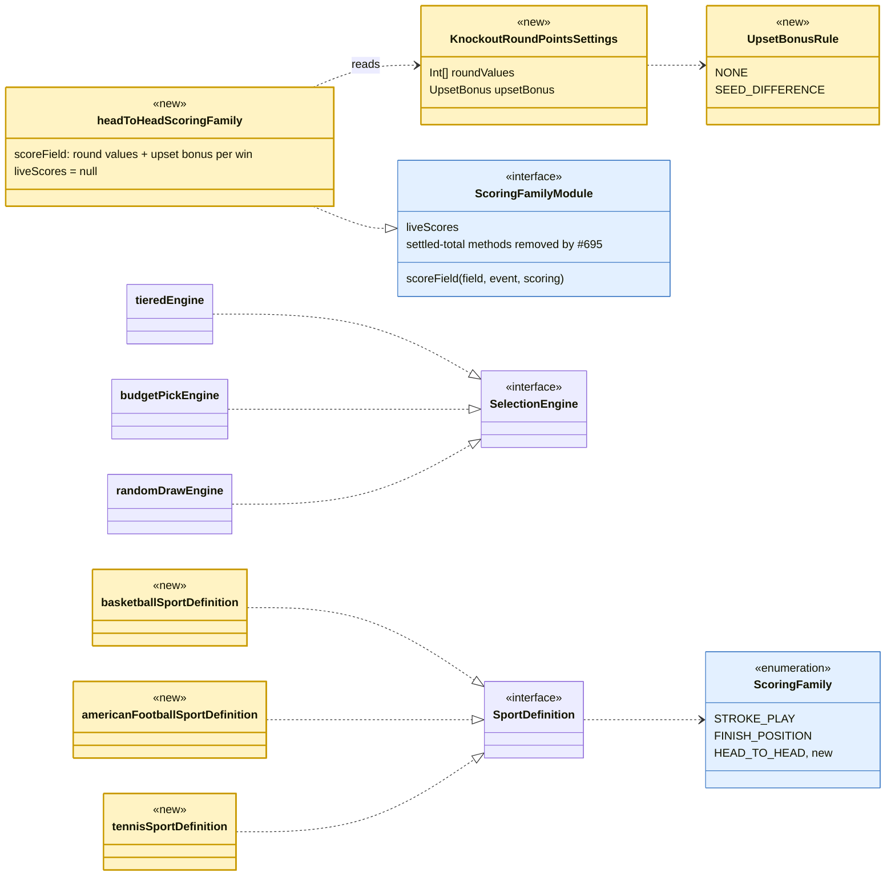
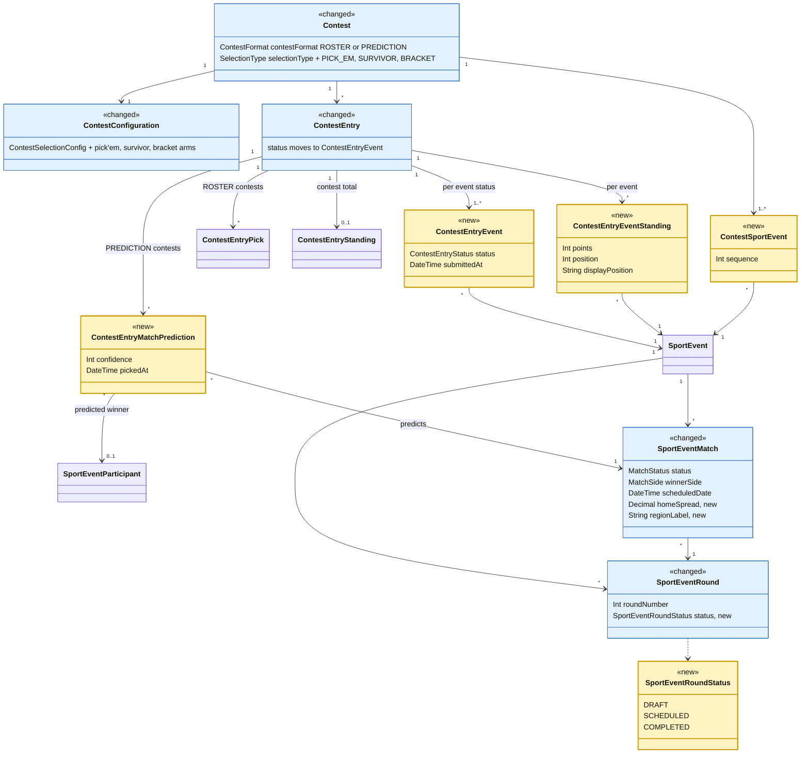
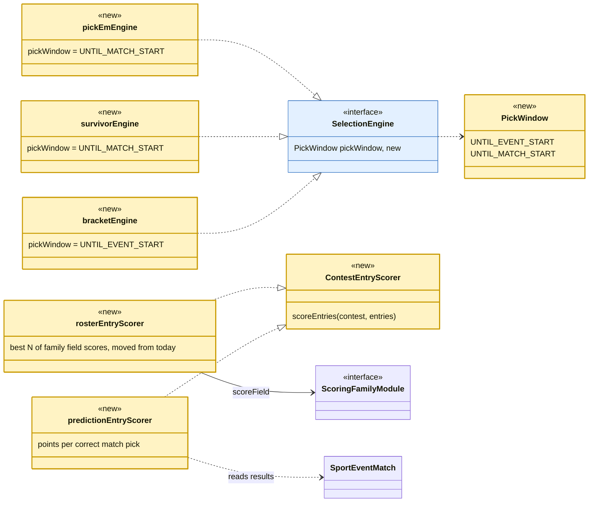

# Knockout pools and pick'em pools: domain design

**Tracking issue:** #599 (knockout, under the next-sport umbrella); pick'em is #607

Written 2026-10-14 for Derek's model review: one design for **knockout pools** (pick teams or
players, score by how far they advance) and **pick'em pools** (predict the winner of each game),
with knockout built first. Checked against the code on `main` at `8bd4548`. Inputs:
`plans/next-sport-adoption.md` §1 and §3 (knockout scoring rules, March Madness, tennis, NFL),
`plans/pickem-pools.md` (pick'em catalog and first design), the sport extension architecture
(the sport registry and scoring families, #602 to #606), and `rules/domain-model-concepts.md`.

Open questions sit inside the section they belong to, marked **Q**, each with a recommendation.
Nothing here waits on an answer: implementation planning can follow the recommendations.
Where this doc and `plans/pickem-pools.md` differ, this doc is the newer design; the pick'em
plan keeps the sport research and the style catalog.

---

## TL;DR

- **Both pool kinds share one new thing: the match.** A `SportEventMatch` records who played
  whom in which round of an event, and who won. Knockout needs it for the upset bonus (you can
  only give a 12 seed a bonus if you know it beat a 5 seed); pick'em needs it because a pick
  *is* a prediction about a match. It is built once, in the knockout work, already shaped for
  brackets and pick'em (bracket slots, where the winner goes next, empty sides until decided).
- **Knockout pools are a new scoring family, not a new kind of contest.** Entries pick a
  roster exactly as in golf and racing today (tiered, budget, random draw). Only results and
  scoring are new: the event's results are matches, and a pick scores
  `round value + upset bonus` for every match it wins.
- **Pick'em pools are a new kind of contest.** An entry holds predictions, not a roster. That
  needs a `PREDICTION` contest format beside today's `ROSTER`, a match-pick table, a lock per
  match instead of per contest, and standings per round. It reuses the match, the scoring
  settings (round values, upset bonus) and everything on the pool side.
- **New model objects for knockout (built first):** `SportEventMatch`, three enums (`MatchStatus`, `MatchSide`, plus new values in
  `ScoringFamily`, `TournamentFormat` and `Sport`), the `KNOCKOUT_ROUND_POINTS` scoring
  definition with typed settings, and new sport definitions (basketball first). The settled
  total moves onto `ContestEntryStanding.totalScore` for every sport first (#695, Q3.9), so
  knockout adds no settled-total table.
- **New model objects for pick'em (built later):** **multi-event contests** first
  (`ContestSportEvent`, `ContestEntryEventStanding`; #713, Q5.2): each NFL week is its own event
  and a contest spans several events, which also gives golf a four-majors pool (#714). Then
  `ContestEntryMatchPrediction`, a spread on the match, `ContestFormat.PREDICTION`, three
  selection types (`PICK_EM`, `SURVIVOR`, `BRACKET`), and **round release** for multi-round
  events picked game by game (section 5.3).
- **Order:** knockout foundation and basketball, then a January pilot (NFL playoffs; the
  Australian Open optionally), then March Madness for Selection Sunday (about March 14, 2027).
  Pick'em follows for the 2027 NFL season. Ticket breakdown in section 6.

Every new name, and the existing name it is patterned on, is in section 0 (naming questions
N1 to N8). The decisions that most shape the model, for a quick read: Q2.1 (the family is "head to head",
not "knockout"), Q2.2 (matches point at field rows), Q3.4 (settled totals table), Q5.1 (contest
format `PREDICTION` is the roster/pick'em switch) and Q5.3 (a pick names the team, not
home/away).

---

## 0. Names for the new objects

*Added 2026-10-14 on Derek's request:* names that follow the existing domain model. The rules
behind them are `rules/domain-model-conventions-rules.md` §10 *Naming Disambiguation* (prefix a
name only where a bare noun would collide, and then the longer name wins) and §2 *Closed Sets Are
Enums*, plus the #544 vocabulary in `rules/domain-model-concepts.md` §2 (selection is the
process; a pick is one participant chosen). The rest of this doc uses these names.

**Tables (persisted entities)**

| Name | What it is | Pattern it follows |
|---|---|---|
| `SportEventMatch` | One match in one round of one event | An event-owned child, like `SportEventRound` and `SportEventTier`. Prefixed because bare "match" already means provider matching (`SportLeague.matchKeyword`, participant mapping confidence) |
| `ContestEntryMatchPrediction` | One pick'em prediction on one match | `ContestEntry<Thing>`, like `ContestEntryPick` and `ContestEntryStanding` |
| `ContestSportEvent` | One event a contest covers, in order (Q5.2) | A join named for its two ends, like `SportEventParticipant` |
| `ContestEntryEvent` | An entry's draft/submitted status for one event of its contest (Q5.4) | `ContestEntry` narrowed to an event; takes over `ContestEntry.status` |
| `ContestEntryEventStanding` | An entry's points and position for one event of a multi-event contest (a pick'em week, one major) | `ContestEntryStanding` narrowed to an event. Replaces the per-round standing proposed earlier (Q5.2) |

**Columns**

| Name | Pattern it follows |
|---|---|
| `ContestEntryStanding.totalScore` (#695) | The entry's settled total in its scoring definition's unit, as `position` is already on the same row; replaces the golf and race extension tables |
| `matchNumber` | `roundNumber`, `tierNumber`, `entryNumber` |
| `homeSportEventParticipantId`, `awaySportEventParticipantId` | A foreign key is named after the model it points at (`ContestEntryPick.sportEventParticipantId`), with the side in front |
| `winnerSide` | An enum, not a third foreign key, so the winner can only be one of the two sides |
| `advancesToMatchId`, `advancesToSide` | Says the direction; "next" could mean next in time or next by number |
| `isNeutralSite` | `is` for booleans, like `isActive` and `isOfficial` |
| `scheduledDate` | `SportEventRound.scheduledDate` and `SportEvent.startDate` |
| `homeScore`, `awayScore` | Plain value columns |
| `homeSpread` (pick'em, later) | Plain value column; null until set, locked when its round is released |
| `regionLabel` (bracket, later) | `SportEventTier.label` |
| `sportEventParticipantId`, `confidence`, `pickedAt` on a prediction | The same names as on `ContestEntryPick` |

**Enums and values**

| Name | Pattern it follows |
|---|---|
| `MatchStatus`: `SCHEDULED`, `IN_PROGRESS`, `COMPLETED`, `CANCELLED` | `<Entity>Status`, in the short form `RaceResultStatus` uses; the values reuse `SportEventStatus` words |
| `MatchSide`: `HOME`, `AWAY` | A closed set, as an enum |
| `SportEventRoundStatus`: `DRAFT`, `SCHEDULED`, `COMPLETED` (pick'em, later) | `<Entity>Status` with the event's own words, so "release" is `DRAFT` -> `SCHEDULED` at both levels |
| `ScoringFamily.HEAD_TO_HEAD` | Names how results are stored, like `STROKE_PLAY` and `FINISH_POSITION` |
| Scoring definition `KNOCKOUT_ROUND_POINTS` | `<what is scored>_POINTS`, like `FINISH_POSITION_POINTS` |
| `KnockoutRoundPointsSettings` | `<Definition>Settings`, like `FinishPositionPointsSettings` |
| `UpsetBonusRule`: `NONE`, `SEED_DIFFERENCE` | Derek's choice (N3); the value names how the bonus is computed |
| `TournamentFormat.KNOCKOUT_BRACKET` | Describes the sport's events, like `STROKE_PLAY_TOURNAMENT` and `RACE`. `MATCH_SCHEDULE` was dropped with Q5.2; see Q5.2a |
| `Sport.BASKETBALL`, `Sport.AMERICAN_FOOTBALL`, `Sport.TENNIS` | Like `AUTO_RACING`: the sport itself, with the competitions as sport leagues |
| `ContestFormat.PREDICTION` | Beside `ROSTER`: what an entry holds |
| `SelectionType.PICK_EM`, `SURVIVOR`, `BRACKET` | Names the process, like `TIERED`, `BUDGET_PICK` and `RANDOM_DRAW` |
| `PickWindow`: `UNTIL_EVENT_START`, `UNTIL_MATCH_START` | The selection code's existing "pick window"; the model has no "lock" action (`rules/domain-model-concepts.md` §4, "entries close") |
| Error code `SPORT_EVENT_MATCH_RESULT_LOCKED` | `<ENTITY>_<PROBLEM>`, like `SPORT_EVENT_INVALID_TRANSITION` |

**Code**

| Name | Pattern it follows |
|---|---|
| `headToHeadScoringFamily` in `scoring-families/head-to-head/` | `finishPositionScoringFamily` in `scoring-families/finish-position/` |
| `basketballSportDefinition`, `americanFootballSportDefinition`, `tennisSportDefinition` | `horseRacingSportDefinition` |
| `SportVocabulary.match`: "game" for basketball and football, "match" for tennis and soccer | The existing vocabulary nouns (`event`, `round`), so screens say the sport's word |
| `ContestEntryScorer`, `rosterEntryScorer`, `predictionEntryScorer` | `SelectionEngine` / `tieredEngine`: an interface and one implementation per kind |

**Code values and screen words are separate** (*Derek 2026-10-16*). Every name above is a code
value. What a screen shows comes from a per-sport dictionary, the sport definition's
`vocabulary` (`packages/shared/domain/sports/sport-definition.ts`), which screens already read
for "golfer" or "horse" and "tournament" or "race". New screen words are added to it by key:
`match` ("game" or "match"), with round labels from `roundLabel`. No screen derives a word from
an enum value, and no sport's word is hardcoded in a shared screen.

Naming questions:

- **N1 Match, game or fixture?** *Decided by Derek 2026-10-16:* `SportEventMatch` in the model.
  The word on screen comes from the sport's vocabulary: "game" for basketball and football,
  "match" for tennis and soccer (Derek 2026-10-16).
- **N2 What is a pick'em row called?** *Decided by Derek 2026-10-16:* `ContestEntryMatchPrediction`.
  "Match" says what it is on; "prediction" matches `ContestFormat.PREDICTION` and avoids #544's
  meaning of a pick (one participant chosen), since a predicted draw names no team. Screens
  still say "pick". `ContestEntryMatchSelection` was ruled out: "selection" is the process.
- **N3 Seed bonus or upset bonus?** *Decided by Derek 2026-10-16:* "upset bonus" in code and on
  screen (`UpsetBonusRule`, `upsetBonus`, `upsetBonusPoints`). The rule's value stays
  `SEED_DIFFERENCE`, which says how the bonus is computed.
- **N4 What should the settled knockout total table be called?** *Decided by Derek
  2026-10-16:* there is no such table. Every sport's settled total is one integer, so it moves
  onto `ContestEntryStanding.totalScore` (#695, Q3.9).
- **N5 What is the format for an event of scheduled matches (an NFL season)?** *Superseded by Q5.2
  (Derek 2026-10-17): an NFL week is its own event, so there is no season event and no per-event
  format; see Q5.2a.* Earlier decision (2026-10-16): `TournamentFormat.MATCH_SCHEDULE`: matches played on a schedule, grouped into
  rounds, nobody eliminated. It pairs with `KNOCKOUT_BRACKET`. `SEASON` was rejected (too many
  meanings, and `LEAGUE_SEASON` collides with `League`); a pool name such as `PICK_EM` was not
  used because the format describes the real event, and pick'em and survivor are selection
  types that both run on it.
- **N6 Spread or line?** *Recommendation:* "spread" (`homeSpread`). *Rationale:* "line" already
  means a seed line (tiers) and a bracket line. *Decided by Derek 2026-10-16:* the spread is a
  column on the match, not a child table, with no published-at field (section 5.2).
- **N7 Enum names.** *Decided by Derek 2026-10-16:* `MatchStatus` and `MatchSide` (`HOME`,
  `AWAY`; feeds use the same pair, ESPN as `homeAway` and Sportradar as `qualifier`), with
  `PrismaMatchStatus` and `PrismaMatchSide` as the schema copies, following the #186 prefix
  convention.
- **N8 Should one prediction row hold every format's columns?** `rules/domain-model-conventions-rules.md`
  §9 says a column that only means something for some rows belongs in its own table.
  *Recommendation:* `confidence` stays on the prediction (as `cost` sits on `ContestEntryPick`
  for budget contests). *Decided by Derek 2026-10-16:* no per-team score predictions to start,
  in any sport, soccer included; a predicted score is a single total-points tiebreaker (section
  5.2). A `ContestEntryMatchPredictionScore` extension (predicted home and away score) is added later
  only if exact-score pools are wanted.

---

## 1. Today's domain model

The model has a pool side (one league's data) and a sport side (global), meeting at the pick
(`rules/domain-model-concepts.md` §1). Results live in per-family extension tables: golf rounds
and standings for stroke play, a race result for finish position. Every scoring difference is
reached through the sport's definition and its scoring family, never by comparing sports
(`rules/architecture-rules.md` §4 *Sport extension*).

**Figure 1: the persisted model today** (selected columns only).



**Figure 2: the code seams today.** A sport is supported when it has a `SportDefinition` in the
registry; the definition names its scoring family; a family module stores results and scores a
field; a selection engine decides roster rules.



What already fits both pool kinds, unchanged:

- **Teams are participants.** `Participant.participantType` is `INDIVIDUAL` or `TEAM`, and a
  field member (`SportEventParticipant`) already carries `seedNumber`, `ranking` and
  `oddsToWin`.
- **Rounds are cross-sport.** `SportEventRound`'s own schema comment already describes "an NFL
  week's set of games"; tennis rounds and March Madness rounds fit the same rows.
- **Tiers and prices live on the event** and work for any field: seed lines as tiers,
  ranking-based prices.
- **Ranking is direction-free.** `compareScores` and `rankSortedScores` handle
  higher-is-better points (racing already uses them).
- **"Knocked out" exists.** `ParticipantInactiveReason.ELIMINATED` and
  `ParticipantStandingStatus.ELIMINATED` are already cross-sport.
- **Typed scoring settings exist.** `ContestScoringSettings` is a union keyed by scoring
  definition, with a Zod schema per definition (racing's points table is the precedent).
  Contest templates can be per sport league (`ContestConfigTemplate.sportLeagueId`), which
  gives per-league presets.

What does not exist yet: nothing records **who played whom**. Results are per participant
(strokes, a finishing place), never per pairing.

---

## 2. The shared foundation: matches

### 2.1 What a match is

A `SportEventMatch` is one game or match within one round of one event: two sides, a schedule,
a status, scores, and a winner. In a knockout event it is also a **bracket slot**: it knows
which match its winner moves on to. The same row serves:

| Use | What it needs from the match |
|---|---|
| Knockout pool scoring (this build) | Who won, in which round, against whom (for the loser's seed) |
| Admin results entry (this build) | Mark a winner; the winner fills the next match's side automatically |
| Event standings (this build) | Round reached per participant, eliminated on a loss |
| Pick'em (later) | The thing a pick predicts; its kickoff is the pick's lock |
| Bracket pick'em (later) | Slots that exist before their teams are known |
| Survivor (later) | Which team won each game of a round |
| Soccer group stages (later) | Draws (a completed match with no winner) and scores |

**Q2.1 Should the scoring family be called "knockout advancement" or "head to head"?**
The architecture plan named the family `KNOCKOUT_ADVANCEMENT`. But a scoring family means
"how a sport's results are stored", and the NFL is one sport whose results are always matches,
whether the event is the playoffs (a knockout) or the regular season (a pick'em season).
A sport has exactly one family (`SportDefinition.scoringFamily`). *Recommendation:* name the
family `HEAD_TO_HEAD` (results are matches), and make "knockout advancement" its first
**scoring definition**, `KNOCKOUT_ROUND_POINTS`. *Rationale:* the NFL, college basketball and
soccer then have one family each that serves both their knockout pools and, later, their
pick'em pools. Calling the family "knockout" would force a second family, or a rename, the day
an NFL season event arrives.

### 2.2 Shape

```
SportEventMatch
  id
  sportEventId            -> SportEvent
  sportEventRoundId       -> SportEventRound          (the round it is played in)
  matchNumber   Int       unique per event; the bracket slot and display order
  homeSportEventParticipantId? -> SportEventParticipant (null until decided, in a bracket)
  awaySportEventParticipantId? -> SportEventParticipant
  isNeutralSite Boolean   true for tennis, March Madness, the Super Bowl
  scheduledDate DateTime? kickoff, tip-off, or the order-of-play time
  status        MatchStatus  SCHEDULED | IN_PROGRESS | COMPLETED | CANCELLED
  winnerSide    MatchSide?   HOME | AWAY; null while undecided, or for a draw
  homeScore     Int?
  awayScore     Int?
  advancesToMatchId?      -> SportEventMatch          (where the winner goes)
  advancesToSide MatchSide?  which side of that match the winner fills
```

Database checks (enforced in Postgres, as the race result does): the two sides differ;
`advancesToSide` is set exactly when `advancesToMatchId` is; `winnerSide` is set only on a
`COMPLETED` match; unique `(sportEventId, matchNumber)` and unique
`(advancesToMatchId, advancesToSide)` (two matches cannot feed the same side). That a side belongs
to the match's own event is a service check (Postgres cannot check it across tables cheaply).
Both enums are Postgres enums mirroring domain consts, like every status column.

Draws: a `COMPLETED` match with no `winnerSide` is a draw. A knockout event never allows one
(a shootout or tiebreak always decides); the head-to-head family refuses a knockout result
with no winner. Soccer group stages will use it.

**Q2.2 Should a match point at the field row (`SportEventParticipant`) or the participant?**
*Recommendation:* the field row. *Rationale:* the seed that the upset bonus reads lives on the
field row, picks already point at field rows (`rules/domain-model-concepts.md` §1, "a pick
points at a `SportEventParticipant`"), and it guarantees a match can only involve teams entered
in that event.

**Q2.3 "Home and away", or neutral "side A and side B"?**
Tennis and March Madness have no home team. *Recommendation:* `HOME` / `AWAY` with an
`isNeutralSite` flag; on a neutral site, `HOME` is the upper line of the bracket. Screens say
"vs" on a neutral site and "@" otherwise. *Rationale:* pick'em needs a real home team (NFL
spreads are quoted from the home side, and "Bills @ Chiefs" is how fans read a slate), and
one naming scheme for every sport keeps the enums and the API single.

**Q2.4 How should the bracket be linked: "where the winner goes" or "which two matches feed
this one"?**
*Recommendation:* each match names where its winner goes (`advancesToMatchId`, `advancesToSide`).
*Rationale:* one link per match, and irregular brackets fall out naturally: an NFL top seed's
bye is just a team placed straight into a Divisional match (the March Madness First Four needs
no link at all; see Q3.7). "Fed by" needs two links and breaks on byes.

**Q2.5 Should a match record how it was decided (walkover, retirement, forfeit)?**
*Recommendation:* not now. A walkover is a win with no score. *Rationale:* scoring treats every
win the same, and under the dead-code goal a column no screen shows should not be built. Add a
`MatchDecision` enum when a tennis screen needs to print "w/o" or "ret.".

### 2.3 Where matches sit in the code

Matches are core event data, not knockout data: the table sits beside `SportEventRound` in the
events module, with its own service for bracket setup and reads. Writing a **result** belongs to
the head-to-head family (section 3), the same split as racing, where the field belongs to
events and the finishing order to the finish-position family.

---

## 3. Knockout pools (build first)

### 3.1 How a knockout pool plays

A commissioner creates a contest on a released knockout event (the 2027 NCAA Tournament, the
Australian Open men's singles). Entries pick a roster with any built selection type:

- **Tiered:** seed lines as tiers (seeds 1-4, 5-8, 9-12, 13-16), one or two per tier.
- **Budget:** teams priced by seed or odds with the existing pricing curve.
- **Random draw:** the sweepstake, each entry dealt teams at random (#601).

Picks lock at the event's start, as today. During the event every pick earns, **for each match
it wins**, the value of that round plus an upset bonus when it beats a better seed. The entry's
total is the sum of its best `countedScores` picks, as today. Ranking is higher-is-better.

### 3.2 Scoring rules (decided by Derek 2026-10-11)

1. **Round values.** Each win is worth the value set for its round, for example 1, 2, 4, 8,
   16, 32 (doubling) or flat 1s.
2. **Upset bonus.** When a worse seed (a higher number) beats a better seed, the winner also
   earns the seed difference: a 12 seed beating a 5 seed in round 1 scores 1 + (12 - 5) = 8.
   No bonus when the better seed wins or the seeds are equal.

A pick's score is `sum over its wins of (roundValues[round] + upsetBonus(win))`.

Typed settings for the new scoring definition, in `packages/shared/domain/contest-scoring.ts`
beside the finish-position points table:

```ts
export const UpsetBonusRule = {
  NONE: 'NONE',
  /** Winner's seed minus loser's seed, when the winner is the worse seed. */
  SEED_DIFFERENCE: 'SEED_DIFFERENCE',
} as const;

KnockoutRoundPointsSettings = {
  /** roundValues[0] is a round-1 win, roundValues[1] a round-2 win, ... One per event round. */
  roundValues: int[]            // 1..8 entries, each >= 0
  upsetBonus:
    | { rule: 'NONE' }
    | { rule: 'SEED_DIFFERENCE'; multiplier: int >= 1 }
}
```

Presets ship as contest templates per sport league (`ContestConfigTemplate.sportLeagueId`):
"Doubling" and "Doubling + upset bonus" for every knockout league, with round counts to match
(six rounds for March Madness, seven for a Slam draw, four for the NFL playoffs).

**Q3.1 What does an unseeded participant get?** Tennis seeds 32 of 128 players.
*Decided by Derek 2026-10-16:* an unseeded participant counts as the worst seed in the field.
The worst seed is the highest seed number among the event's field rows, read when the event is
released (seeds are locked then, like tiers). In a Slam draw with 32 seeds, an unseeded player
counts as seed 32: beating the 30 seed earns a bonus of 2, beating the 1 seed earns 31, and two
unseeded players meeting earn no bonus. The rule needs no new column: the scorer substitutes
the worst seed when a field row's seed is empty. March Madness and the NFL seed every team, so
it does not arise there.

**Q3.2 Should the bonus have a multiplier or a cap, and is it on by default?** *Decided by Derek
2026-10-16:* the upset bonus is off by default. A new knockout contest starts with
`{ rule: 'NONE' }`, and the commissioner turns it on. When it is on, the multiplier defaults to
1 and there is no cap. *Rationale:* a multiplier is one integer and covers the "double the
bonus" house rule; caps and "from round 2 on" variants are rare and can be added to the union
later without a migration (the settings are JSON validated by the schema).

**Q3.3 Must the round values table match the event's round count?** *Recommendation:* yes;
creating or changing a contest refuses a table whose length differs from the event's rounds.
*Rationale:* a short table silently scoring late rounds as 0 is exactly the kind of quiet
default the rules forbid, and the commissioner sees the error at setup, not at the Final.

**Q3.4 Byes.** The NFL's top seeds skip Wild Card weekend. *Recommendation:* a bye scores
nothing; the team is placed straight into its next-round match. *Rationale:* points are for
wins, which is how NFL playoff pools score byes; it also needs no "bye match" rows.

### 3.3 Results and standings

- **Bracket setup (events module).** The admin loads the bracket with the event: the round-1
  pairings plus the empty later-round slots and their links. The source is the sport data file
  (the `load-sport-data` skill's envelope gains a `matches` list) or an admin screen for edits.
- **Results entry (head-to-head family).** Per round, the admin marks each match's winner
  (scores optional). Saving a result in one transaction: sets the match `COMPLETED`; fills the
  winner into `advancesToMatchId`'s side; marks the loser's standing `ELIMINATED`; and recomputes the
  event standings (`position` by round reached and wins, champion 1, runner-up 2, semifinal
  losers T3, and so on; `currentRound` = round reached).
- **Corrections.** A result can be changed until the winner's next match has a result.
  *Recommendation:* refuse a change after that with a typed error
  (`SPORT_EVENT_MATCH_RESULT_LOCKED`); the admin clears the later result first. *Rationale:*
  changing an early winner silently would leave a later match between the wrong teams.
- **Who enters results:** the root admin, as for racing results. No live feed: 67 March
  Madness games or 13 NFL playoff games are light work. The family's `liveScores` is `null`.
- **Event lifecycle** is unchanged: the round schedule starts the event, and the admin
  completes it after the final; settlement then freezes each entry's total.

**Q3.5 Seeds frozen at release?** Today a field refresh can still change `seedNumber`.
*Recommendation:* release locks seeds on knockout events, as it already locks tiers and prices.
*Rationale:* the upset bonus is computed from seeds, so a seed changed mid-event would rewrite
every past score. (`next-sport-adoption.md` §1 already assumes seeds "as they stood at the
event's release".)

**Q3.6 Release readiness.** *Recommendation:* releasing a knockout event also requires every
round-1 match to have both sides (or a bye placement) and every active field member to appear
in the bracket. *Rationale:* a contest on a bracket with holes cannot score; release is the
existing gate for "ready for commissioners".

**Q3.7 March Madness First Four.** The field is announced Sunday as 68 teams; four play-in games
on Tuesday and Wednesday decide the last four Round of 64 places; the Round of 64 starts
Thursday. *Decided by Derek 2026-10-16:* each play-in slot is **one combined field member**
("Texas / Xavier"), so the field is 64 entries and the bracket starts at the Round of 64. An
entry can pick the slot like any team. Whoever wins the play-in game becomes that field member,
and every pick follows automatically, because picks point at the field row, not at the team
(`rules/domain-model-concepts.md` §1). No First Four matches are entered or scored, and nothing
else in the model changes.

How it is carried out: the field row for the slot starts out pointing at a participant standing
for the pairing, and the admin's "set play-in winner" action points the row at the winning
team. A seed and tier belong to the slot, so they carry over unchanged. Q3.7a below covers the
one detail.

**Q3.7a What does the slot's field row point at before the play-in is decided?** A field row
must point at a participant. *Recommendation:* a participant created for the pairing (named
"Texas / Xavier", type `TEAM`), which the winner replaces and which is then inactivated, as
tours and players are today. *Rationale:* it keeps "every field row has a participant" true
with no nullable column. A slot that points at one of the two teams would show the wrong name
until the game is played.

**Q3.8 Should each field row cache its wins (a knockout extension table, like golf's
standing)?** *Recommendation:* no; the family computes wins from the event's matches.
*Rationale:* an event has at most 127 matches, so the read is small, and a cache is a second
copy that a correction must keep in step.

### 3.4 What the family module does

`headToHeadScoringFamily` implements `ScoringFamilyModule` unchanged:

- `scoreField(field, event, scoring)`: for each field row, sum its won matches' round values and
  upset bonuses under the contest's `KNOCKOUT_ROUND_POINTS` settings. The field read attaches
  each row's matches the way it attaches `raceResult` for racing (the interface's own comment
  anticipated this: "it reads matches ... as its own field read").
- `liveScores: null`.
- No settled-total methods: after #695, settlement writes the entry's total to
  `ContestEntryStanding.totalScore` for every family, and the interface no longer has
  `entryStandingDetail` or `settledEntryTotal`.
- The leaderboard's `ParticipantScoreDetail` gains a head-to-head arm:
  `{ scoringFamily: HEAD_TO_HEAD, wins, upsetBonusPoints, isAlive, roundReached }`, so a pick
  shows "3 wins, +7 upset bonus, still alive".

**Q3.9 Where does an entry's settled total live?** *Decided by Derek 2026-10-16:* on the
core standing row, `ContestEntryStanding.totalScore`, for every sport, filed as **#695** and done
**before** knockout implementation starts. An entry's settled total is one integer everywhere
(golf -12 to par, a Derby entry 8 points, a March Madness entry 47); its unit, direction and
display come from the contest's scoring definition, which already says them. The golf and race
extension tables (`ContestEntryGolfStanding`, `ContestEntryRaceStanding`) are migrated into the
column and dropped, the scoring family interface loses its two settled-total methods, and the
leaderboard entry DTO carries one `totalScore`. What really differs by sport (golf rounds, race
results, matches, and the per-pick leaderboard blocks) keeps its own tables. Knockout and
pick'em then add no settled-total table at all.

**Q3.10 "Max possible points" on the leaderboard?** March Madness pools often show how many
points an entry can still reach. *Recommendation:* not in the first release; a follow-up ticket
once the bracket is live. *Rationale:* it needs each alive pick's remaining path through the
bracket, and the leaderboard is useful without it.

### 3.5 Sports

Each sport is its own ticket through the `add-sport` skill (refine, registry entry, storage,
admin results, contest setup, web vocabulary, tests, first event, reflect). All three share the
head-to-head family and `TournamentFormat.KNOCKOUT_BRACKET` (a new value, valid for the `ROSTER`
contest format).

| Sport (new `Sport` value) | Participants | Sport leagues | First events | Round labels |
|---|---|---|---|---|
| `BASKETBALL` | Teams | NCAA Division I Men, NCAA Division I Women | 2027 NCAA Tournaments (Selection Sunday about March 14, 2027) | First Round, Second Round, Sweet 16, Elite Eight, Final Four, National Championship |
| `AMERICAN_FOOTBALL` | Teams | NFL | 2027 NFL Playoffs (Wild Card weekend mid-January 2027, inferred) | Wild Card, Divisional, Conference Championship, Super Bowl |
| `TENNIS` | Individuals | ATP Tour, WTA Tour | 2027 Australian Open men's and women's singles (mid-January 2027, inferred) | First Round ... Fourth Round, Quarterfinal, Semifinal, Final |

Seeding data: `ranking` holds the overall order (the committee's 1-68 S-curve for March Madness,
the ATP/WTA ranking for tennis), so ranking-based tiers give seed lines with no new valuation
source; `seedNumber` holds the bracket seed (1-16 per region, 1-7 per NFL conference, 1-32 in a
Slam draw).

**Q3.11 Sport naming: `BASKETBALL` with NCAA leagues, or `NCAA_BASKETBALL` as the sport?**
*Decided by Derek 2026-10-16:* `BASKETBALL`, with the NCAA men's and women's tournaments as
sport leagues and the NBA and WNBA playoffs as further leagues; likewise `AMERICAN_FOOTBALL`
with the NFL (college football later). *Rationale:* it follows Derek's auto racing decision
(one sport, series as sport leagues), so a new league needs only data.
The NBA and WNBA playoffs play each round as a series (best of seven; the WNBA's first round is
best of three). In a bracket a series is one `SportEventMatch`: its winner advances, and
`homeScore`/`awayScore` hold games won (4-2). No new table or column is needed; a per-game
record inside a series is out of scope until a pool scores individual games. *Built in #706:* the leagues' rounds needed their own names (the NBA's four rounds
are not March Madness's last four, and the NFL and College Football Playoff both have four), so a
sport league carries `roundNames`, shown in place of the sport's. *Built in #707:* the College Football Playoff's 12 teams do not fit
football's seven tiers of two (the NFL's 14), so a sport league may also carry `tierCount`, the
tiers its new events start with (six for the playoff).

**Q3.12 The word "team" means two things on screen.** A squad is called "team" on screen
(`rules/poolmaster-webapp-rules.md` §1), and a March Madness participant is also a "team"
("pick 8 teams for your team"). *Decided by Derek 2026-10-16:* screens never need the word "team" or "squad" for the squad.
A squad is shown by its name ("Derek's Great Golf Guys"), and picking is always for a contest
entry, never for a team: "Pick 8 teams for your entry", "Derek's Great Golf Guys picked Duke".
In basketball and football "team" then means only the participant (the sport vocabulary's
word). The web ticket (4) sweeps the picker, entry and leaderboard copy for squad-as-"team"
wording.

**Q3.13 Which event pilots the foundation?** *Decided by Derek 2026-10-16:* there is no live
release date; knockout is tested in QA only. The NFL playoffs are the **QA test data**: a
14-team, 13-game bracket with byes, small enough to load and enter by hand, which exercises
seeds, byes, the upset bonus and settlement. A completed bracket (the playoffs played in
January 2026) can be loaded with its real results, so tests do not depend on today's date.
March Madness and the Australian Open are later events, not deadlines.

### 3.6 Model change for knockout

**Figure 3: knockout additions.** New objects are marked `<<new>>` and shaded yellow; changed
ones are marked `<<changed>>` and shaded blue. Unchanged pool-side classes are trimmed to the ones knockout touches.



**Figure 4: knockout additions to the code seams** (yellow new, blue changed).



No selection engine changes: tiered, budget and random draw work on a knockout field as they
are. Snake draft (#199), the classic "draft the 64 teams" pool, stays deferred.

**Q3.14 `Contest.scoringStopsOnElimination` is dead.** The column is mapped by the contest
repository but no code reads it to change a score. Its meaning would suit survivor pools later.
*Recommendation:* delete it in the first knockout ticket under the dead-code goal; survivor adds
its own typed rule in its contest config when it is built. *Rationale:* a column nothing honours
invites someone to assume it works.

---

## 4. How the rest of the system sees knockout

| Area | Change |
|---|---|
| Event admin | A bracket tab on knockout events: matches by round, edit pairings before release, mark winners after start |
| Release | Also requires a complete round-1 bracket (Q3.6); locks seeds (Q3.5) |
| Contest setup | The knockout scoring definition with round values and upset bonus; presets from league templates |
| Selection room | Unchanged engines; sport vocabulary for team or player; seed shown beside each pick |
| Leaderboard | Points, wins, upset bonus, alive or out per pick; round labels from the sport definition |
| Settlement | Unchanged flow; writes `ContestEntryStanding.totalScore` like every sport after #695 |
| Contracts | New DTOs for matches and results (mapped from domain types, `rules/service-rules.md` §4); the leaderboard detail union gains the head-to-head arm |
| Lint | No sport branching: knockout rules are configuration and the family, never `sport === BASKETBALL` |

---

## 5. Pick'em pools (designed now, built after knockout)

The pick'em catalog (straight-up, against the spread, confidence, tipping, score predictor,
survivor, bracket) and sport research stay in `plans/pickem-pools.md` §1 to §2, along with its
questions on sports, squares, data and dates (its Q1.1, Q1.2, Q2.1, Q2.2, Q4.1, Q5.1). This
section is the model.

### 5.1 The roster/prediction split

Today every contest is `ContestFormat.ROSTER`: an entry holds field members, and the sport's
family scores those field members. A pick'em entry holds **predictions about matches**, and its
score depends on the prediction (the side, the confidence weight, the spread), not on a field
member alone.

**Q5.1 How does the system tell roster contests from pick'em contests?**
*Decided by Derek 2026-10-17:* add `ContestFormat.PREDICTION`. A contest's format decides how entries are
scored: `ROSTER` asks the sport's scoring family to score the field and sums each entry's best
picks (today's path); `PREDICTION` scores each entry's match picks against match results.
*Rationale:* `ContestFormat` exists for exactly this distinction (its validity matrix against
`TournamentFormat` is already in `contest-validity.ts`), and it keeps the scoring family
interface about results, not about pools. The pick'em plan proposed an entry-level hook on the
family instead; the family interface shipped in #606 without one, and a format switch avoids
widening it.

**Q5.2 How are the 18 weeks of an NFL season grouped, and where does an event's format live?**
*Decided by Derek 2026-10-17 (option B):* **each NFL week is its own event, and a contest can
span several events.** There is no season event and no new grouping object: events already
carry a sport league and a year, and the commissioner picks the contest's events from that list
(with "add all"). Filed as **#713**, pick'em slice 0, before any pick'em ticket.

- **The link:** `ContestSportEvent` (contest, event, `sequence`) replaces `Contest.sportEventId`.
  Every contest uses it; a golf or race contest has one row, so there is one code path.
- **Entries and picks:** one entry per member per contest, as today. Picks already point at a
  field row, so each pick belongs to its event unchanged.
- **Pick window:** picks for an event open when that event is released and close at its start
  (or at each game's start in pick'em). The contest goes `ACTIVE` at the first event's start and
  `COMPLETED` when the last event settles.
- **Standings:** the contest total stays on `ContestEntryStanding.totalScore`; a new
  `ContestEntryEventStanding` gives each event's points and position (the weekly winner, or one
  major's result). It replaces the per-round standing proposed before.
- **Release:** each week is set up and released exactly like a golf event, so the round release
  of section 5.3 is needed only where one event has several rounds picked game by game.
- **Two pool types on one event** were already allowed: an event's format describes the real
  competition, and each contest picks its own contest format. One NFL playoffs event can host
  a team pool, a bracket pool and a weekly pick'em at once.

*As built in #713:* the contest's events are kept in start order (`sequence` follows start
date). The commissioner adds released, not-started events of the first event's sport league;
the year is a filter on the picker, not a rule. Events can be added until the contest is
`COMPLETED` and removed only until one of them starts (removal deletes that event's picks). A
random draw covers one event, and a budget contest's events must share one salary cap. Per-event
standings use the same `totalScore` column name as the contest standing. The contest total is
the sum of the events an entry submitted; the missed-event rule was left to #714 (below). A cancelled event is not handled yet: a contest whose event is cancelled never
reaches `COMPLETED`.

*As built in #714 (golf majors pool):* an entry that did not submit an event of a contest of
several events still gets that event's standing, scored as if each counted pick were an unplayed
competitor: in golf, each of the counted golfers at 80 strokes a round over the event's rounds
(four counted golfers over four par-72 rounds is +128), in a race the not-finished points for
each counted pick, and nothing in a game-based event. So missing a major never helps. The
leaderboard marks each event's winner with a trophy once the event is `COMPLETED`. A contest
template can name event series (`eventSeriesNames`, by the name a series takes); a contest made
from it takes each of those series' editions of its events' year as the edition is released, so
the PGA TOUR's "Majors pool" template (the four majors, golf's one-a-tier, best-four rules) gets
each major once its field is set, with no commissioner step. A contest that is finished, drawn,
already has the edition, or holds another year's events is left alone, and one whose rules
refuse the edition (another salary cap) is logged and skipped.

*Rationale (Derek's):* a format setting on each event or on the sport could not describe a
season of weeks, and a pool covering the regular season plus the playoffs needs several events
anyway. It also opens pools we can't run today: a four-majors golf pool (**#714**), golf's
One and Done, and a season-long F1 pool.

**Q5.2a What format does an NFL regular-season week carry?** `Sport.tournamentFormat` stays on
the sport, and #708 gave basketball `KNOCKOUT_BRACKET`. A regular-season week is a set of games
with no bracket. *Recommendation:* when the first non-bracket match event lands (pick'em slice
1), rename `KNOCKOUT_BRACKET` to `MATCHES`, meaning results are games between two sides. Whether
an event's games form a bracket is then read from the match links (`advancesToMatchId`). Knockout
round points and bracket picks are refused at release on an event whose games aren't linked.
*Rationale:* the sport has one shape (games) whether or not they form a bracket, so a second
format value would only restate what the match links already say. Until slice 1, nothing changes.

### 5.2 New objects

- **`ContestEntryMatchPrediction`**: entry, match (`sportEventMatchId`), the team predicted to win
  (`sportEventParticipantId`, the same column name as on `ContestEntryPick`; null for a predicted
  draw), optional `confidence`, `pickedAt`. Unique on (entry, match).
- **Tiebreakers are one number: total points scored** (*decided by Derek 2026-10-16*). An entry
  predicts the combined points of a named match, both teams together (3 for a 2-1 soccer
  score), as NCAA tournament pools do for the final and NFL pools do for the Monday night game.
  This applies to every sport, soccer included. A bracket or one-event pool uses the existing
  `ContestEntry.tiebreakerValue`; a weekly pick'em pool keeps one value per entry per week
  as `tiebreakerValue` on `ContestEntryEvent` (#717). Predicting each
  team's score (exact-score soccer pools) is left for later, as a `ContestEntryMatchPredictionScore`
  extension if wanted.
- **`ContestEntryEventStanding`** (from #713): an entry's total and position for one event
  of the contest (weekly winners), beside the contest total on `ContestEntryStanding`.
- **The spread is a column on the match** (*decided by Derek 2026-10-16*): `homeSpread`, the
  points from the home team's side, null until set. Like tiers and prices it changes freely
  while being set up and locks when its round is released (section 5.3). No published-at
  field and no history table: a pool is scored against the one spread that locked.
- **Selection types** `PICK_EM` (straight-up, confidence, against the spread as configuration),
  `SURVIVOR` and `BRACKET`, each with a typed arm in `ContestSelectionConfig`.
- **Engine pick window.** Each engine declares when its picks close and are revealed:
  `UNTIL_EVENT_START` (roster engines and bracket, as today) or `UNTIL_MATCH_START` (pick'em
  and survivor). The shared
  pick window (`areContestEntriesOpen`) asks the engine instead of assuming the event start.

**Q5.3 Should a match pick name the team, or say HOME/AWAY?**
*Decided by Derek 2026-10-17:* name the team (`sportEventParticipantId`, a field row). *Rationale:* a bracket pick
for a later round is "Duke wins match 61" before anyone knows Duke's opponent, so HOME/AWAY
cannot express it; survivor's "each team once a season" is a direct check on the team; and an
against-the-spread pick is still "this team covers". One rule serves every format.
(`plans/pickem-pools.md` Q3.1 already chose a new table over extending `ContestEntryPick`; this
keeps that.)

**Q5.4 Entry status for pick'em.** *Decided by Derek 2026-10-17:* every entry, in every
contest, keeps today's draft and submit flow. An entry is `DRAFT` until submitted, and picks
can be changed until the start. A change that leaves picks missing sends it back to `DRAFT`, and
only submitted picks count. Nobody else sees an entry's picks before the start (picks are
revealed when the event goes `IN_PROGRESS`, as today). In a multi-event contest the status is
**per event**: "submit week 6", "submit your Masters picks". So it moves from `ContestEntry`
to a new `ContestEntryEvent` row (entry, event, status, submittedAt), one per event the entry
plays. A single-event contest has one row. Added to #713. In pick'em each pick also locks at its
own game's kickoff. A week not submitted before its first kickoff doesn't count, as a golf
draft left at tee-off doesn't, and the week screen warns before the first game.

How one week runs (described to Derek 2026-10-17):
- The **week's event** goes `DRAFT` (games loaded, still changeable), then released
  (`SCHEDULED`; games lock and picks open), then `IN_PROGRESS` at the first kickoff, then
  `COMPLETED`, when the week settles with its weekly winner.
- The **entry's week** (`ContestEntryEvent`) goes `DRAFT` (each pick saves, "11 of 16
  picked"), then `SUBMITTED` once every game is picked. Picks stay changeable after submitting.
- **Each game** locks its picks at its own kickoff, and reveals them at the same moment. Others
  see an entry's Thursday pick after Thursday's kickoff, but not its Sunday picks until those
  start. In pick'em this per-game reveal replaces the event-level reveal.
- **After the first kickoff, a submitted week stays submitted.** A pick on a game not yet
  started can be swapped to the other team but not cleared, so a late edit can't silently void
  the week.
- Weeks run side by side: week 7 can be picked and submitted while week 6 is still playing.

*As built in #716:* the pick is `ContestEntryMatchPrediction` with a team that is never null
(no sport with draws is built yet). Picks are saved in batches, all or none, so two confidence
values can be swapped in one save; a value may repeat until submit. A week still in draft at
its first kickoff can no longer be picked or submitted. A game's kickoff is its scheduled time,
else the event's start; cancelled games are not picked, and a pick'em contest refuses an event with a game whose team is still undecided. The pick window is declared by the
prediction engines only (roster picks always close at the event's start). `KNOCKOUT_BRACKET`
allows `PREDICTION` until #715 renames it. Settlement leaves prediction contests `ACTIVE` until
#717 scores them, the web create page does not offer pick'em until the week screen (#718), and
submitting a week sends no email yet.

*As built in #721 (full brackets):* `BRACKET` is a prediction selection type on one event whose
games fill in as a bracket. Picks are `ContestEntryMatchPrediction` rows on the event's games, and
the picking flow is pick'em's (`PredictionService`, with a bracket engine). A later game's pick is
a team the entry picked to get there; in a reseeded round the entry's picked winners are paired by
seed with the admin's own rule, so the pick is a slot and is correct when its team wins a game in
that round, wherever the real reseeding put it. A stranded later pick is cleared in the same
write. The tiebreaker is `ContestEntry.tiebreakerValue`, saved with the picks and required at
submit. Max possible points is an upper bound: two teams still in can meet before the round the
entry picked them to win. Brackets settle.

*As built in #721 (second-chance brackets):* `startsAtRound` is required in the bracket rules (1 for
a full bracket; stored brackets were backfilled with 1). The contest's bracket is the event's games
from that round on, so the starting round reads as a first round with the real teams. Its cutoff is
the typed `ContestCutoff` (`EVENT_START` or `ROUND_START` with the round, in
`contests/entry-window.ts`): joining, picks, the tiebreaker and submit close, picks are revealed and
the contest goes `ACTIVE` at the starting round's first game, which the lifecycle scheduler checks
for each event in progress, as does each match result entered. Round release (§5.3) is not built, so setup stands in for it: a
second-chance bracket is refused until its starting round has all its teams, and after that round's
first game. The event's round values score the rounds picked.

*As built in #717 (pick'em scoring):* a pick'em pick scores by the pool's mode, whatever scoring
definition the contest carries: 1 point straight up, its confidence value in a confidence pool,
nothing for a loss or a tie (an NFL tie scores 0). A pick on a game cancelled after the week was
submitted is not scored or counted, and the other confidence values are kept as submitted, not
renumbered. The tiebreaker moved from the entry to `ContestEntryEvent.tiebreakerValue` for every
prediction event (a bracket's guesses were moved by the migration): the guess of the tiebreaker
game's total points, a bracket's final or a week's last game by kickoff. It is needed to submit,
and locks and is revealed with that game's pick. Each completed week freezes its
`ContestEntryEventStanding`s (place 1 wins the week); the contest's last week sums them into
`ContestEntryStanding` and completes it. `getPickEmLeaderboard` is the season leaderboard.

*As built in #718 (pick'em screens):* Create contest offers Pick'em with its mode, Straight up or
Confidence, and no scoring settings, since the mode alone scores it. The contest starts on one week
and the commissioner adds the season's others from its Events page (Add all). The entry page shows
one week at a time with a week switcher: each game in kickoff order, away team first, picked with a
tap; in a confidence pool each pick takes a value from a list, and choosing a value another open
game holds swaps the two in one save. The tiebreaker is typed on the week's tiebreaker game. A draft
week warns until its first kickoff that it scores nothing unless submitted, and once that kickoff
passes it says so and locks. Another entry's pick on a game shows from that game's kickoff. The
season leaderboard has a column per week with the entry's points and place, a trophy on each week's
winners, and the season total.

**Q5.5 What does `ACTIVE` mean for a pick'em contest?** *Decided by Derek 2026-10-17:* every
week is its own mini workflow. Its event is set up, released, picked and submitted, then goes
live and settles. The contest keeps the same four statuses as every contest. It is `ACTIVE`
from the first event's start to the last event's settlement, and what can be picked is decided
by each event's own status, not the contest's. No second status set is needed.
`rules/domain-model-concepts.md` §4 is updated when #713 builds it.

**Q5.6 Late joiners.** *Decided by Derek 2026-10-17 (whichever is easiest):* no late joining.
New entries are refused once the contest is `ACTIVE` (its first event has started), which is
today's rule for every contest, so nothing new is built. A "join after the start" option can
come later if leagues ask.

**Q5.7 Bracket regions.** March Madness brackets are drawn in four named regions.
*Decided by Derek 2026-10-17:* a short display label on the match (`regionLabel`), added with the bracket
selection type. *Rationale:* regions only group matches on screen; the links between matches
already define the structure.

Scoring reuse: a correct bracket pick scores with the same `KnockoutRoundPointsSettings` as a
knockout pool (round value plus upset bonus), so commissioners meet one set of scoring words.

### 5.3 Round release: every round is set up, then released

*Decided by Derek 2026-10-16:* a contest whose picks are made round by round (weekly pick'em,
survivor) treats **each round the way a golf event is treated today**: an admin sets it up or
syncs it, then releases it for entry. Until a round is released its matches, teams and spreads
can change freely; release locks them and opens the round's games for picks. This is the same
explicit-release rule that events (`DRAFT` -> `SCHEDULED`) and contests (`DRAFT` -> `OPEN`)
follow, applied one level down, and no time-based lock replaces it.

Why per round and not at event release: in a bracket picked game by game (weekly pick'em over
the playoffs), later rounds' matchups do not exist until earlier rounds finish. *Since Q5.2
(2026-10-17)* each regular-season NFL week is its own event, so a week is released by the
existing event release and needs nothing here.

How it fits the model:

- **`SportEventRound` gains a status**, `SportEventRoundStatus`: `DRAFT` (being set up),
  `SCHEDULED` (released for entry, the same word event release uses) and `COMPLETED` (every
  match final, which is when the round's standings and weekly winners settle).
- **Release a round** is an admin action. It refuses a round whose matches are missing a team,
  or a spread when a contest on the event scores against the spread, and it locks those
  values. Release order is free: an admin may release week 7 before week 6 is played.
- **The pick window** for a match-by-match engine (`UNTIL_MATCH_START`) opens when the match's
  round is released and closes at the match's start.
- **Single-window events are unchanged.** A golf tournament, a race and a knockout roster pool
  (or a full bracket) take every pick before the event starts, so their rounds are released
  together with the event and nothing new is asked of the admin.

**Q5.8 Should round release go into `rules/domain-model-concepts.md` §4 as a general verb now,
or when pick'em is built?** *Recommendation:* when the first pick'em ticket builds it, per the
docs-ride-with-code rule (`rules/workflow-rules.md` §6); this doc records the decision until
then. *Rationale:* the concepts file describes what the product does today, and no code has
round release yet. *Decided by Derek 2026-10-16: as recommended.*

**Q5.9 Does a released round ever need to be reopened** (a game postponed to another week,
a wrong spread)? *Recommendation:* no undo; a postponed game is cancelled in its week's event and added
to the event it moves to (still in setup); a wrong spread can be corrected only while nobody
has made a prediction on that match, and is refused with a typed error after that.
*Rationale:* this matches "no undo" on contest open, and a correction that cannot change a pick
already made is harmless. *Decided by Derek 2026-10-16: as recommended.*

### 5.4 Model change for pick'em

**Figure 5: pick'em additions on top of the knockout model.** New in this phase: `<<new>>`,
yellow; changed: `<<changed>>`, blue. The match is plain because knockout already built it.



**Figure 6: pick'em additions to the code seams** (yellow new, blue changed).



The `ContestEntryScorer` seam (keyed by `ContestFormat`, exhaustive like the family registry) is where
"how an entry is scored" lives once there are two answers. Today the leaderboard calculator and
settlement do the roster sum inline; moving that behind `rosterEntryScorer` happens in the first
pick'em ticket, not before, so the seam is shaped by its second user (the #323 lesson the
architecture plan cites).

### 5.5 Pick'em tickets

Filed under #607 on 2026-10-17 after Derek's review; every question in section 5 is decided.
Each is one PR opened against main, after knockout.

0. **Multi-event contests** (#713; `model-change`): `ContestSportEvent`, `ContestEntryEvent`
   (entry status per event), `ContestEntryEventStanding`. First use: the golf majors pool (#714).
1. **NFL weeks as events** (#715): one event per week with its games, from the sport data
   pipeline; `KNOCKOUT_BRACKET` renamed to `MATCHES` (Q5.2a).
   *As built in #715:* a week is an event of one round whose games all have `advancesTo: null`;
   loading such a set skips the one-final check, even in a league that reseeds. Knockout round
   points are refused on it at contest setup (`CONTEST_EVENT_NOT_A_BRACKET`). A postponed game
   of a released week is cancelled with `cancelEventMatch`, and the admin adds it to its new
   week while that week is a draft. The 2027 schedule is not published until about May 2027,
   so its data file waits. QA test data is the 2025 season's weeks 1 to 3 as played
   (`american-football-2025-nfl-weeks-test.json`).
2. **Prediction contests and the weekly submit flow** (#716): `PREDICTION`,
   `ContestEntryMatchPrediction`, `PICK_EM` (straight-up, confidence), per-game lock and reveal.
3. **Prediction scoring and weekly winners** (#717): the entry scorer, the weekly tiebreaker,
   per-week settlement.
4. **Week pick screen and season leaderboard** (#718).
5. **Survivor** (#719).
6. **Against the spread** (#720): `homeSpread`, locked at week release.
7. **Bracket pools** (#721): pick every game of a knockout, scored with the knockout round values;
   also second-chance brackets (start at a later round) and "max possible points" (Q3.10),
   added by Derek 2026-10-17.

**Order for March Madness 2027** (Derek 2026-10-17): #713, then the core of #716 (predictions
and the engine pick window), then #721, ahead of the weekly pick'em tickets. NFL reseeding is
#722 (knockout), needed before bracket pools run on the NFL.

Deferred: AFL tipping (#710), Super Bowl squares (#711), prop pools (#712). Target: the 2027 NFL
season (early September 2027).

---

## 6. Knockout implementation tickets

Filed under #599 on 2026-10-17 after Derek's review. Each is one PR opened against main, through the
named skill. The order keeps every merge free of dead code: each ticket ships something its
successor or an admin uses.

0. **Settled total on the entry standing** (#695, filed 2026-10-16, dispatched ahead of the
   rest): `ContestEntryStanding.totalScore` replaces the golf and race settled-total tables
   (Q3.9). Merged 2026-10-16 as PR #696.
1. **Basketball and the bracket** (#698; `add-sport`, `model-change`). `Sport.BASKETBALL` with the
   NCAA men's and women's sport leagues (reference data in the migration);
   `TournamentFormat.KNOCKOUT_BRACKET`; `ScoringFamily.HEAD_TO_HEAD` registered with a module
   that has no scoring definition yet; `SportEventMatch` with `MatchStatus` and `MatchSide`;
   admin API to load and edit a bracket; release checks (Q3.6) and seed lock (Q3.5); delete
   `Contest.scoringStopsOnElimination` (Q3.14). Integration tests for the bracket queries and
   the database checks.
2. **Knockout scoring and results** (#699; `add-endpoint`). `KNOCKOUT_ROUND_POINTS` with
   `KnockoutRoundPointsSettings` and `UpsetBonusRule`; results entry API (mark winner, advance,
   eliminate, standings, correction lock); `scoreField` and the leaderboard pick detail arm
   (settlement needs nothing new after #695); round-values length check (Q3.3); the "Doubling" and
   "Doubling + upset bonus" templates for both NCAA leagues. Unit tests for the scoring math
   (upset bonus, unseeded, equal seeds, multiplier, byes) and a functional test from release to
   settlement.
3. **Admin bracket and results screens** (#700; `add-frontend-feature`). A bracket tab on knockout
   events: matches by round with labels from the sport definition, pairing edits before release,
   one tap to mark a winner after start, correction errors shown in product copy.
4. **Commissioner and member screens** (#701; `add-frontend-feature`). Scoring setup for round values
   and the upset bonus with presets; seeds in the selection room; leaderboard wins, upset bonus points
   and alive/out per pick; the "team" copy sweep (Q3.12).
5. **NFL playoffs** (#702; `add-sport`, then `load-sport-data`). `Sport.AMERICAN_FOOTBALL`, the NFL
   league, byes in the bracket (Q3.4), four-round templates; a completed NFL playoff bracket
   loaded as QA test data with its results (Q3.13).
6. **Matches in sport data files** (#703; `load-sport-data`). The data file envelope gains a
   `matches` list with bracket links, cross-checked against a second source like fields are;
   used by 5 and 8. Could merge before 5 if 5 needs it first.
7. **Tennis** (#704; `add-sport`, optional pilot). `Sport.TENNIS`, ATP and WTA leagues, seven-round
   templates, unseeded rule (Q3.1); the 2027 Australian Open singles draws if Derek wants the
   second pilot.
8. **March Madness 2027** (#705; `load-sport-data`, no launch date set). Men's and women's 68-team fields and
   brackets loaded on Selection Sunday (about March 14, 2027), First Four handling (Q3.7);
   applied only on Derek's yes, per the skill.
9. **NBA and WNBA playoffs** (#706; league rows, templates and data on `BASKETBALL`; a series
   is one match, Q3.11).
10. **College Football Playoff** (#707; a league on `AMERICAN_FOOTBALL` after 5, byes as in the
   NFL, first-round campus games not neutral).
11. **Reseeded brackets** (#722): the NFL reseeds after Wild Card; reseeded rounds carry no
   links, the admin places teams, bracket entries derive matchups from their own picks.
12. **Later:** "max possible points" moved into #721 (Q3.10); snake draft for team pools (#199); soccer
   knockouts and the Champions League (data on the same family).

Ticket 1 and ticket 2 can be planned together and built back to back; 3 and 4 can run in
parallel once 2 has merged. There is no live release date (Q3.13): the order is what matters,
with #695 first and the NFL test bracket (5) as the first end-to-end check in QA; 8 needs only
data once 1 to 4 and 6 are in.

---

## 7. Rules and docs this work updates

Recorded here so the tickets carry them (docs ride with code, `rules/workflow-rules.md` §6):

- `rules/domain-model-concepts.md`: the match, bracket words ("bye", "upset bonus", "seed"),
  the squad shown by its name and picks made for an entry, never "your team" (Q3.12), and, in the pick'em phase, the prediction contest,
  `ACTIVE` accepting picks, and **release a round** as a verb (section 5.3).
- `rules/poolmaster-webapp-rules.md` §1: today it makes "Team" the screen name for a squad.
  Ticket 4 rewrites it to Derek's Q3.12 decision: the squad is shown by its name, and picks are
  for an entry.
- `rules/architecture-rules.md` §4 *Sport extension*: the head-to-head family, and later the
  entry scorer seam keyed by contest format.
- `docs/DOMAIN-OPERATIONS.md`: bracket setup and result entry operations with their error codes.
- A `docs/` setup procedure for knockout events, like `docs/RACE-SETUP-PROCEDURES.md`.
