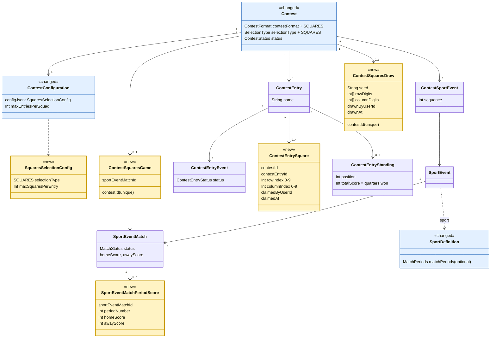

# Super Bowl squares

**Tracking issue:** #711

Written 2026-10-19 for Derek's ask: a detailed design and plan for squares, with the model
changes and how they fit Poolmaster's existing model. Status: design agreed; quarter scores (#772) are built, squares contests on the server (#773) and the screens (#774) are next. It
builds on the ticket's approach and checks it against main as of #771. Every question below was
answered by Derek on 2026-10-19; the slices in section 6 are filed under #711.

---

## TL;DR

- **What it is:** a 10x10 grid on one game. Members claim boxes; then the digits 0 to 9 are
  drawn at random along each side. At the end of each quarter, the box at (last digit of one
  team's score, last digit of the other's) wins that quarter. Pure luck, no predictions.
- **Fit:** a third contest format, `SQUARES`, beside `ROSTER` and `PREDICTION`, with one
  selection type of the same name. It runs on **one game of an event the platform already has**
  (the Super Bowl is the final match of the NFL playoffs event from #702), so no new event or
  sport data shape is needed.
- **Reused as is:** league, squad, contest, entry, `ContestSportEvent`, contest setup and
  release, the seeded shuffle from the random draw (#601), the match results screen (#700),
  `ContestEntryStanding` for the settled result, the sport data file loader.
- **Reused with one new case:** the contest cutoff (`ContestCutoff` gains "game start", next to
  the second-chance bracket's "round start"); settlement and the leaderboard gain a squares
  branch next to bracket, pick'em and survivor.
- **New tables (4):** `SportEventMatchPeriodScore` (quarter scores), `ContestSquaresGame` (which
  game the contest is on), `ContestEntrySquare` (a claimed box), `ContestSquaresDraw` (the
  digits). Plus `SportDefinition.matchPeriods` (four quarters for American football).
- **Size:** three slices, each a normal PR. Deadline: Super Bowl LXI, February 2027.

---

## 1. How a squares pool plays

1. The commissioner creates a contest on the NFL playoffs, chooses **Squares**, and picks the game
   (the Super Bowl is offered first). They set how many boxes each entry may hold.
2. They release it. Members join as usual (one entry per squad by default) and claim empty boxes
   by tapping them. The commissioner can claim or clear any box for any entry, for the person who
   paid in cash and never opened the app.
3. The commissioner presses **Draw numbers**. The server shuffles 0 to 9 for the rows and again for
   the columns and shows them on the grid. Claiming is closed from then on.
4. The game is played. As the admin enters the score at the end of each quarter, the winning box
   for that quarter lights up on the grid and in a winners list (Q1, Halftime, Q3, Final).
5. When the game's result and every quarter's score are in, the contest settles and goes Final.

Payout amounts stay outside Poolmaster, as for every pool.

---

## 2. Where it fits in the existing model

**Figure 1: squares additions.** New objects are marked `<<new>>` and shaded yellow; changed
ones are marked `<<changed>>` and shaded blue. Classes squares does not touch are left out.

### 2.1 What is reused unchanged

| Existing piece | Role in squares |
|---|---|
| League, Squad, membership | Who may join and claim, exactly as today |
| `Contest`, `ContestConfiguration`, release (DRAFT → OPEN) | Contest setup and release; `maxEntriesPerSquad` caps entries (default 1) |
| `ContestSportEvent` | The contest's one event: the NFL playoffs (or a pick'em week, for a Monday night game) |
| `ContestEntry` | One per squad; it holds boxes instead of picks. Shown by the squad's name, per the wording rule |
| `ContestEntryEvent` | The entry's draft/submitted status. The draw submits every entry that holds a box, as the random draw submits every entry it deals to; an entry with no box stays a draft and does not count |
| `SportEventMatch` | The game. Its final `homeScore`/`awayScore` decide the Final winner, overtime included |
| Seeded shuffle (`seededShuffle` in the random-draw engine) | Shuffles the digits, replayable from the stored seed |
| `ContestEntryStanding` | The settled result: `totalScore` is quarters won, `position` ranks by it |
| Match results screen and endpoint (#700) | Where the admin enters the game's final result, as today |
| Sport data file and loader (#642, #728) | Carries quarter scores for test data (section 5) |

### 2.2 What changes

- **`ContestFormat.SQUARES` and `SelectionType.SQUARES`** (Postgres enums gain one member each).
  `CONTEST_FORMAT_BY_SELECTION_TYPE` maps one to the other. `VALID_CONTEST_FORMATS_BY_TOURNAMENT_FORMAT`
  adds `SQUARES` to `MATCHES` only. The shared types `RosterSelectionType` and
  `PredictionSelectionType` are each defined today as "the rest"; with a third format,
  `PredictionSelectionType` must be narrowed to the PREDICTION types explicitly, or the
  prediction engine registry would demand a squares engine.
- **No selection engine.** Squares has no lineup and no game picks, so it gets neither a roster
  `SelectionEngine` nor a `PredictionEngine`. Its own small service (`SquaresService`, in the
  selections module) owns claim, clear and draw. The routes the other formats use refuse a squares
  contest with the usual typed error.
- **`ContestCutoff` gains `MATCH_START`.** Today a contest closes at the event's start, or (second-chance
  bracket, #721) at a later round's first game. A squares contest closes at its one game's
  kickoff. Without this, a squares pool on the NFL playoffs would close at Wild Card weekend,
  a month before the Super Bowl. Joining, claiming and going live all follow this cutoff, the same
  way the bracket's round start already works.
- **Settlement** gains a squares branch next to bracket, pick'em and survivor: when the contest's
  game is COMPLETED (not the whole event), it writes each counting entry's standing and moves the
  contest to Final. A cancelled game ends the contest Final with no scores, per #743.
- **Leaderboard** gains a squares reader next to the bracket, pick'em and survivor ones: the grid
  with owners, the digits once drawn, each quarter's winning box and its owner, and quarters won
  per entry.
- **`SportDefinition.matchPeriods`** (optional): `{ count: 4, label: { one: 'quarter', many: 'quarters' } }`
  for American football. A sport without it is not offered squares, and nothing branches on the
  sport (the `no-sport-branching` lint stays clean). `SQUARES` is added to American football's
  `selectionTypes`.
- **Contest template:** one seeded `ContestConfigTemplate` row for American football squares
  (reference data, in the migration).

---

## 3. Model changes in detail

### 3.1 `SportEventMatchPeriodScore` (new, core event data)

The score at the end of a period, exactly as the admin enters it: `sportEventMatchId`,
`periodNumber`, `homeScore`, `awayScore`; unique on (match, period). Rows exist for every period
but the last (Q1, Q2 and Q3 in football). The last scoring moment is the **final score**, overtime
included, which is the match's own result (`SportEventMatch.homeScore`/`awayScore`), entered on the
existing results screen; it is not stored twice. Database checks: period at least 1, scores never
negative.

It is a separate table, not three columns on `SportEventMatch`, by
`rules/domain-model-conventions-rules.md` §9 *Schema Design*: only squares reads it, and a
period count differs by sport (basketball halves vs quarters). It is a child of the match, like
the match is of the round, so it is plain event data any later feature (a live game screen,
props) can read.

- **Q3.1** *Decided by Derek 2026-10-19:* the admin enters the score at each of the four
  scoring moments (end of Q1, end of Q2, end of Q3, final), as shown on the scoreboard. The
  server does no addition. Each of the four settles its own winner, and the last one is the
  final score, not the end of the fourth quarter.

### 3.2 `ContestSquaresGame` (new)

`contestId` (unique), `sportEventMatchId`. Written at contest setup; the game must be one of the
contest's event's matches (a service check, as for the bracket's links). It may be changed while
the contest is a draft.

It is its own table rather than a nullable column on `ContestSportEvent` or `Contest`, by the same
§9 test: the column would mean something only for squares.

- **Q3.2** Which games can a commissioner pick? *Decided by Derek 2026-10-19:* **any game of the
  contest's event whose kickoff is still ahead**, with the event's final (the match with no next
  match) offered first. The two games that matter most are the **Super Bowl** and the **college
  football national championship game**; both are the final of their playoff event, so both are
  covered with no sport branching. The championship game needs the College Football Playoff
  league and its bracket (#707) loaded first. Teams may still be unknown at setup (the Super
  Bowl's sides are set after the conference games); the grid shows "Home" and "Away" until they
  are.

### 3.3 `ContestEntrySquare` (new)

A claimed box: `contestId`, `contestEntryId`, `rowIndex` (0 to 9), `columnIndex` (0 to 9),
`claimedByUserId`, `claimedAt`. Unique on (contest, row, column), which is what stops two people
taking the same box at once. `contestId` is denormalized from the entry for that unique key, as
on `ContestEntryStanding`; a composite foreign key (contest, entry) keeps the two in step.
Database checks: indexes 0 to 9.

This differs from the ticket on purpose. The ticket had 100 pre-made rows per contest with a
nullable entry. Rows only for claimed boxes mean: no null foreign keys, claiming is an insert,
clearing is a delete, and an empty contest has no rows. The 100-box grid is drawn by the reader.

The row and column are **grid positions**, not digits. The digit at a position is read from the
draw, so claiming does not depend on the draw, and boxes can be claimed before the digits exist.

- **Q3.3** Box cap: a contest setting `maxSquaresPerEntry` (1 to 100) in the squares selection
  config. *Decided by Derek 2026-10-19:* **default 10 per squad**, carried by the seeded squares
  contest template's config, so a new contest starts at 10; the commissioner can set it at setup
  and change it until the draw. A squares contest takes one entry per squad, so the cap per entry
  is the cap per squad. A lowered cap does not take away boxes already claimed; it only stops
  new claims.
- **Q3.4** Can the commissioner claim and clear boxes for others? *Decided by Derek 2026-10-19:* **yes, until
  the draw**, for the member who paid cash and never opened the app. A member can clear only
  their own entry's boxes. Every claim and clear is logged with who did it.

### 3.4 `ContestSquaresDraw` (new)

`contestId` (unique), `seed`, `rowDigits` (10 ints), `columnDigits` (10 ints), `drawnByUserId`,
`drawnAt`. Its existence means the digits are drawn and claiming is closed, the same rule the
random draw's `ContestDraw` follows. The unique key stops two presses drawing twice. Database
check: each array has ten entries, the digits 0 to 9 once each (a Postgres check on the sorted
array).

It is a sibling of `ContestDraw`, not more columns on it. `ContestDraw`'s `fieldOrder` and
`entryOrder` mean nothing for squares and the digits mean nothing for a random draw, so §9 splits
them. The shuffle code is shared.

- **Q3.5** When can the draw run? *Decided by Derek 2026-10-19:* **any time the contest is OPEN, until the end of
  the first quarter is entered.** Claiming closes at kickoff whether or not the draw has run, so
  a commissioner who forgets until the game has begun can still draw, and nobody can choose their
  box knowing the digits. There is no automatic draw at kickoff (passive time locks were rejected;
  explicit actions instead).
- **Q3.6** What about boxes nobody claimed? *Decided by Derek 2026-10-19:* **the draw runs with
  empty boxes, and a quarter whose winning box is empty shows "No winner"**. Commissioners handle that payout
  their own way (roll it over, refund), outside Poolmaster. A "fill the empty boxes at random"
  button is a possible later add, not in this ticket.

### 3.5 Results and standings

Winners are derived, not stored while the game is live: quarter *n*'s winning box is at
(position of the last digit of the away team's score at the end of that quarter in `rowDigits`,
position of the home team's in `columnDigits`). Final uses the match's final score, overtime included.

At settlement the contest writes `ContestEntryStanding` for each entry that holds a box:
`totalScore` = quarters won (0 to 4), position by that, ties shared, `countingPickLimit` and
`scoredPickCount` = boxes held (the columns are not null; this is the closest meaning).

- **Q3.7** Freeze the winning boxes at settlement? Settlement exists so a later score correction
  cannot quietly rewrite a finished result. Quarters won per entry is frozen in the standing,
  but which box won which quarter is not. *Decided by Derek 2026-10-19:* **yes, add a small
  `ContestSquaresWinner` table** (contest, period, row, column, entry or none), written by
  settlement only, which the Final leaderboard reads. The alternative is no table, and a score
  correction after Final would move the highlighted box on the grid while the standings stayed.
- **Q3.8** Does overtime count toward the Final box? *Decided by Derek 2026-10-19:* **yes**, the final score
  including overtime, which is the common rule. It is not a separate period winner.
- **Q3.9** Which side is rows and which columns? *Decided by Derek 2026-10-19:* **the away team along the side
  (rows), the home team across the top (columns)**, which is how TV scorebugs read (away first).
  Fixed; not a setting.

---

## 4. API and screens

### 4.1 Endpoints (contract-first, `add-endpoint` skill)

| Endpoint | Who | What |
|---|---|---|
| `GET /contests/:contestId/squares` | League members | The grid: each claimed box's position and owner (entry name), digits once drawn, the game and its sides, the score at each scoring moment, and each quarter's winning box. One response serves the claim screen and the live board |
| `PUT /contests/:contestId/squares/:row/:column` | Entry owner, or commissioner | Claim a box for an entry (`contestEntryId` in the body). 409 when taken, the cap is reached, the digits are drawn, or the game has started |
| `DELETE /contests/:contestId/squares/:row/:column` | Owner of that box's entry, or commissioner | Clear a box, under the same windows |
| `POST /contests/:contestId/squares/draw` | Commissioner | Draw the digits. 409 when already drawn, not OPEN, or the first quarter's score is in |
| `PUT /events/:eventId/bracket/matches/:matchNumber/periods/:periodNumber` | Root admin | Enter both sides' score at the end of one period (Q1 to Q3). Allowed while the game is in progress, unlike the final result |
| `DELETE` of the same | Root admin | Clear a period's score |

The existing final result endpoint is unchanged, and its score is the Final winner. The contest setup
request gains the game (`sportEventMatchId`) for a squares contest, and contest setup and the
squares GET carry `maxSquaresPerEntry`.

### 4.2 Screens (`add-frontend-feature` skill)

- **Contest setup:** "Squares" is offered on an event whose sport has periods. The game picker
  lists the event's games still to kick off, final first; the box cap field sits below it.
- **The grid:** a 10x10 board, team names on the two edges, digits in the header cells (blank
  until drawn, then revealed). An empty box is tappable to claim; a claimed box shows the squad's
  name (shortened) and is highlighted for the viewer's own. A counter reads "4 of 10 boxes
  claimed". It needs to work on a phone: the board scrolls sideways inside its card, with the
  edge labels pinned.
- **Commissioner tools on the grid:** claim for (pick an entry), clear, and **Draw numbers**
  with a confirm.
- **Live and Final:** the four quarter winners above the board (quarter, score, winning box,
  owner or "No winner"), and the winning boxes outlined on the board.
- **Admin match results:** under each game, a row of period score fields per side, saved one
  period at a time, next to the existing final result.

---

## 5. Data and tests

- **Test data:** the 2026 NFL test data file (last season as played, per the test data
  convention) gains `periodScores` on Super Bowl LX, gathered and cross-checked with the
  `load-sport-data` skill. The sport data file schema gets an optional `periodScores` array on a
  match, and the loader writes `SportEventMatchPeriodScore`. That lets a squares contest be
  played start to finish in tests and in QA with no dependency on today's date.
- **Unit:** winner derivation (digits, quarter scores, overtime in the final, empty box), the draw shuffle
  (replayable from the seed, a permutation of 0 to 9), the cap and window checks, the cutoff at
  the game's kickoff.
- **Integration:** one test per new query, plus the race of two claims on one box (the unique key
  wins) and two draw presses.
- **API scenario:** a squares journey added to the sport x selection-type suite (#758): set up,
  release, two squads claim, draw, enter quarters, settle, read the Final board.
- **Browser:** claim a box and see the grid update; the commissioner draws and the digits appear.

---

## 6. Slices

Three PRs under #711, in order. Each is a normal implement, review, merge cycle.

1. **Quarter scores (#772).** `SportEventMatchPeriodScore`, `SportDefinition.matchPeriods` (American
   football 4), the admin period endpoint and the period fields on the match results screen, and the data
   file `periodScores` with Super Bowl LX in the 2026 test file. Useful on its own and unblocks the rest.
2. **Squares contests, server side (#773).** The enums, `ContestSquaresGame`, `ContestEntrySquare`,
   `ContestSquaresDraw`, `ContestSquaresWinner`, the `MATCH_START` cutoff, the
   squares service and endpoints, settlement and the leaderboard reader, the template row, and the
   scenario test. As built, the board read is the leaderboard (each entry's boxes, quarters won and place), so
   there is no separate leaderboard route. A contest's game is fixed at create; once it is open,
   only the box limit can change, until the draw. A game with a quarter's score counts as kicked off.
3. **Squares screens (#774).** Setup, the grid with claiming and commissioner tools, the draw, live and
   Final winners, and the browser test.

Slices 2 and 3 can share one PR if the review stays small enough; the plan assumes separate.

---

## 7. Out of scope

- Payouts and prize amounts (outside Poolmaster, as always).
- Auto-filling empty boxes, re-drawing digits per quarter (a variant some pools use), and a
  "reverse" winner (swapped digits). Each can be a small later setting.
- Basketball squares (March Madness final): the model supports it once basketball gets
  `matchPeriods`; NCAA men's basketball plays two halves, so a league-level period count would
  come with it. Not needed for February.
- Live score feeds for quarter scores: the admin enters them, as for every head-to-head result.
